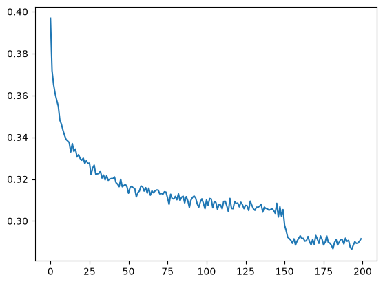
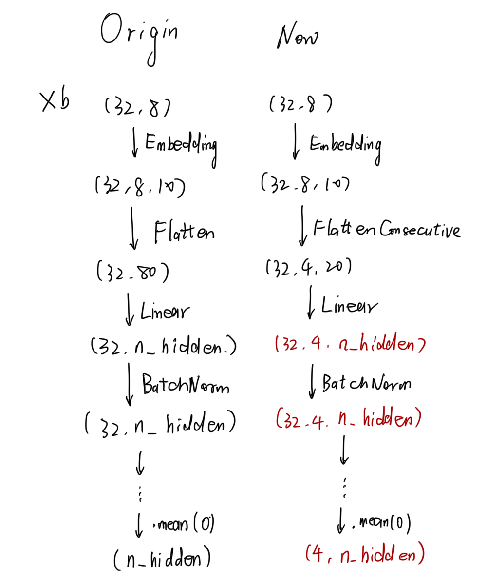

# Lecture 6：Makemore5（Wavenet）

# Introduction

截至目前，在 makemore 系列课程中，我们已经按照[这篇论文](https://www.jmlr.org/papers/volume3/bengio03a/bengio03a.pdf)所提出的方法，构建了相应的数据处理与训练结构：


但这种方法存在一个问题。如果增大 `block_size`，也就是增加输入字符的数量，那么输入层会变得更宽；参数量随之增加，计算速度变慢，而且隐藏层可能成为瓶颈。 如果继续沿用目前的实现方式，模型的可扩展性和能力都会受到限制。

为了更优雅地提升模型能力，我们需要输入更长的字符上下文；更重要的是，需要让模型变得更深。为此，*我们可以在多个更深的层中逐步组合输入，而不是在输入层和隐藏层之间一次性把所有输入全部合并。*

这种扩展方式也出现在 [WaveNet 论文](https://arxiv.org/abs/1609.03499)中；WaveNet 是一种基于音频的语言模型。 不过从根本上说，它的整体结构仍然与 [Bengio 等人 2003 年的论文](https://www.jmlr.org/papers/volume3/bengio03a/bengio03a.pdf)相同，只是增加了更多层。首先，我们从 Lecture 4 复制一些代码：

```Python
import torch
import torch.nn.functional as F
import matplotlib.pyplot as plt
%matplotlib inline
```

```Python
# Read in all the words
words = open('names.txt', 'r').read().splitlines()
print('Word Count:', len(words))
print('Max Word Length:', max(len(w) for w in words))
print(words[:8])
```

```Python
# Build a vocabulary of characters and map them to integers
chars = sorted(list(set(''.join(words))))  # set(): Throwing out letter duplicates

stoi = {s:i+1 for i,s in enumerate(chars)} # Make tuples of type (char, counter)
stoi['.'] = 0                              # Add this special symbol's entry explicitly
itos = {i:s for s,i in stoi.items()}       # Switch order of (char, counter) to (counter, char)

vocab_size = len(itos)

# Showing the two mappings, they really just are mirrors of one another
print(itos)
print(stoi)
print(vocab_size)
```

```Python
# Randomize the set of words (with reproducibility)
import random
random.seed(42)
random.shuffle(words)   # 随机打乱
```

```Python
# Build the dataset
block_size = 3
def build_dataset(words):
    X, Y = [], []

    for w in words:
        context = [0] * block_size  # 生成一个大小为block_size的全0 列表
        for ch in w +'.':
            ix = stoi[ch]
            X.append(context)
            Y.append(ix)
            context = context[1:] + [ix]  
            # 删除 context 中最旧的字符，并把新字符 ix 添加到末尾，使上下文窗口向右移动一格。
    X = torch.tensor(X)
    Y = torch.tensor(Y)

    print(X.shape, Y.shape)
    return X, Y
# 划分数据集
n1 = int(0.8 * len(words))
n2 = int(0.9 * len(words))
Xtr, Ytr = build_dataset(words[:n1])     # 80%
Xdev, Ydev = build_dataset(words[n1:n2]) # 10%
Xte, Yte = build_dataset(words[n2:])     # 10%
```

```Python
for x, y in zip(Xtr[:20], Ytr[:20]):    # zip 可以把多个可迭代对象中相同位置的元素配对，组成一个个元组。
    print(''.join(itos[ix.item()] for ix in x), '-->', itos[y.item()])
```

在 Lecture 4中，我们开始构建 `Linear` 层，并为其加入批归一化。下面的代码与之前基本相同，只是现在做了更清晰的模块化封装。

```Python
class Linear:
    def __init__(self, fan_in, fan_out, bias=True):
        self.weight = torch.randn((fan_in, fan_out)) / fan_in**0.5
        self.bias = torch.zeros(fan_out) if bias else None
    def __call__(self, x):
        self.out = x @ self.weight
        if self.bias is not None:
            self.out += self.bias
        return self.out
    def parameters(self):
        return[self.weight] + ([] if self.bias is None else [self.bias])
class BatchNorm1d:
class BatchNorm1d:
    def __init__(self, dim, eps=1e-5, momentum=0.1 ):
        self.eps = eps
        self.momentum = momentum
        self.training = True
        self.gamma = torch.ones(dim)
        self.beta = torch.zeros(dim)
        self.running_mean = torch.zeros(dim)
        self.running_var = torch.ones(dim)
    def __call__(self, x):
        # 如果我们在“training mode“，则计算每个批次的均值和方差（主动归一化），否则使用训练好的均值和方差
        if self.training:
            xmean = x.mean(0, keepdim=True)
            xvar = x.var(0,keepdim=True)
            with torch.no_grad():
                self.running_mean = (1 - self.momentum) * self.running_mean + self.momentum * xmean
                self.running_var = (1 - self.momentum) * self.running_var + self.momentum * xvar
        else:
            xmean = self.running_mean
            xvar = self.running_var
        xhat = (x - xmean)/ torch.sqrt(xvar + self.eps)
        self.out = self.gamma * xhat + self.beta
        return self.out
    def parameters(self):
        return [self.gamma, self.beta]
class Tanh:
    def __call__(self, x):
        self.out = torch.tanh(x)
        return self.out
    def parameters(self):
        return []
```

**与之前一样，我们使用：**

- 尺寸为 `(27, 10)` 的嵌入层；

- 尺寸为 `(30, 200)` 的隐藏层；

- 对隐藏层输出的第二个维度进行批归一化；

- \\tanh 激活函数；

- 尺寸为 `(200, 27)` 的线性层。

```Python
n_embd = 10 
n_hidden = 200
C = torch.randn((vocab_size, n_embd))
layers = [
    Linear(n_embd * block_size, n_hidden, bias=False),
    BatchNorm1d(n_hidden),
    Tanh(),
    Linear(n_hidden, vocab_size),
]
# Parameter init
with torch.no_grad():
    layer[-1].weight *= 0.1
parameters = [C] + [p for layer in layers for p in layer.parameters()]
for p in parameters:
    p.requires_grad = True
```

Output:


```Python
plt.plot(lossi)
```


下面关闭“training mode”，计算下训练集和验证集上的损失。

```Python
for layer in layers:
    layer.training = False
```

```Bash
def split_loss(split):
    x, y = {
        'train': (Xtr, Ytr),
        'val': (Xdev, Ydev),
        'tese': (Xte, Yte),
    }[split]

    emb = C[x]
    x = emb.view(emb.shape[0], -1)
    for layer in layers:
        x = layer(x)
    loss = F.cross_entropy(x,y)
    print(split, loss.item())
split_loss('train')
split_loss('val')
```

Output:


```Python
for _ in range(20):
    out = []
    context = [0] * block_size
    while True:
        # forward pass through the neural net
        emb = C[torch.tensor([context])]
        x = emb.view(emb.shape[0], -1)
        for layer in layers:
            x = layer(x)
        logits = x
        probs = F.softmax(logits, dim=1)
        ix = torch.multinomial(probs, num_samples=1).item() # torch.multinomial()：按照给定的概率或权重，随机抽取对应元素的索引。
        context = context[1:] + [ix]
        out.append(ix)
        if ix == 0:
            break
        print(''.join(itos[i] for i in out))
```

Output：


观察 `loss` 曲线会发现，它看起来非常混乱，噪声大到几乎无法看出有意义的趋势。主要原因是 batch size 太小。32 太小了。每个 batch 里只有 32 次预测。这不足以得到稳定、可靠的平均损失。更糟糕的是，小 batch 可能会偶然抽到特别“幸运”或特别“不幸运”的样本组合，从而让损失曲线变得更加扭曲。下面来修复这条糟糕的损失曲线：

# 处理损失曲线过于嘈杂的问题

`lossi` 是一个不断累积的 `float` 列表，记录每个 batch 的损失。为了让曲线更容易阅读，可以对多个 batch 的损失取平均。

```Python
print(len(lossi))
```

Output:200000

> \[\!recall\]
> 
> 只要张量中的元素总数不变，我们就可以用不同的维数和形状来观察或重塑它。
> 
> 


如果先把 `lossi` 转换为 `torch.tensor`，就更容易对它进行处理。`lossi` 的长度为 200000。我们把它重塑为形状 `(200, 1000)` 的矩阵。后对每一行（包含 1000 个数）求平均值。 原先总共有 200000 个独立损失，现在就变成了 200 个平均损失。*这样会更容易阅读。*

```Python
print(torch.tensor(lossi).view(-1,1000).shape)  # (200, 1000)
print(torch.tensor(lossi).view(-1,1000).mean(1).shape) # (200,)
plt.plot(torch.tensor(lossi).view(-1,1000).mean(1))
```


现在可以清楚地看到学习率在什么位置被降低，也能看到降低学习率确实让模型更精细地逼近“理想”的局部最小值，即总体误差进一步减小。


# 改进前向传播

接下来要改进的是前向传播本身。现在的写法太臃肿，代码行数太多。此外，嵌入表 `C` 被当成了一个位于普通网络层之外的特殊对象。`emb.view` 也在各层之外单独执行。*这种写法代价较高，因为这些操作没有被统一到可并行处理的层结构中。*

换句话说，此前我们已经把一些层放进 `layers` 列表中（`Linear`、`BatchNorm1d`、`Linear`）。但层外还有以下操作：

```Python
emb = C[Xb]
x = emb.view(emb.shape[0], -1)
```

我们要把上面两个操作视为网络层并加入这个列表。

其中一个是 `Embedding` \(嵌入）层，另一个称为 `Flatten` （扁平化）层。

先从嵌入层开始。PyTorch 中存在一个功能等价的实现，叫作 `torch.nn.embedding`。这一层可以写成：

```Python
class Embedding:
    def __init__(self, num_embeddings, embedding_dim):
        self.weight = torch.randn((num_embeddings, embedding_dim))
    def __call__(self, IX):
        self.out = self.weight[IX]
        return self.out
    def parameters(self):
        return [self.weight]
```

```Python
class Flatten:
    def __call__(self, x):
        self.out = x.view(x.shape[0], -1)
        return self.out
    def parammeters(self):
        return []
```

这种写法大幅提升了可读性，也让各层的处理过程更加统一；现在可以把这些层加入原来的 `layers` 列表，并像处理其他层一样依次遍历。

```Python
layers = [
    Embedding(vocab_size, n_embd),
    Flatten(),
    Linear(n_embd * block_size, n_hidden, bias=False),
    BatchNorm1d(n_hidden),
    Tanh(),
    Linear(n_hidden, vocab_size),
]
```

把原来嵌入和扁平化的部分注释掉，便可以得到更简洁的前向传播过程，同时前向、反向传播时各层的交互也得到了简化。

```Python
max_steps = 200000
batch_size = 32
lossi = []

for i in range(max_steps):
    # mini-batch constract
    ix = torch.randint(0, Xtr.shape[0], (batch_size,))
    Xb, Yb = Xtr[ix], Ytr[ix]
    # forward-pass
    # emb = C[Xb]
    # x= emb.view(emb.shape[0], -1)
    x = Xb
    for layer in layers:
        x = layer(x)
    loss = F.cross_entropy(x, Yb)
    # backward-pass
    for p in parameters:
        p.grad = None
    loss.backward()
    # update
    lr = 0.1 if i <150000 else 0.01
    for p in parameters:
        p.data += -lr * p.grad
    if i % 10000 == 0:
        print(f'{i:7d}/{max_steps:7d}: {loss.item():.4f}')
    lossi.append(loss.log10().item())
    break # 先观察第一个损失函数
```

output：


下面继续简化代码**，**目前所有层都保存在名为 `layers` 的列表中。*但列表并不是组织这些层的最高效方式。* 我们可以构建一个类似“容器”的对象，像 `torch.nn` 一样，这个对象负责组织网络层。我们要模仿的 PyTorch 组件是 `Sequential` 容器。它可以自动把输入依次传递给内部的全部网络层。这正是我们需要的功能。下面构建 `Sequential` 容器：

```Python
class Sequential:
    def __init__(self, layers):
        self.layers = layers
    def __call__(self, x):
        for layer in self.layers:
            x = layer(x)
        self.out = x
        return self.out
    def parameters(self):
        return [p for layer in self.layers for p in layer.parameters]
```

同样，把这些过程重新封装进类中，也会让网络设计和使用方式更加清晰：

```Python
model = Sequential([
    Embedding(vocab_size, n_embd),
    Flatten(),
    Linear(n_embd * block_size, n_hidden, bias=False),
    BatchNorm1d(n_hidden),
    Tanh(),
    Linear(n_hidden, vocab_size),
])
```

```Python
max_steps = 200000
batch_size = 32
lossi = []

for i in range(max_steps):
    # mini-batch constract
    ix = torch.randint(0, Xtr.shape[0], (batch_size,))
    Xb, Yb = Xtr[ix], Ytr[ix]
    # forward-pass
    # emb = C[Xb]
    # x= emb.view(emb.shape[0], -1)
    # x = Xb
    # for layer in layers:
    #     x = layer(x)
    logits = model(Xb) # New
    loss = F.cross_entropy(logits, Yb) # New 
    # backward-pass
    for p in parameters:
        p.grad = None
    loss.backward()
    # update
    lr = 0.1 if i <150000 else 0.01
    for p in parameters:
        p.data += -lr * p.grad
    if i % 10000 == 0:
        print(f'{i:7d}/{max_steps:7d}: {loss.item():.4f}')
    lossi.append(loss.log10().item())
```

Output:


```Python
print(torch.tensor(lossi).view(-1,1000).shape)  # (200, 1000)
print(torch.tensor(lossi).view(-1,1000).mean(1).shape) # (200,)
plt.plot(torch.tensor(lossi).view(-1,1000).mean(1))
```


同样计算训练集和验证集上的损失：

```Python
for layer in model.layers:
    layer.training = False
def split_loss(split):
    x, y = {
        'train': (Xtr, Ytr),
        'val': (Xdev, Ydev),
        'tese': (Xte, Yte),
    }[split]
    logits = model(x) # New
    loss = F.cross_entropy(logits, y) #New
    print(split, loss.item())
split_loss('train')
split_loss('val')
```

Output:


```Python
for _ in range(20):
    out = []
    context = [0] * block_size
    while True:
        # forward pass through the neural net
        logits = model(torch.tensor([context])) # New
        probs = F.softmax(logits, dim=1)
        ix = torch.multinomial(probs, num_samples=1).item() # torch.multinomial()：按照给定的概率或权重，随机抽取对应元素的索引。
        context = context[1:] + [ix]
        out.append(ix)
        if ix == 0:
            break
    print(''.join(itos[i] for i in out))
```

Output:


可以看到，训练集损失和验证集损失非常接近。这表明模型具有较好的泛化能力,它没有过拟合。*这是非常好的现象。*在我们已经有了一个不错的基础，可以尝试增大模型规模，让模型形成更深入的理解，并进一步降低损失。

# 加深网络

目前，我们使用了一种实现得更加优雅的架构，但网络在最开始仍然会把所有输入字符一次性压缩进同一层。


[WaveNet](https://arxiv.org/abs/1609.03499) 的方法可以解决这个问题：

不同字符会逐步进入网络，而不是立刻一次性被压缩到同一层。原本非常突然、剧烈的合并过程，现在分散到了多个层中，因此更加平缓。**这样可以降低信息丢失的风险。**在第一层中，我们先“融合”两个字符。随后再融合前面得到的两个融合结果（此时总共覆盖 4 个字符），并继续重复这一过程。由此形成一棵树状结构；我们可以根据需要增加树的深度，从而扩大上下文长度。

> 这种层层堆叠，并像树枝一样逐步合并输入的结构，准确名称是**“膨胀因果卷积层”（dilated causal convolutional layers）。**
> 
> 


先把 `block_size` 从 3 增大到 8，且暂时不改变模型架构，

参数量增加了 10000，这完全是由上下文长度增大造成的运行结果如下：





可以看到，损失确实有了**明显改善**。


接下来按照前面讨论的“膨胀因果卷积层”方法，让模型结构变得更具可扩展性。观察第一个线性层`class Linear`,我们发现，无论输入该层的张量维度是多少，矩阵乘法都可以正常运行，这是由于矩阵乘法始终作用于最后一个维度，而忽略前面列出的任意 $n\\geq0$ 个维度。

我们可以利用这个性质：现在有 `block_size=8` 个字符（记作`1 2 3 4 5 6 7 8`），与之前一样，每个字符都会被嵌入成一个 10 维向量。接下来，希望对嵌入后的字符（每个字符现在都是 10 维）进行逐级分组：`(1 2) (3 4) (5 6) (7 8)`，同时还希望高效地并行处理由此形成的 4 个子组。因此，需要修改此前使用的矩阵乘法，使其能够处理这种结构。

 第一层只融合每组中的 2 个字符。对于 batch size 为 4 的输入，一共有 4 个样本；每个样本包含 4 组、每组 2 个字符：`(1 2) (3 4) (5 6) (7 8)`。每个字符本身是 10 维，
 所以每组的维度为 $2\\times10=20$：

因此，`Flatten` 层不应该输出 `[4, 80]`，而应该输出 `[4, 4, 20]`：即 4 个样本，每个样本有 4 组，每组由两个 10 维字符向量组成，总维度为 20。这样才能正确地送入已经按照分组输入方式设计的新线性层。

当前输入形状为 \(4,8,10\)，依次表示 `batch_size`、`block_size`、`embedding_size`。

```Python
e = torch.randn(4, 8, 10) # Mocked input to the flatten layer
# Currently, Flatten() creates just this reshaped version:
print(e.view(4, -1).shape)
```

**Output：**

```Plain Text
torch.Size([4, 80])
```

接下来我们需要把它变成 \(4,4,20\)。

```Python
print((e.view(4, 4, 20) == explicit).all())
```

**Output：**

```Plain Text
tensor(True)
```

这个过程可以进一步推广。假设展平层接收到形状为 `[B, T, C]` 的张量，三个维度分别表示 `batch_size`、字符数和嵌入通道数。

 如果它接收参数 n，把连续字符按每 n 个一组进行合并，那么可以把张量统一重塑为 `[B, T // n, C * n]`。下面把这一发现应用到模型架构中，其他类保持不变，修改 `Flatten` 类：

```Python
class FlattenConsecutive:
    def __init__(self, n):
        self.n = n
    def __call__(self, x):
        B, T, C = x.shape
        x = x.view(B, T//self.n, C * self.n)    # "//"表示整除（向下取整除法）
        if x.shape[1] == 1:
            x = x.squeeze(1) # 删除张量或数组中长度为 1 的维度
        self.out = x
        return self.out
    def parameters(self):
        return []
```

现在构建一个输入逐步收窄、网络深度增加的新模型架构：

```SQL
n_embd = 10 
n_hidden = 68
# C = torch.randn((vocab_size, n_embd))
model = Sequential([
    Embedding(vocab_size, n_embd),
    FlattenConsecutive(2),Linear(n_embd * 2, n_hidden, bias=False),
    BatchNorm1d(n_hidden),Tanh(),
    FlattenConsecutive(2),Linear(n_hidden * 2, n_hidden, bias=False),
    BatchNorm1d(n_hidden),Tanh(),
    FlattenConsecutive(2),Linear(n_hidden * 2, n_hidden, bias=False),
    BatchNorm1d(n_hidden),Tanh(),
    Linear(n_hidden, vocab_size),
])
# Parameter init
with torch.no_grad():
    model.layers[-1].weight *= 0.1
parameters = model.parameters()
for p in parameters:
    p.requires_grad = True
```

```Python
max_steps = 200000
batch_size = 32
lossi = []

for i in range(max_steps):
    # mini-batch constract
    ix = torch.randint(0, Xtr.shape[0], (batch_size,))
    Xb, Yb = Xtr[ix], Ytr[ix]
    # forward-pass
    # emb = C[Xb]
    # x= emb.view(emb.shape[0], -1)
    # x = Xb
    # for layer in layers:
    #     x = layer(x)
    logits = model(Xb) # New
    loss = F.cross_entropy(logits, Yb) # New 
    # backward-pass
    for p in parameters:
        p.grad = None
    loss.backward()
    # update
    lr = 0.1 if i <150000 else 0.01
    for p in parameters:
        p.data += -lr * p.grad
    if i % 10000 == 0:
        print(f'{i:7d}/{max_steps:7d}: {loss.item():.4f}')
    lossi.append(loss.log10().item())
```

Output:


```Python
print(torch.tensor(lossi).view(-1,1000).shape)  # (200, 1000)
print(torch.tensor(lossi).view(-1,1000).mean(1).shape) # (200,)
plt.plot(torch.tensor(lossi).view(-1,1000).mean(1))
```


```Bash
def split_loss(split):
    x, y = {
        'train': (Xtr, Ytr),
        'val': (Xdev, Ydev),
        'tese': (Xte, Yte),
    }[split]
    logits = model(x) # New
    loss = F.cross_entropy(logits, y) #New
    print(split, loss.item())
split_loss('train')
split_loss('val')
```

Output:


```Python
for _ in range(20):
    out = []
    context = [0] * block_size
    while True:
        # forward pass through the neural net
        logits = model(torch.tensor([context])) # New
        probs = F.softmax(logits, dim=1)
        ix = torch.multinomial(probs, num_samples=1).item() # torch.multinomial()：按照给定的概率或权重，随机抽取对应元素的索引。
        context = context[1:] + [ix]
        out.append(ix)
        if ix == 0:
            break
    print(''.join(itos[i] for i in out))
```

Output：


# 修正BatchNorm层的Bug

我们的 `BatchNorm1d` 层中仍然存在一个奇怪的问题。它确实能运行，但它真的在做正确的事情吗？下面检查一下：

```Python
for layer in model.layers:
    print(layer.__class__.__name__, ':', tuple(layer.out.shape))
```

Output：


第一个 `BatchNorm1d` 接收到形状为 `[32, 4, 68]` 的输入。这是一个三维张量。但目前的 `BatchNorm1d` 实现只考虑了二维输入。那为什么之前仍然能够得到输出？因为广播机制让模型中的张量运算仍然可以完成，但 `BatchNorm1d` 实际上只是在做某种并不正确的操作。 模型仍然能够产生一定的学习效果，并在某种程度上补偿这种异常行为。 所以 `BatchNorm1d` 看起来似乎工作正常，**但实际上并不是。**



这说明当前实现会并行地对 4\\times68 个位置分别做“批归一化”，

而不是只针对总共 68 个通道进行归一化。

> 当前实际上是在对不同字符嵌入分组分别归一化，而不是对字符嵌入的通道整体归一化。
> 
>  分组本身很小，所以问题没有严重到让模型完全失效，但它仍然会扭曲归一化过程。
> 
> 

我们真正想做的是：对 32\\times4 个嵌入向量一起求平均，而每个嵌入向量都有 68 个通道。

> 我们需要得到所有嵌入向量在 68 个通道上的平均值。
> 
> 

可以用下面的方法实现：

```Python
class BatchNorm1d:
    def __init__(self, dim, eps=1e-5, momentum=0.1 ):
        self.eps = eps
        self.momentum = momentum
        self.training = True
        self.gamma = torch.ones(dim)
        self.beta = torch.zeros(dim)
        self.running_mean = torch.zeros(dim)
        self.running_var = torch.ones(dim)
    def __call__(self, x):
        # 如果我们在“training mode“，则计算每个批次的均值和方差（主动归一化），否则使用训练好的均值和方差
        if self.training:
            if x.ndim == 2:
                dim = 0
            elif x.ndim == 3:
                dim = (0, 1)
            xmean = x.mean(0, keepdim=True)
            xvar = x.var(0,keepdim=True)
        else:
            xmean = self.running_mean
            xvar = self.running_var
        xhat = (x - xmean)/ torch.sqrt(xvar + self.eps)
        self.out = self.gamma * xhat + self.beta
        if self.training:
            with torch.no_grad():
                    self.running_mean = (1 - self.momentum) * self.running_mean + self.momentum * xmean
                    self.running_var = (1 - self.momentum) * self.running_var + self.momentum * xvar
        return self.out
    def parameters(self):
        return [self.gamma, self.beta]
```

注意，`.ndim` 是 PyTorch 张量自带的属性，表示这个张量有多少个维度。

改进后的输出结果如下：


从技术上说，我们现在已经实现了 [WaveNet](https://arxiv.org/abs/1609.03499) 论文中的方法。刚刚完成的结构还有一个更熟悉的名字：**简单的一维卷积。**


`FlattenConsecutive(2)` 层把相邻字符的嵌入合并为一个特征向量。随后，`Linear` 层对这些特征向量分别应用同一组学习到的线性变换，这与卷积核在不同位置共享参数的工作方式相似。

# 加宽网络

既然各个组件已经检查并修复了错误，现在可以增大网络隐藏层的宽度。

我们令`n_embd = 24`,`n_hidden = 48`,输出结果如下：


