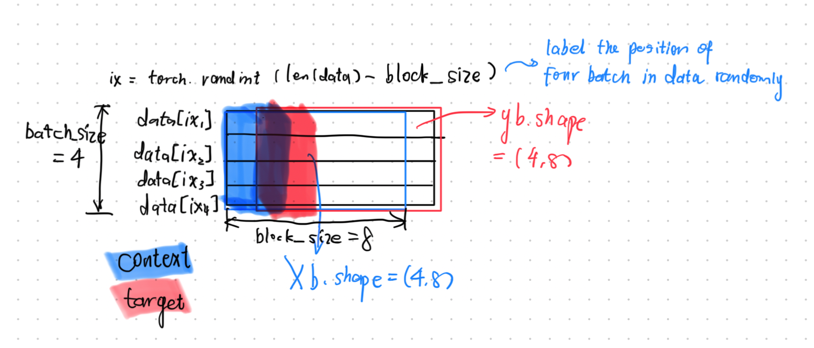

# Lecture 7: GPT1（Scratch）

# Introduction

[ChatGPT](https://chatgpt.com/) 会根据用户给出的提示词，按顺序生成文本。每一次生成的回答通常都会略有不同。 ChatGPT 接收提示词的能力，看起来主要只受近期事件知识、工具使用能力以及人为设置的安全限制约束。ChatGPT 系统的核心主要是一个大规模的概率系统，也就是大语言模型（Large Language Model，LLM）。这个大语言模型会继续补全由用户初始提示词开头的词语序列。它所做的事情，本质上就是不断按照概率分布采样下一个词。
论文 [Attention Is All You Need（Vaswani 等，2017）](https://arxiv.org/abs/1706.03762) 提出了 **Transformer** 架构，为大多数成熟的大语言模型奠定了基础。

本讲，我们将在 [Tiny Shakespeare](https://raw.githubusercontent.com/jcjohnson/torch-rnn/master/data/tiny-shakespeare.txt) 数据集上，训练一个 GPT（Generative Pre\-trained Transformer）。GPT 是 Transformer 架构的一种。我们将使用 Python 从零重新实现 [nanoGPT](https://github.com/karpathy/nanoGPT)，也就是 GPT 架构的一个极简版本。给定 Tiny Shakespeare 中的一段文本，我们的 nanoGPT 模型将预测并追加下一个字符，然后反复执行这一过程。

# Build the Data Set

```Python
import torch
import torch.nn as nn
from torch.nn import functional as F
import tiktoken
```

```Python
with open('tiny-shakespeare.txt', 'r') as f:
    text = f.read()

print("Length of dataset:", len(text), "\n")
print(text[:100])  # 提取前 100 个字符
```

由于 Python 中集合 `set` 的性质，同一个字符无论在原文中出现多少次，集合中都只会保留一份。可以把整篇文本转换成一个由字符构成的 `set`，从而找出数据集中出现的所有不同字符。

得到包含所有不同字符的集合之后，可以再把它转换为字符 `list`。这样就可以为了便于阅读而按照顺序排列这些字符。

```Python
chars = sorted(list(set(text))) 
vocab_size = len(chars)
print(''.join(chars))
print(f'\nVocabulary size: {vocab_size}')
```

> \[\!output\]
> 
> \!$\&',\-\.3:;?ABCDEFGHIJKLMNOPQRSTUVWXYZabcdefghijklmnopqrstuvwxyz
> 
> 
> 
> Vocabulary size: 65
> 
> 

下面我们把字符都映射到整数：

```Python
stoi = { ch:i for i,ch in enumerate(chars)}
itos = {i:ch for i,ch in enumerate(chars)}
encode = lambda s: [stoi[c] for c in s] # lambda 用于定义一个简短的匿名函数
decode = lambda l: ''.join([itos[i] for i in l])
# test
msg = "hii there"
token_list = encode(msg)
print(token_list)
print(decode(token_list))
```

> \[\!output\]
> 
> \[46, 47, 47, 1, 58, 46, 43, 56, 43\]
> 
> hii there
> 
> 

接下来我们对数据集进行分词：

```Python
data = torch.tensor(encode(text), dtype=torch.long)
print(f'Total size: {data.shape} elements of type {data.dtype}')
print('First 10 tokens from the dataset', data[:10])
```

> \[\!output\]
> 
> Total size: torch\.Size\(\[1115394\]\) elements of type torch\.int64
> 
> First 10 tokens from the dataset tensor\(\[18, 47, 56, 57, 58,  1, 15, 47, 58, 47\]\)
> 
> 

现在，整个 Tiny Shakespeare 文本已经表示为一条很长的整数序列，接下来我们需要把数据划分为训练集和验证集。

```Python
n = int(0.9 * len(data)) 
train_data = data[:n]    
val_data = data[n:]
```

下面开始准备模型。我们不会把完整的 token 序列一次性作为提示词送入模型。相反，我们会每次向模型输入一段**随机抽取但内部连续的 token 序列**。模型的任务就是根据这段序列预测下一个 token。

> 我们把这种长度受限、内部连续的 token 输入序列称为 **block（数据块）**。
> 
>  所谓长度受限，是指 block 的长度最多为 `block_size`。
> 
> 

下面查看一个 block 的例子：

```Python
block_size = 8
train_data[:block_size + 1]
```

从整体上看，这个 block 就是一段按照正确顺序排列的 token。给定 \[18, 47, 56, 57, 58, 1, 15, 47, 58\]，可以从中构造 8 个不同的训练样本：

- \[18\] \\rightarrow 47

- \[18, 47\] \\rightarrow 56

- \[18, 47, 56\] \\rightarrow 57

- 依此类推。

下面举一个小例子说明：

```Python
# first block of tokens
x = train_data[:block_size]    # e.g. [1, 2, 3, 4, 5, 6, 7, 8]
# individual tokens shifted by one (also including the very last token now)
y = train_data[1:block_size+1] # e.g. [2, 3, 4, 5, 6, 7, 8, 9]

for t in range(block_size):
    context = x[:t+1] # context means the prompt
    target = y[t]     # the token we want to predict
    print(f'When the prompt is {context}, predict {target}')
```

> \[\!output\]
> 
> When the prompt is tensor\(\[18\]\), predict 47
> 
> When the prompt is tensor\(\[18, 47\]\), predict 56
> 
> When the prompt is tensor\(\[18, 47, 56\]\), predict 57
> 
> When the prompt is tensor\(\[18, 47, 56, 57\]\), predict 58
> 
> When the prompt is tensor\(\[18, 47, 56, 57, 58\]\), predict 1
> 
> When the prompt is tensor\(\[18, 47, 56, 57, 58,  1\]\), predict 15
> 
> When the prompt is tensor\(\[18, 47, 56, 57, 58,  1, 15\]\), predict 47
> 
> When the prompt is tensor\(\[18, 47, 56, 57, 58,  1, 15, 47\]\), predict 58
> 
> 

当提示词长度**超过** `block_size` 时，我们会把提示词截断到 `block_size` 或更短。

理论上，我们可以每次只使用一个 block 进行训练。

 但是，数据集中存在数量庞大的可选 block，因此“每次只训练一个 block”显然**效率很低**。GPU 一次能够容纳的不止一个 block。我们可以同时训练多条序列，并让每条序列的长度都恰好等于 `block_size`。这种方法称为 **mini\-batching（小批量训练）**。

```Python
def get_batch(split, batch_size):
    data = train_data if split == 'train' else val_data
    ix = torch.randint(len(data) - block_size, (batch_size,))
    x = torch.stack([data[i: i+block_size ]for i in ix])
    y = torch.stack([data[i+1:i+block_size + 1] for i in ix])
    return x, y
xb, yb = get_batch('train', batch_size)
print('inputs shape:', xb.shape)
print(xb, '\n')
print('targets shape',yb.shape)
print(yb, '\n')
for b in range(batch_size):
    for t in range(block_size):
        context = xb[b, :t+1]
        target = yb[b, t]
        print(f'When the prompt is {context}, print {target}')
```

> \[\!output\]
> 
> inputs shape: torch\.Size\(\[4, 8\]\)
> 
> tensor\(\[\[52, 52, 47, 52, 45,  1, 47, 52\],
> 
> \[55, 59, 47, 58, 63, 12,  1, 21\],
> 
> \[49, 43,  1, 58, 46, 43,  1, 56\],
> 
> \[44, 44,  1, 58, 46, 39, 58,  1\]\]\) 
> 
> 
> 
> targets shape torch\.Size\(\[4, 8\]\)
> 
> tensor\(\[\[52, 47, 52, 45,  1, 47, 52, 57\],
> 
> \[59, 47, 58, 63, 12,  1, 21, 57\],
> 
> \[43,  1, 58, 46, 43,  1, 56, 39\],
> 
> \[44,  1, 58, 46, 39, 58,  1, 61\]\]\) 
> 
> 
> 
> When the prompt is tensor\(\[52\]\), print 52
> 
> When the prompt is tensor\(\[52, 52\]\), print 47
> 
> When the prompt is tensor\(\[52, 52, 47\]\), print 52
> 
> When the prompt is tensor\(\[52, 52, 47, 52\]\), print 45
> 
> When the prompt is tensor\(\[52, 52, 47, 52, 45\]\), print 1
> 
> When the prompt is tensor\(\[52, 52, 47, 52, 45,  1\]\), print 47
> 
> When the prompt is tensor\(\[52, 52, 47, 52, 45,  1, 47\]\), print 52
> 
> When the prompt is tensor\(\[52, 52, 47, 52, 45,  1, 47, 52\]\), print 57
> 
> When the prompt is tensor\(\[55\]\), print 59
> 
> When the prompt is tensor\(\[55, 59\]\), print 47
> 
> When the prompt is tensor\(\[55, 59, 47\]\), print 58
> 
> When the prompt is tensor\(\[55, 59, 47, 58\]\), print 63
> 
> When the prompt is tensor\(\[55, 59, 47, 58, 63\]\), print 12
> 
> \.\.\.
> 
> When the prompt is tensor\(\[44, 44,  1, 58, 46\]\), print 39
> 
> When the prompt is tensor\(\[44, 44,  1, 58, 46, 39\]\), print 58
> 
> When the prompt is tensor\(\[44, 44,  1, 58, 46, 39, 58\]\), print 1
> 
> When the prompt is tensor\(\[44, 44,  1, 58, 46, 39, 58,  1\]\), print 61
> 
> 


> 这里 torch\.stack\(\)用于把多个形状相同的张量沿一个**新维度**堆叠起来，生成一个更高维的张量。（默认新生成的维度放在 dim=0 的位置）
> 
> 

一个输入 batch 由张量 `xb` 和 `yb` 构成。`xb` 和 `yb` 的形状都恰好是$\\text\{batch\\\_size\}\\times\\text\{block\\\_size\}$`yb` 实际上就是把 `xb` 向后移动一个 token 得到的张量，也就是说，`yb[i, j]` 是 `xb[i, j]` 后面的下一个 token。


而每一个 batch 中都包含若干个部分 subblock，它们对应不同的上下文长度，因此可以同时形成多个训练样本。这些“subblock”被称为 `context` 和 `target`。



# The Embedding Layer

与 Makemore 一样，我们先构建一个 bigram（二元）模型。这个模型只根据前一个 token 来预测下一个 token：

```Python
class BigramLM(nn.Module):  # 此处用到了类的继承，父类 nn.Module 是PyTorch 神经网络模块的基础类
    def __init__(self, vocab_size):
        super().__init__() # 调用父类的初始化方法，保证后续嵌入层的创建可以顺利进行
        self.embed = nn.Embedding(vocab_size, vocab_size) 
        # 创建嵌入层，格式：nn.Embedding(num_embeddings, embedding_dim)
    def forward(self, idx, targets):
        logits = self.embed(idx)
        return logits
print('Vocabuary size: ', vocab_size)
m = BigramLM(vocab_size) # 创建对象
out = m(xb, yb) # 本质是 nn.Module.__call__()在调用 forward()
print(out.shape)
```

> \[\!output\]
> 
> Vocabuary size:  65
> 
> torch\.Size\(\[4, 8, 65\]\)
> 
> 

对于**nn\.Module** 需要做一些简单的说明：

> \[\!remark\]
> 
> - **nn\.Module** :
> 
> PyTorch 中所有神经网络模型和网络层的基础类,用于
> 
> 1. 自动管理模型参数
> 
> 如：`self.linear = nn.Linear(10, 5)`，
> 
> `linear` 中的权重和偏置会被自动注册为模型参数，因此可以通过：`model.parameters()`交给优化器更新：
> 
> `optimizer = torch.optim.Adam(model.parameters())`
> 
> 2. 管理子模块
> 
> 像下面这些层本身也继承自 `nn.Module`：
> 
> ```Plain Text
> nn.Linear
> nn.Embedding
> nn.LayerNorm
> nn.Sequential
> ```
> 
> 把它们保存为：`self.layer = ...`
> 
> 3. 定义前向传播
> 
> PyTorch 会通过 `nn.Module` 提供的 `__call__()`，自动执行：
> 
> ```Plain Text
> model.forward(x)
> ```
> 
> 因此通常调用 `model(x)`，而不是直接调用 `model.forward(x)`。
> 
> 

分词后文本中的每个 token 都由一个整数表示。现在，每一个这样的整数都会被映射成一个尺寸为`vocab_size`的嵌入向量。我们使用**嵌入层**完成这一操作,而嵌入层是可以训练的。这意味着模型可以根据当前训练任务的需要，自行学习怎样表示各个 token，而不必受原始分词编号方式限制。

对于嵌入层，我们把 token 索引张量 `idx` 输入 PyTorch 的 `nn.Embedding` 层。该层在初始化时需要给出词表大小和嵌入维度；这里我们把嵌入维度也设置为 `vocab_size`。

 嵌入层输出一个形状为 `(batch_size, block_size, vocab_size)`的张量，并将它称为 `logits`。

# Set up the Loss Function

```Python
class BigramLM(nn.Module):  # 此处用到了类的继承，父类 nn.Module 是PyTorch 神经网络模块的基础类
    def __init__(self, vocab_size):
        super().__init__() # 调用父类的初始化方法，保证后续嵌入层的创建可以顺利进行
        self.embed = nn.Embedding(vocab_size, vocab_size) 
        # 创建嵌入层，格式：nn.Embedding(num_embeddings, embedding_dim)
    def forward(self, idx, targets):
        logits = self.embed(idx)
        B, T, C = logits.shape
        logits = logits.view(B*T, C)
        targets = targets.view(B*T)
        loss = F.cross_entropy(logits, targets)
        return logits, loss
print('Vocabuary size: ', vocab_size)
m = BigramLM(vocab_size) # 创建对象
logits, loss = m(xb, yb) 
print(logits.shape)
print(loss.item())
```

> \[\!output\]
> 
> Vocabuary size:  65
> 
> torch\.Size\(\[32, 65\]\)
> 
> 4\.522608757019043
> 
> 

如果完全随机地预测下一个 token，理论损失为：

$-\ln\left(\frac{1}{65}\right)=4.1743872699$

当前计算出的损失更高，也就是更差，因为模型一开始的预测甚至不是完全均匀的随机预测。

下面为当前模型加入一个 `generate` 函数：它接收序列最后一个 token，并按照指定次数持续生成后续 token：

```Python
class BigramLM(nn.Module):  # 此处用到了类的继承，父类 nn.Module 是PyTorch 神经网络模块的基础类
    def __init__(self, vocab_size):
        super().__init__() # 调用父类的初始化方法，保证后续嵌入层的创建可以顺利进行
        self.embed = nn.Embedding(vocab_size, vocab_size) 
        # 创建嵌入层，格式：nn.Embedding(num_embeddings, embedding_dim)
    def forward(self, idx, targets):
        logits = self.embed(idx)
        if targets == None:
            loss = None
        else:
        B, T, C = logits.shape
        logits = logits.view(B*T, C)
        targets = targets.view(B*T)
        loss = F.cross_entropy(logits, targets)
        return logits, loss
    def generate(self, idx, max_new_tokens):
        for _ in range(max_new_token):
            logits, _ = self(idx) 
            # self(idx) 返回（logits， loss），再进行元组解包；
            # _ 本质上只是一个普通变量名，使用 _ 表示这个值不准备继续使用
            logits = logits[:, -1, :]
            probs = F.softmax(logits, dim=-1)
            idx_next = torch.multinomial(probs, num_sample=1) # 按概率分布抽样
            idx = torch.cat((idx, idx_next), dim=1)
            return idx
print('Vocabuary size: ', vocab_size)
m = BigramLM(vocab_size) # 创建对象
logits, loss = m(xb, yb) 
print(logits.shape)
print(loss.item())
```

`self(idx)` 会调用模型的 `forward` 函数。上面的 `forward` 也已经相应修改，使它能够只接收 `idx`。

下面开始运行这个模型：

# Start to Generate

```Python
ix = torch.zeros((1, 1), dtype=torch.long)
tokens = m.generate(ix, max_new_tokens=100)
print(tokens.shape)
print(decode(tokens[0].tolist()))
```

> \[\!output\]
> 
> torch\.Size\(\[1, 101\]\)
> 
> zRUFLkWO\!Mw$OpVgzLvYreqL\.gRzkgz\.DjMgx?utx'qdcp$ivVZJLoocfBMFqkCeirKIrLNWHnIkFVL,JBvwY\&fluSbL,qSDEKt
> 
> 

这里执行的是最基本的生成任务： 向模型输入一个只包含换行符的提示词，然后让它迭代生成后续 100 个“最可能”的字符。

在 `print` 语句中可以看到 `[0]`。这里使用 `[0]`，**并不是**因为我们只关心生成文本的第一个字符。原因是 `generate` 返回的张量形状`(batch_size, 0, 1)`。这里的 `batch_size=1`，所以只需要取数组中的第一个元素，再把它转换成字符串。

目前的生成效果并不好。`generate` 函数不断循环，让 `context_size` 逐渐增大，并把不断增长的上下文重新输入自身。但是在预测时，我们只使用上下文最后一个 token 对应的 logits，并没有利用它之前位置的 logits。对于当前方法，上下文实际上完全可以保持固定长度。在当前 bigram 模型中，我们并没有充分利用整个上下文。

下面我们创建一个 python 的 AdamW 优化器

```Python
opt = torch.optim.AdamW(m.parameters(), lr=1e-3)
```

开始训练！

```Python
batch_size = 32
losses = []

for steps in range(10000):
    xb, yb = get_batch('train', batch_size)
    logits, loss = m(xb, yb)
    loss.backward()
    opt.step()    # 优化参数
    opt.zero_grad()    # 清零梯度，重新反向传播
    if steps % 100 == 0:
        print(f'Loss at step {steps}:{loss.item()}')
        losses.append(loss.item())
```

> \[\!output\]
> 
> Loss at step 0:4\.7715277671813965
> 
> Loss at step 100:4\.617330074310303
> 
> Loss at step 200:4\.51447868347168
> 
> Loss at step 300:4\.356998443603516
> 
> Loss at step 400:4\.2458882331848145
> 
> Loss at step 500:4\.321239471435547
> 
> Loss at step 600:4\.146215438842773
> 
> Loss at step 700:4\.192132472991943
> 
> Loss at step 800:3\.9595134258270264
> 
> Loss at step 900:3\.9015400409698486
> 
> Loss at step 1000:3\.7695200443267822
> 
> Loss at step 1100:3\.790976047515869
> 
> Loss at step 1200:3\.647991418838501
> 
> Loss at step 1300:3\.525726079940796
> 
> Loss at step 1400:3\.539829730987549
> 
> Loss at step 1500:3\.5138754844665527
> 
> Loss at step 1600:3\.490902900695801
> 
> Loss at step 1700:3\.3435275554656982
> 
> Loss at step 1800:3\.320678949356079
> 
> Loss at step 1900:3\.2576208114624023
> 
> Loss at step 2000:3\.3410794734954834
> 
> Loss at step 2100:3\.318479299545288
> 
> Loss at step 2200:3\.1375186443328857
> 
> Loss at step 2300:3\.157883882522583
> 
> Loss at step 2400:3\.046466827392578
> 
> \.\.\.
> 
> Loss at step 9600:2\.3540897369384766
> 
> Loss at step 9700:2\.4685516357421875
> 
> Loss at step 9800:2\.4274044036865234
> 
> Loss at step 9900:2\.466163158416748
> 
> 

下面从模型中采样，看看它的表现：

```Python
print(decode(m.generate(torch.zeros((1, 1), dtype=torch.long), max_new_tokens=500)[0].tolist()))
```

> \[\!output\]
> 
> 
> 
> ARThe t 'lttt than d thond y co aw: hist:
> 
> I con alounu,
> 
> RO:
> 
> K:UFid a qmino gordureay vithe thisthollarauthtedofaist fild arPh to, t Ve, wigou spoourlonoucermesinghar\.
> 
> S feder\! wenyor ck s e t f?enduOull fe Bk\!
> 
> 
> 
> CLI pstirorilc3zJO:
> 
> I y ngathen'di'd l ES th crsse f an ch ithanouth m theringhthold ETEO:
> 
> IO oustorsBRD:
> 
> Orolkl ost:
> 
> Rorwhomyorune, an at o\. thasir: aurofong f
> 
> 
> 
> 
> 
> OLourishave
> 
> 'RYo hon feslasude d vorirans S:
> 
> HApralateat lybomshonbak,
> 
> WBEGond\.
> 
> Slke k vilour fethat
> 
> AMPAndy geavenor mes wag
> 
> 

```Python
from matplotlib import pyplot as plt
plt.plot(losses)*;*
```


**这里需要说明一下损失曲线：**此时的损失噪声很大，因为每个 batch 都是独立随机抽取的，有些 batch 的预测会更“幸运”，另一些则更“不幸运”。从完整训练过程来看，不同 batch 的损失并不完全可比，因此曲线会不断跳动。

请注意，这里每隔 100 个训练步骤才记录一次损失。当前可视化的损失过于依赖具体 batch，而且单个 batch 太小，无法代表整个训练集。虽然仍然能够看出整体趋势，但接下来可以切换到 `bigram.py`，查看经过执行效率优化的脚本版本。在该脚本中，损失解释问题通过下面的方法解决：


# The Mathmetical Trick in Self\-Attantion

下面我们准备开始实现自注意力模块，先考虑一个`vocab_size`只有 2 的例子：

```Python
B, T, C = 4, 8, 2 # Batch_size, Block_size, vocab_size
x = torch.randn(B, T, C) 
```

这里有 8 个 token，每个 token 都是一个尺寸为 2 的向量。目前它们彼此之间没有交流，也没有任何关联。

我们希望让它们建立联系，例如第 3 个 token 只能与第 2、第 1 个位置的 token 通信，**不能**与未来第 4 个位置的 token 通信。

> **信息必须能够流动，但只能沿一个方向流动。**
> 
> 

最简单的做法是，对当前 token 以及它之前的所有 token 求平均。 本质上，这会使用当前 token 的历史上下文来概括当前 token。对于第 t 个 token，我们希望得到前面所有 token 向量以及当前第 t 个 token 向量的平均值：

```Python
xbow = torch.zeros(B, T, C)
for b in range(B):
    for t in range(T):
        xprev = x[b, :t+1]
        xbow[b, t] = xprev.mean(dim=0)
print('Batch [0]:\n', x[0], "\n")
print('Running Averages: \n', xbow[0])
```


> \[\!output\]
> 
> Batch \[0\]:
> 
> tensor\(\[\[\-0\.4463, \-0\.3886\],
> 
> \[\-0\.1196, \-0\.3995\],
> 
> \[\-1\.0392, \-1\.2003\],
> 
> \[ 0\.2007,  0\.4352\],
> 
> \[ 1\.9026, \-0\.2139\],
> 
> \[ 1\.1093, \-0\.3065\],
> 
> \[ 0\.0710,  0\.0579\],
> 
> \[\-1\.1425,  0\.8509\]\]\) 
> 
> 
> 
> Running Averages:
> 
> tensor\(\[\[\-0\.4463, \-0\.3886\],
> 
> \[\-0\.2830, \-0\.3940\],
> 
> \[\-0\.5350, \-0\.6628\],
> 
> \[\-0\.3511, \-0\.3883\],
> 
> \[ 0\.0996, \-0\.3534\],
> 
> \[ 0\.2679, \-0\.3456\],
> 
> \[ 0\.2398, \-0\.2880\],
> 
> \[ 0\.0670, \-0\.1456\]\]\)
> 
> 

由于使用了循环，这种实现效率相对较低。而我们可以使用速度快得多的矩阵乘法来构造这种累积平均值：

现在考虑 PyTorch 函数 `torch.tril`。 它会返回矩阵（二维张量）的下三角部分。把 `torch.tril` 应用于矩阵 `a`，可以借助下三角矩阵计算 `a` 的逐步累积和：

```Python
a = torch.tril(torch.ones(3, 3))
a = a / a.sum(dim=1, keepdim=True)
b = torch.randint(0, 10, (3,2)).float()
c = a @ b
print(f'a (ones + trail +avg) =\n{a}\n')
print(f'b (random) =\n{b}\n')
print(f'c = a @ b =\n{c}\n')
```

> \[\!output\]
> 
> a \(ones \+ trail \+avg\) =
> 
> tensor\(\[\[1\.0000, 0\.0000, 0\.0000\],
> 
> \[0\.5000, 0\.5000, 0\.0000\],
> 
> \[0\.3333, 0\.3333, 0\.3333\]\]\)
> 
> 
> 
> b \(random\) =
> 
> tensor\(\[\[6\., 0\.\],
> 
> \[2\., 5\.\],
> 
> \[9\., 0\.\]\]\)
> 
> 
> 
> c = a @ b =
> 
> tensor\(\[\[6\.0000, 0\.0000\],
> 
> \[4\.0000, 2\.5000\],
> 
> \[5\.6667, 1\.6667\]\]\)
> 
> 

把这一技巧应用到当前问题中，就可以让经过 `torch.tril` 处理的矩阵 `a` 与 batch 相乘，从而计算 batch 中 token 的累积平均值：

```Python
wei = torch.tril(torch.ones(T, T))
wei = wei / wei.sum(dim=1, keepdim=True)
xbow2 = wei @ x
torch.allclose(xbow, xbow2) # 判断二者是否大致相等
```

> \[\!output\]
> 
> True
> 
> 

这里的矩阵乘法间接利用了 PyTorch 的广播能力：矩阵 `wei` 会被扩展到与 batch `x` 相适应的维度。 因此，相同的矩阵 `wei` 实际上会应用到数据集中 batch 维度 `B` 的每一个样本上。


理解这一点后，就可以在矩阵乘法步骤中加入 softmax，从而进一步接近自注意力模块：

```Python
tril = torch.tril(torch.ones(T, T))
wei = torch.zeros((T, T))
wei = wei.masked_fill(tril == 0, float('-inf'))
wei = F.softmax(wei, dim=-1)
xbow3 = wei @ x
torch.allclose(xbow2, xbow3)
```

> \[\!output\]
> 
> True
> 
> 

`.masked_fill()` 是 PyTorch 张量的方法，用来：根据一个布尔掩码，把满足条件的位置替换成指定的值。

基本形式：

```Plain Text
result = x.masked_fill(mask, value)
```

`mask`：布尔张量，形状需要能够和 `x` 广播；

`value`：要填入的新值。

softmax 会把每一行中的全部数值压缩为一个概率分布。具体来说，它先计算每个数值的指数，再除以这一行所有指数值的总和。这样就完成了归一化，使一行中的所有数值之和等于 1。**我们由此构造出了一个概率分布。**


# Build the Self\-Attantion

为了简化问题，我们先构建一个只包含单个注意力头的自注意力模块。实现时继续使用前面介绍的“累积平均”技巧。

但我们不希望 `wei` 每一行中的概率都是均匀的。不同 token 应该认为其他 token 具有不同的重要程度或相关程度。**而这种关系应该由模型通过训练自行学习。**

在自注意力中，batch 中的每个 token 都会产生两个向量：`query` 和 `key`。

- **`query`**** 向量**表示该 token 的“**我正在寻找什么？**”；

- **`key`**** 向量**表示该 token 的“**我包含什么信息？**”。

为了建立 batch 中 token 之间的**亲和度**，也就是它们之间的关联强度以及对采样决策的影响程度，我们会计算每个 token 的 `query` 与所有 token 的 `key` 之间的点积。**得到的结果就是亲和度矩阵，在代码中称为 ****`wei`****。**如果点积较，说明 `key` 与 `query` 的方向非常一致或相似，亲和度就会较高；反之，亲和度就会较低。

下面构建一个单独的注意力头：

```Python
B, T, C = 4, 8, 32
x = torch.randn(B, T, C)
head_size = 16
key = nn.Linear(C, head_size, bias=False)
query = nn.Linear(C, head_size, bias=False)
value = nn.Linear(C, head_size, bias=False)
k = key(x)
q = query(x)
wei = q @ k.transpose(-2, -1) # 交换张量的两个维度，-1 表示倒数第一个维度
tril = torch.tril(torch.ones(T, T))
wei = wei.masked_fill(tril == 0, float('-inf'))
wei = F.softmax(wei, dim=-1)
v = value(x)
out = wei @ v
print(wei[0])
```

> \[\!output\]
> 
> tensor\(\[\[1\.0000, 0\.0000, 0\.0000, 0\.0000, 0\.0000, 0\.0000, 0\.0000, 0\.0000\],
> 
> \[0\.5528, 0\.4472, 0\.0000, 0\.0000, 0\.0000, 0\.0000, 0\.0000, 0\.0000\],
> 
> \[0\.3513, 0\.4845, 0\.1642, 0\.0000, 0\.0000, 0\.0000, 0\.0000, 0\.0000\],
> 
> \[0\.1057, 0\.1625, 0\.5007, 0\.2311, 0\.0000, 0\.0000, 0\.0000, 0\.0000\],
> 
> \[0\.0263, 0\.2172, 0\.4247, 0\.1192, 0\.2127, 0\.0000, 0\.0000, 0\.0000\],
> 
> \[0\.0351, 0\.0419, 0\.0650, 0\.7370, 0\.0878, 0\.0332, 0\.0000, 0\.0000\],
> 
> \[0\.3261, 0\.0302, 0\.0726, 0\.0564, 0\.0440, 0\.1088, 0\.3620, 0\.0000\],
> 
> \[0\.2518, 0\.0358, 0\.4413, 0\.0528, 0\.0164, 0\.0620, 0\.1116, 0\.0284\]\],
> 
> grad\_fn=\<SelectBackward0\>\)
> 
> 

把 batch `x` 传入线性层 `key` 和 `query` 执行 `forward()` 后，会对 `x=(B,T,C)` 中的每个 token 生成经过训练得到的 `query` 向量和 `key` 向量。

 也就是说，只需把 `x` 输入这两个线性层，就会**同时**为每个 batch、每个 block 中的每个 token 生成 `query` 和 `key`。

此，`k` 和 `q` 的形状都是 `(B, T, head_size)`。需要注意，在这个阶段，每个 token 的 `query` 和 `key` 仍然是彼此独立生成的。

token 之间真正的通信发生在亲和度矩阵 `wei` 的计算过程中。我们需要计算每个 token 的 `query` 与所有 token 的 `key` 之间的点积。为此，先把 `k` 转置为 `(B, head_size, T)`，最终得到形状为 `(B, T, T)` 的 `wei`。由于矩阵的高度和宽度都是 T，可以像之前一样使用 softmax 技巧屏蔽未来 token。

 区别在于：现在的 `wei` 不再从全零矩阵开始，而是一开始就包含可以学习的亲和度。 因此，softmax 不会再把总概率 1 均匀地分配给所有允许访问的 token，而是会按照当前学习到的亲和度进行分配。**这正是自注意力的核心。**

值得注意的是，从代码上看，`key`和`query`似乎起始都是随机生成的，但它们的地位并不是等价的，关键在于矩阵的乘法是不可交换的，且由于在对`wei`作用 softmax 函数时是按行作用的，所以只能用：$QK^T$ 而不能颠倒。最后得到的`wei`是按行求和等于 1，对于第 i 行，表示$q\_i$与不同 k 值的亲和度。

# Residual Connection

深层和非常深的神经网络很难训练，会出现梯度消失、梯度爆炸等优化问题。残差连接有助于缓解这些问题。

**其基本思想如下：**
我们设神经网络原本的输出为$y=F\(x\)$, 这个输出是 x 经过层层神经网络得到的，但现在，我们令$y=F\(x\)\+x$, 在原来输出的基础上加入一个没有经过神经网络的原始输入 x。


这样做有什么好处呢，我们求导：

$\frac{\partial y}{\partial x}= 1+  \frac{\partial F(x)}{\partial x}$


出现的 1可以很好地避免梯度消失

# LayerNorm

这与我们在第四讲中讨论的 BatchNorm 十分相近，只是我们改为对每个样本内部的特征进行归一化，而不是像BatchNorm 那样，在 batch 中对同一特征进行归一化。

```Python
class LayerNorm:
    def __init__(self, dim, eps=1e-5, momentum=0.1):
        self.eps = eps
        self.gamma = torch.ones(dim)
        self.beta = torch.zeros(dim)
    def __call__(self, x):
        xmean = x.mean(1, keepdim=True)
        xvar = x.var(1, keepdim=True)
        xhat = (x - xmean) / torch.sqrt(xvar + self.eps)
        self.out = self.gamma * xhat + self.beta
        return self.out
    def parameters(self):
        return [self.gamma, self.beta]
module = LayerNorm(100)
x = torch.randn(32, 100)
print(x[0,:].mean, x[0, :].std())
x = module(x)
print(x[0,:5].mean(), x[0,:].std())
x = module(x)
print(x[0,:].mean(), x[0, :].std())
print(x[0,:5])
print(x.shape)
```

> \[\!output\]
> 
> \<built\-in method mean of Tensor object at 0x12c8fed00\> tensor\(0\.9344\)
> 
> tensor\(\-0\.5592\) tensor\(1\.0000\)
> 
> tensor\(\-1\.4305e\-08\) tensor\(1\.0000\)
> 
> tensor\(\[\-0\.2594, \-3\.4087,  0\.1659,  0\.7871, \-0\.0808\]\)
> 
> torch\.Size\(\[32, 100\]\)
> 
> 

由于 `LayerNorm` 内部的计算不会跨越 batch 维度，因此可以删除缓冲区 `running_mean` 和 `running_var`。训练模式和评估模式之间也不再有区别，所以可以删除 `train` 参数。优化器会在训练过程中根据需要学习相对于标准正态分布的偏移和缩放。


