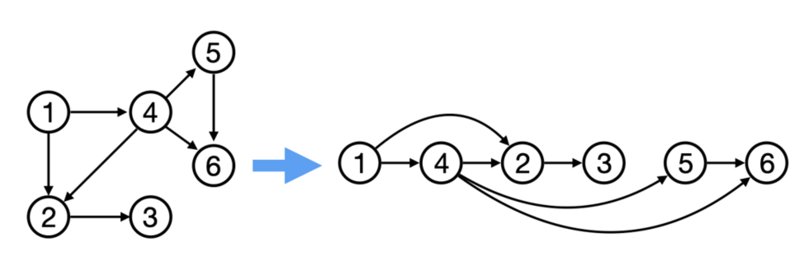

# Introduction

这是一份学习日志，该project为跟着Karpathy的“Zero to Hero"课程手搓一个microGPT。

笔者之前学习的计算机语言是c\+\+，对python不熟悉，学习日志中有一些对于python语言本身的记录将用引用的格式呈现。

本讲的核心在于构建自动计算梯度便于反向传播的数据类型Value，构建反向传播的数据结构并实现MLP，是深度学习的基础。


# Python基础

## 三元条件表达式

```Plain Text
other = other if isinstance(other, Value) else Value(other)
```

这是 Python 的条件表达式，也叫三元表达式。一般格式是：

```Plain Text
满足条件时的值 if 条件 else 不满足条件时的值
```

所以这行等价于：

```Plain Text
if isinstance(other, Value):
    other = other
else:
    other = Value(other)
```

## F\-string

字符串前面的 `f` 表示这是一个 **格式化字符串**，英文叫 **f\-string**。

它允许你把变量或表达式直接写进字符串中。

```Plain Text
name = "张三"
age = 19

text = f"我叫{name}，今年{age}岁"
print(text)
```

输出：

```Plain Text
我叫张三，今年19岁
```

其中：

```Plain Text
f"我叫{name}，今年{age}岁"
```

里的 `{name}` 和 `{age}` 会被替换成变量对应的值。

如果不加 `f`：

```Plain Text
text = "我叫{name}，今年{age}岁"
print(text)
```

输出会是：

```Plain Text
我叫{name}，今年{age}岁
```

因为普通字符串不会处理大括号中的变量。

## lambda与匿名函数

`lambda` 是 Python 中用来创建“匿名函数”的关键字，也就是没有正式名称的简短函数。

例如：

```Plain Text
lambda: None
```

等价于：

```Plain Text
def do_nothing():
    return None
```

区别是 `lambda` 可以直接写在赋值语句中：

```Plain Text
self._backward = lambda: None
```

这表示把一个“什么都不做、返回 `None` 的函数”保存到 `self._backward` 中。注意此时只是保存函数，还没有执行。

执行它需要加括号：

```Plain Text
self._backward()
```

\*\*基本语法\*\*

```Plain Text
lambda 参数: 返回值表达式
```

例如：

```Plain Text
add = lambda x, y: x + y

result = add(2, 3)
print(result)  # 5
```

它大致等价于：

```Plain Text
def add(x, y):
    return x + y
```

在 Micrograd 代码里：

```Plain Text
self._backward = lambda: None
```

可以理解成：

```Plain Text
def empty_backward():
    pass

self._backward = empty_backward
```

它是一个默认的空反向传播函数。对于没有父节点的叶子节点，即使调用：

```Plain Text
value._backward()
```

也不会报错或做任何事情。

需要注意，`lambda` 通常只能包含一个表达式，适合非常简短的函数。复杂逻辑一般使用 `def`。

## 集合、元组、列表

可以把它们理解成三种“装东西的容器”。

### 列表 `list`

列表最常用，适合保存一组可能会变化的数据。

```Plain Text
a = [1, 2, 2, 3]

a.append(4)
a[0] = 10

print(a)
```

结果：

```Plain Text
[10, 2, 2, 3, 4]
```

特点：

- 有顺序 

- 可以通过下标访问 

- 可以增加、删除、修改 

- 可以有重复元素 

```Plain Text
print(a[1])
```

对于这个list这个对象，可以用python内置的类型自带方法append来在列表的末尾插入元素：

```Plain Text
topo = []

topo.append("x1")
topo.append("w1")
topo.append("x1*w1")

print(topo)
```

结果是：

```Plain Text
["x1", "w1", "x1*w1"]
```

### 元组 `tuple`

元组和列表很像，但创建后不能修改。

```Plain Text
b = (1, 2, 2, 3)

print(b[0])
```

可以读取：

```Plain Text
1
```

但不能修改：

```Plain Text
b[0] = 10
```

会报错。

元组适合表示“不希望被改变”的数据，例如坐标：

```Plain Text
point = (3, 5)
```

注意，只有一个元素的元组要写成：

```Plain Text
x = (1,)
```

因为：

```Plain Text
x = (1)
```

只是整数 `1`。

### 集合 `set`

集合的主要特点是自动去重。

```Plain Text
c = {1, 2, 2, 3}

print(c)
```

结果类似：

```Plain Text
{1, 2, 3}
```

集合不能通过下标访问：

```Plain Text
c[0]
```

会报错，因为集合不强调元素的位置和顺序。

集合常用于：

- 去除重复元素 

- 判断某个元素是否存在 

- 求交集、并集 

例如：

```Plain Text
a = {1, 2, 3}
b = {2, 3, 4}

print(a | b)  # 并集
print(a & b)  # 交集
```

结果：

```Plain Text
{1, 2, 3, 4}
{2, 3}
```

`add()` 用于向集合中加入一个元素：

```Plain Text
visited = set()

visited.add("x1")
visited.add("w1")

print(visited)
```

结果类似：

```Plain Text
{"x1", "w1"}
```

## Class and Objects

例如：

- “学生”是一个类

- “张三”“李四”是两个具体的学生对象

类规定了学生通常具有：

- 姓名

- 年龄

- 学号

- 学习、考试等行为

而每个对象拥有自己的具体数据。

在 Python 中，可以写成：

```Python
class Student:
    pass
```

这里定义了一个名为 `Student` 的类。

然后可以根据这个类创建对象：

```Python
student1 = Student()
student2 = Student()
```

### 对象的属性

属性就是对象保存的数据。

```Python
class Student:
    pass


student1 = Student()

student1.name = "张三"
student1.age = 19

print(student1.name)
print(student1.age)
```

输出：

```Plain Text
张三
19
```

不过这种在类外部临时添加属性的方式不够规范。通常使用 `init` 方法初始化属性。

```Python
class Student:
    def __init__(self, name, age):
        self.name = name
        self.age = age
```

Re:`self` 代表“当前这个对象”。

Re:`name` 和 `age` 只是 `init` 函数里的临时变量，而 `self.name` 和 `self.age` 才是真正属于对象的属性。

创建对象：（注意在创建对象时括号中无需写“self”这一项）

```Python
student1 = Student("张三", 19)
student2 = Student("李四", 20)

print(student1.name)
print(student2.name)
```

输出：

```Plain Text
张三
李四
```

当执行：

```Python
student1 = Student("张三", 19)
```

Python 会自动调用：

```Python
Student.__init__(student1, "张三", 19)
```

可以近似理解为：Python 先创建一个对象，然后把这个对象作为 `self` 传给 `init`。


**Re：** 在给类中的对象赋值时，只有没有默认值的属性是必须赋值的,例如：

```Python
class Value:
    def __init__(self, data, label=' ')
        self.data = data
        self.label = label 
    def __repr__(self)
        return f"Value({self.data}, {self.label})"
a = Value(2.0)
b = Value(1.0, label='b')
print (a)
print (b)
```

### 对象的方法


类中定义的函数称为**方法**。方法表示对象能够执行的行为。

```Python
class Student:
    def __init__(self, name, age):
        self.name = name
        self.age = age

    def introduce(self):
        print(f"我叫{self.name}，今年{self.age}岁")

    def study(self, subject):
        print(f"{self.name}正在学习{subject}")
```

使用：

```Python
student1 = Student("张三", 19)

student1.introduce()
student1.study("深度学习")
```

输出：

```Plain Text
我叫张三，今年19岁
张三正在学习深度学习
```

调用：

```Python
student1.study("深度学习")
```

实际上可以近似理解为：

```Python
Student.study(student1, "深度学习")
```

因此，在定义实例方法时，第一个参数通常必须写成 `self`。

- Wrapper function:\_\_repr\_\_

```Python
def __repr__(self):
    return f"Student(name={self.name})"
```


像“\_\_init\_\_","\_\_repr\_\_"前后各有两个下划线的方法称为“ **Special Method** ”，它们是 Python 官方规定好的名字。不能随便改。


而某些方法名前只带了一个下划线，这是我们约定俗成的用于类内部使用的函数。

### 实例属性与类属性

#### 实例属性

属于某一个具体对象，通常写在：

```Python
self.xxx
```

中。

```Python
class Student:
    def __init__(self, name):
        self.name = name
```

不同对象的实例属性可以不同：

```Python
student1 = Student("张三")
student2 = Student("李四")

print(student1.name)  # 张三
print(student2.name)  # 李四
```

#### 类属性

属于整个类，所有对象默认共享。

```Python
class Student:
    school = "河海大学"

    def __init__(self, name):
        self.name = name
```

使用：

```Python
student1 = Student("张三")
student2 = Student("李四")

print(student1.school)
print(student2.school)
print(Student.school)
```

都会输出：

```Plain Text
河海大学
```

可以这样区分：

```Python
class Student:
    school = "河海大学"       # 类属性

    def __init__(self, name):
        self.name = name      # 实例属性
```

- `school`：很多学生共同拥有的信息

- `name`：每个学生自己的信息

### 

### 继承

继承允许一个类在另一个类的基础上继续扩展。

```Python
class Animal:
    def __init__(self, name):
        self.name = name

    def eat(self):
        print(f"{self.name}正在吃东西")
```

定义一个 `Dog` 类继承 `Animal`：

```Python
class Dog(Animal):
    def bark(self):
        print(f"{self.name}正在叫：汪汪")
```

使用：

```Python
dog = Dog("旺财")

dog.eat()
dog.bark()
```

输出：

```Plain Text
旺财正在吃东西
旺财正在叫：汪汪
```

虽然 `Dog` 中没有重新定义 `eat`，但它继承了 `Animal` 的方法。

- 方法重写

子类可以重新定义父类的方法：

```Python
class Animal:
    def speak(self):
        print("动物发出声音")


class Dog(Animal):
    def speak(self):
        print("汪汪")


class Cat(Animal):
    def speak(self):
        print("喵喵")
```

使用：

```Python
dog = Dog()
cat = Cat()

dog.speak()
cat.speak()
```

输出：

```Plain Text
汪汪
喵喵
```

这称为**方法重写**。

- `super()` 的作用

如果子类想调用父类的方法，可以使用 `super()`。

```Python
class Animal:
    def __init__(self, name):
        self.name = name


class Dog(Animal):
    def __init__(self, name, breed):
        super().__init__(name)
        self.breed = breed
```

创建对象：

```Python
dog = Dog("旺财", "金毛")

print(dog.name)
print(dog.breed)
```

其中：

```Python
super().__init__(name)
```

表示调用父类 `Animal` 的初始化方法。

---

### 类与深度学习有什么关系

在 PyTorch 中，神经网络模型通常就是一个类。

例如：

```Python
import torch
import torch.nn as nn


class LinearModel(nn.Module):
    def __init__(self):
        super().__init__()
        self.linear = nn.Linear(3, 1)

    def forward(self, x):
        return self.linear(x)
```

创建模型对象：

```Python
model = LinearModel()
```

这里：

- `LinearModel` 是类

- `model` 是对象

- `self.linear` 是模型的一个属性

- `forward` 是模型的方法

- `nn.Module` 是父类

- `super().init()` 初始化父类功能

输入数据：

```Python
x = torch.tensor([[1.0, 2.0, 3.0]])
y = model(x)

print(y)
```

看起来我们调用的是：

```Python
model(x)
```

而不是：

```Python
model.forward(x)
```

这是因为 `nn.Module` 实现了 `call` 等机制，最终会调用模型的 `forward` 方法。

因此，理解类与对象，是理解 PyTorch 和 GPT 代码的重要基础。

### 一个极简 GPT 风格的类

下面暂时不需要理解模型原理，只观察类的结构：

```Python
class GPT:
    def __init__(self, vocab_size, d_model):
        self.vocab_size = vocab_size
        self.d_model = d_model

    def train(self):
        print("开始训练模型")

    def generate(self, prompt):
        print(f"根据输入“{prompt}”生成文本")
```

使用：

```Python
model = GPT(vocab_size=5000, d_model=256)

print(model.vocab_size)
print(model.d_model)

model.train()
model.generate("人工智能")
```

这里可以把 `model` 理解为一个具体的 GPT 模型对象。它保存模型配置，也可以执行训练和生成操作。

---

### 最需要掌握的语法

```Python
class 类名:
    类属性 = 某个值

    def __init__(self, 参数):
        self.实例属性 = 参数

    def 方法名(self, 参数):
        # 方法内容
        pass
```

创建对象：

```Python
对象名 = 类名(参数)
```

访问属性：

```Python
对象名.属性名
```

调用方法：

```Python
对象名.方法名(参数)
```

对于刚开始学习深度学习，现阶段重点掌握四件事即可：

1. 类是模板，对象是类的实例。

2. `init` 用于初始化对象。

3. `self` 表示当前对象。

4. `self.xxx` 保存对象自己的属性。


# Class Value

## 基本结构

为了把求微分逻辑用于神经网络，首先需要合适的数据结构。

`Value` 类用来保存数值对象；我们希望 `Value` 对象可以形成一种便于计算偏导数的数据结构，并用运算图可视化。

```Python
class Value:
    
    # Object initialization (constructor)
    def __init__(self, data):
        self.data = data

    # Tells how to print this object nicely  
    def __repr__(self):
        return f"Value(data={self.data})"
    
    # Python-specific operator function for addition, a+b == a.__add__(b)
    def __add__(self, other):
        out = Value(self.data + other.data)
        return out
    
    # Operator function for multiplication
    # For more: https://docs.python.org/3/library/operator.html
    def __mul__(self, other):
        out = Value(self.data * other.data)
        return out
```

现在可以像下面这样使用 `Value` 实例：

```Python
a = Value(2.0)
b = Value(-3.0)
c = Value(10.0)

d = a * b + c  # equivalent to a.__mul__(b).__add__(c)

print(d)       # calls d.__repr__(), prints "Value(data=4.0)"
print(d.data)  # the actual numeric value contained within d: 4.0
```

**运行结果：**

```Plain Text
Value(data=4.0)
4.0
```


## 前向传播

目前已经实现了数据存储、打印、加法和乘法，但还不知道运算的先后顺序，以及各 `Value` 如何连接（Value间的运算逻辑关系）。换言之，需要记录某些 `Value` 如何生成另一个 `Value`。

为此增加 `_children`（代码中保存为 `_prev`）属性，记录直接影响当前Value值的节点。

例如， `c=a+b` 时，`c` 的前驱包括 `a` 与 `b`。之所以称为 children，是因为后续反向传播时会从结果向输入反向遍历；前向过程中的“父节点”，在反向视角下可看作“子节点”。

```Python
class Value:
    
    # 构造函数 now got extended to optionally take the _children tuple
    def __init__(self, data, _children=()):  # _children is a tuple of Values
        self.data = data                     # the actual numeric value contained within this Value object
        self._prev = set(_children)          # _prev is _children but cast to a set for easier processing
        
    def __repr__(self):
        return f"Value(data={self.data})"
    
    # 加法, a+b == a.__add__(b)
    def __add__(self, other):
        # We initialize the result's _children to be the Values self and other
        out = Value(self.data + other.data, (self, other))
        return out
    
    # 乘法, a*b == a.__mul__(b)
    def __mul__(self, other):
        # We initialize the result's _children to be the Values self and other
        out = Value(self.data * other.data, (self, other))
        return out
```

```Python
a = Value(2.0)
b = Value(-3.0)
c = Value(10.0)
d = a * b + c

print(d)        # Value(data=4.0)
print(d._prev)  # {Value(data=-6.0), Value(data=10.0)}
```

**运行结果：**

```Plain Text
Value(data=4.0)
{Value(data=-6.0), Value(data=10.0)}
```

我们已经知道直接前驱节点，却仍不知道它们通过什么操作生成当前值。因此再加入 `_op`（运算符）与 `label`（图中标签）两个属性；`label` 仅用于可视化。

```Python
class Value:
    
    # 构造函数 now got extended to optionally take the _children tuple, the _op string and the label string
    def __init__(self, data, _children=(), _op='', label=''):
        self.data = data
        self._prev = set(_children)
        self._op = _op
        self.label = label
        
    def __repr__(self):
        return f"Value(data={self.data})"
    
    # 加法 (a+b == a.__add__(b))
    def __add__(self, other):
        out = Value(self.data + other.data, (self, other), '+') # see the _op argument being set as '+' here
        return out
    
    # 乘法 (a*b == a.__mul__(b))
    def __mul__(self, other):
        out = Value(self.data * other.data, (self, other), '*')
        return out
```

此处`self._prev = set(_children)`把元组转化为集合，`_prev` 用集合保存当前节点的父节点，方便遍历计算图和去重。

```Python
a = Value(2.0, label='a')
b = Value(-3.0, label='b')
c = Value(10.0, label='c')

e = a*b; e.label='e'
d = e+c; d.label='d'

f = Value(-2.0, label='f')
L = d*f; L.label = 'L'  # L = (a*b+c) * f

print(L)        # Value(data=-8.0)
print(L._prev)  # {Value(data=-2.0), Value(data=4.0)}
print(L._op)    # *
```

**运行结果：**

```Plain Text
Value(data=-8.0)
{Value(data=-2.0), Value(data=4.0)}
*
```

用计算图可以清楚地表示前向传播的过程：


## 反向传播

我们可以通过下面这种方式来进行梯度的计算：

```Python
def lol():
    h = 0.001

    a = Value(2.0)
    b = Value(-3.0)
    c = Value(10.0)
    e = a * b
    d = e + c  
    f = Value(-2.0)
    L = d * f
    L1 = L.data

    a = Value(2.0 + h) #此处求L对a的偏导数
    b = Value(-3.0)
    c = Value(10.0)
    e = a * b
    d = e + c  
    f = Value(-2.0)
    L = d * f
    L2 = L.data

    print((L2-L1)/h)
lol()
```

我们可以先计算 $\operatorname{gard} d =\partial d/\partial L $和$\operatorname{gard} f = \partial f /\partial L$,由于$L=df
$我们发现,$\operatorname{gard} d =f,\operatorname{gard}f=d$ 。所以计算图中乘法节点的梯度就是另一个变量的值。

同理，我们可得：加法节点梯度保持不变。再结合求导的链式法则，我们可以得到所有点的梯度，从而我们可以通过调整传播过程中各个变量的值来最小化损失函数。


下面展示的是深度学习中神经元的基本结构。


深度学习中的神经元主要由三部分组成：

1. **输入与权重**：接收多个输入 $x_i$，每个输入对应一个权重 $w_i$，表示其重要程度。

2. **加权求和与偏置**：计算  $z=\sum_i w_i x_i+b$ 其中 $b$ 是偏置，用于调整神经元的激活条件。

3. **激活函数**：将 $z$ 输入 ReLU、Sigmoid 等激活函数，得到输出 $y=f(z)$

多个神经元连接成层，多层结构共同学习数据中的复杂特征。

在cell body中，我们需要一个激活函数\(activation\)，主要作用是**引入非线性**，让神经网络能够学习复杂关系。如果没有激活函数，无论网络叠加多少层，整体仍等价于一个线性模型，无法处理图像识别、语言理解等复杂任务。此处以双曲正切函数为例:

```Python
import matplotlib.pyplot as plt
import numpy as np
plt.plot(np.arange(-5,5,0.2),np.tanh(np.arange(-5,5,0.2)));plt.grid();
```


下面，我们我们需要在类中定义新的运算才可以实现激活，我们可以定义指数运算，但下面我们直接定义双曲正切运算。

```Python
class Value:
    def __init__(self,data,_children=(),_op='',label=''):
        self.data = data
        self._children = _children
        self._op = _op
        self.label = label
    def __repr__(self):
        return f"Value({self.data})"
    def __add__(self,other):
        return Value(self.data + other.data, (self,other), '+')
    def __mul__(self,other):
        return Value(self.data*other.data, (self,other), '*')
    def tanh(self):
        n = self.data
        t = (np.exp(2*n)-1)/(np.exp(2*n)+1)
        out = Value(t, (self,), 'tanh') # the second argument is a tuple of the children of this node
        return out
# input x1,x2
# Remark:the definition of the objects must be put outside the class
x1 = Value(2.0,label='x1')
x2 = Value(0.0,label='x2')
# weights w1,w2
w1 = Value(-3.0,label='w1')
w2 = Value(1.0,label='w2')
# bias b
b = Value(6.7,label='b')
x1w1 = x1 * w1;x1w1.label = 'x1*w1'
x2w2 = x2 * w2;x2w2.label = 'x2*w2'
x1w1x2w2 = x1w1 + x2w2;x1w1x2w2.label = 'x1*w1 + x2*w2'
n = x1w1x2w2 + b;n.label = 'n'
o = n.tanh();o.label=o
print(n)
```

该过程计算图如下：


为实现自动反向传播，我们需要扩展Value类：

```Python
import numpy as np
class Value:
    def __init__(self,data,_children=(),_op='',label=''):
        self.data = data
        self._prev = set(_children)
        self._op = _op
        self.label = label
        self.backward = lambda: None # a placeholder for the backward method
    def __repr__(self):
        return f"Value({self.data})"
    def __add__(self,other):
        out = Value(self.data + other.data, (self,other), '+')
        def backward():
            self.grad += out.grad
            other.grad += out.grad
        out.backward = backward
        return out
    def __mul__(self,other):
        out = Value(self.data*other.data, (self,other), '*')
        def backward():
            self.grad += other.data * out.grad
            other.grad += self.data * out.grad
        out.backward = backward
        return out
    def tanh(self):
        n = self.data
        t = (np.exp(2*n)-1)/(np.exp(2*n)+1)
        out = Value(t, (self,), 'tanh') # the second argument is a tuple of the children of this node
    def backward():
            self.grad += (1-t**2) * out.grad
        out.backward = backward
        return out
```

值得注意的是，在这里我们的各个变量（除了leaf node）梯度初始值设置为0，且使用`self.gard+=`

的形式来更新梯度，是为了避免以下情况发生：

```Python
a = Value(3.0, label='a')
b = a + a; b.label = 'b'
b.backward()
draw_dot(b)
```


此时`b= a + a = 2*a`,所以a的梯度应当等于2，上面求得的梯度是错误的


接下来，我们只需要对类中每个对象执行object\.backwark函数即可实现自动反向传播

```Python
o.grad = 1.0  # 
o._backward()
n._backward()
# b._backward()  # Bias term b doesn't propagate to any higher Value, it's just a leaf node, so no need to run this
x1w1x2w2._backward()
x2w2._backward()
x1w1._backward()
# x1._backward() # Don't need to run these, same reason as for b above
# w1._backward()
# x2._backward()
# w2._backward()
print(o)
```

我们接下来还剩下一件事情需要自动化：反向传播的拓扑结构，我们必须保证在结构上的每个节点都已经被计算过了：



我们通过以下代码可以实现：

```Python
def backward(self):
        topo = []
        visited = set()
        def build_topo(v):
            if v not in visited:
                visited.add(v)
                for child in v._prev:
                    build_topo(child)
                topo.append(v)
        build_topo(self)
        self.grad = 1.0
        for v in reversed(topo):
            v._backward()
```

列表`topo`用于保存计算节点的拓扑顺序，集合`visited`用于记录已经访问过的节点，防止重复遍历。

内部的`build_topo()`函数通过深度优先搜索，确定了节点遍历的顺序。

> 深度优先搜索（DFS，Depth\-First Search）是一种遍历树或图的方法。它的核心思想是：
> 
> 沿着一条路径尽可能深入，走到底后再返回，继续探索其他路径。
> 
> 

注意`topo.append(v)`在`for child in v._prev:`循环外面，所以`topo`的顺序对应前向传播，反向传播时要取`reversed(topo)` 。

## 用梯度下降更新参数

梯度下降法通过不断调整参数，使损失函数逐渐减小。基本过程是：

1. **前向传播**：根据当前参数计算预测结果和损失 L。

2. **反向传播**：计算损失对各参数的梯度： $\frac{\partial L}{\partial w}$

3. **更新参数**： $w \leftarrow w-\eta\frac{\partial L}{\partial w} $其中 $\eta $是学习率。

4. **清空梯度**：避免下一轮的梯度与当前梯度累加。

5. 重复以上过程，直到损失趋于稳定。

## 用Pytorch实现以上过程

```Java
import torch
x1 = torch.tensor([2.0]).double(); x1.requires_grad = True
x2 = torch.tensor([0.0]).double(); x2.requires_grad = True
w1 = torch.tensor([-3.0]).double(); w1.requires_grad = True
w2 = torch.tensor([1.0]).double(); w2.requires_grad = True
b = torch.tensor([6.7]).double(); b.requires_grad = True

m = x1*w1 + x2*w2 + b
o = torch.tanh(m)

print(o.data.item())
o.backward()
print(x1.grad.item())   
print(x2.grad.item())
print(w1.grad.item())
print(w2.grad.item())
```

其中，`x1.requires_grad = True`表示需要记录与 `x1` 有关的计算，以便之后计算损失或输出对 `x1` 的梯度。由此可见，Pytorch中的张量运算和内置函数实现了我们上述Value类的功能。

# 从神经元到多层感知机

Class Value为我们实现神经元功能的可能性，接下来我们要从构建一个个单独的神经元，把它们分层连接，最终得到一个多层感知机（MLP）。

单个神经元的功能是接收多个输入，先进行加权求和，再经过激活函数，我们在构建神经元时，用于控制神经元结构的参量只有输入的个数`nin`。

```Python
class Neuron:
    def __init__(self,nin):
        self.w = [Value(np.random.uniform(-1,1)) for _ in range(nin)]
        self.b = Value(np.random.uniform(-1,1))
    def __call__(self,x):
        act = sum(wi*xi for wi,xi in zip(self.w,x)) + self.b
        out = act.tanh()
        return out
    def __parameters__(self):
        return self.w + [self.b]
```

其中，`__init__()`用于初始化神经元的结构,`__call__`用于实现神经元的基本功能，`__parameters__`用于输出这个神经元的所有参数，以便于后续调用。

把多个神经元放在一起，就构成一个全连接层。每个神经元都接收同一组输入，但拥有各自的权重和偏置。此时，为了把握整层的结构，我们需要知道两个参量：每个神经元的输入个数`nin`,这一层神经元的数量`nout`。

```Python
class Layer:
    def __init__(self,nin,nout):
        self.neurons = [Neuron(nin) for _ in range(nout)]
    def __call__(self,x):
        out = [n(x) for n in self.neurons]
        return out[0] if len(out) == 1 else out 
    def __parameters__(self):
        return [p for n in self.neurons for p in n.__parameters__()]
```

下面我们需要在层与层间构建连接，把前一层的输出作为后一层的输入，就能构成多层感知机。

```Python
class MLP:
    def __init__(self,nin,nouts):  #nouts is a list of the number of neurons in each layer
        sz = [nin] + nouts
        self.layers = [Layer(sz[i],sz[i+1]) for i in range(len(nouts))]
    def __call__(self,x):
        for layer in self.layers:
            x = layer(x)
        return x
    def __parameters__(self):
        return [p for layer in self.layers for p in layer.__parameters__()]
```

此时描述MLP结构的参量分为两部分，一部分是输入的个数`nin`，一部分是每一层神经元的个数，记为一个列表`nout`,例如：`model = MLP(3, [4, 4, 1])`

接下来，我们就可以在构建好的多层感知机运行反向传播算法，完成学习：

```Python
# Features/Inputs
n = MLP(3,[4,4,1])  # 3 inputs, 2 hidden layers of 4 neurons each, 1 output
xs = [
  [2.0, 3.0, -1.0],
  [3.0, -1.0, 0.5],
  [0.5, 1.0, 1.0],
  [1.0, 1.0, -1.0],
]

# Desired targets
ys = [1.0, -1.0, -1.0, 1.0]

# Get the NN's current prediction for xs
ypred = [n(x) for x in xs]

for i in range(len(ypred)):
    print(f'{ypred[i]}\t --> {ys[i]}')
loss = sum((yout - ygt)**2 for ygt, yout in zip(ys, ypred))
loss.backward()
for p in n.__parameters__():
    p.data -= 0.01 * p.grad
ypred = [n(x) for x in xs]

new_loss = sum(
    (yout - ygt)**2
    for ygt, yout in zip(ys, ypred)
)
print("旧损失:", loss.data)
print("新损失:", new_loss.data)
```


