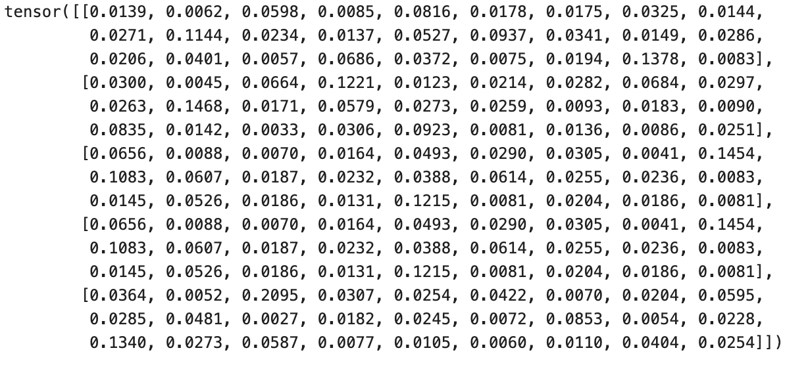

# Introduction

这是一份学习日志，该project为跟着Karpathy的“Zero to Hero"课程手搓一个microGPT。

笔者之前学习的计算机语言是c\+\+，对python不熟悉，学习日志中有一些对于python语言本身的记录将用引用的格式呈现。

本讲要生成一个基于字符的GPT

我们先从GitHub上下载"name\.txt"的数据库，其中包含了许多人名，我们希望最终的成品能够分析其中字符的排布规律，并生成一些新的名字。

我们通过以下代码读取数据，并获取数据集的基本信息。

```Python
words = open('names.txt').read().splitlines()
#.splitlines()用于根据换行符拆分字符串，并自动去掉每行末尾的换行符，得到列表：
words[:10]  # Display the first 10 words from the list
len(words)  # Display the total number of words in the list
min(len(w) for w in words)  # Display the length of the shortest word
max(len(w) for w in words)  # Display the length of the longest word
```

> 需要注意，Python 切片遵循“**左闭右开**”规则：
> 
> ```Python
> words[start:stop]
> ```
> 
> - 包含 `start`
> 
> - 不包含 `stop`
> 
> - 返回一个新列表，不会修改原来的 `words`
> 
> 

# The Bigram Languege Model

## Counting and Visualizing the Data

我们先来研究相连的前后两个字符间的关系，用下面的指令可以依次配对提取单词中相邻的两个字符：

```Python
for w in words[:1]:
      for ch1,ch2 in zip(w,w[1:]):
          print(ch1,ch2)
```

> `zip()` 是 Python 内置函数，用来把多个可迭代对象中的元素按位置一一配对。
> 
> 

接下来，我们在单词的首尾加上起始和结束的标识，

```Python
b = {}
for w in words[:1]:
    chs = ['<S>'] + list(w) + ['<E>']
    for ch1, ch2 in zip(chs, chs[1:]):
        bigram = (ch1, ch2)
        b[bigram] = b.get(bigram, 0) + 1
        print(ch1,ch2)
    print(b)
```

> `get()` 是 Python 字典用于获取某个键对应值的方法，基本语法是：
> 
> ```Plain Text
> 字典.get(键, 默认值)
> ```
> 
> 例如：
> 
> ```Python
> person = {'name': 'Tom', 'age': 18}
> 
> person.get('name')        # 'Tom'
> person.get('height')      # None
> person.get('height', 0)   # 0
> ```
> 
> 而`b[bigram]`表示键`bigram`对应的值，默认为0\.
> 
> 

下面的指令可以按照出现的频率对b中的各个键进行排序：

```Plain Text
sorted(b.items(), key = lambda kv: kv[1])
```

> `items()` 会获取字典中的所有“键—值”对：`b.items()`可以近似理解为：
> 
> ```Plain Text
> [
>     ('em', 5),
>     ('mm', 2),
>     ('ma', 8)
> ]
> ```
> 
> 每个元素都是一个包含两个成员的元组：
> 
> `sorted()` 用于排序：
> 
> ```Plain Text
> sorted(要排序的数据, key=排序依据)
> ```
> 
> 它会返回一个排好序的**新列表**，不会修改原字典 `b`。
> 
> 如果没有指定 `key`：`sorted(b.items())`
> 
> Python 默认根据每个元组的第一个元素排序，也就是按照 bigram 排序。
> 
> `lambda` 用于创建一个简短的匿名函数：`lambda kv: kv[1]`
> 
> 等价于：
> 
> ```Plain Text
> def get_value(kv):
>     return kv[1]
> ```
> 
> 假设传入：`kv = ('em', 5)`
> 
> 那么：
> 
> ```Python
> kv[0]  # 'em'
> kv[1]  # 5
> ```
> 
> 因此：`lambda kv: kv[1]`
> 
> 会从 `('em', 5)` 中取出数字 `5`，让 `sorted()` 使用它作为排序依据。
> 
> 

比起字典，我们用pytorch中的张量可以更好地储存各个组合出现的频率：（张量可以调用torch库中各种运算）

```Plain Text
import torch
N = torch.zeros((28, 28), dtype=torch.int32)
```

把字母和起始、终止符都映射到数字：

```Python
chars = sorted(list(set(''.join(words))))   #把所有出现过的字符进行排序（即得到一个由26个字母组成的列表）
stoi = {s:i for i,s in enumerate(chars)}  #建立字符到索引的映射，索引从0开始
stoi['<S>'] = 26
stoi['<E>'] = 27
```

> **`''.join(words)`**
> 
> 假设：
> 
> ```Plain Text
> words = ['emma', 'olivia', 'ava']
> ```
> 
> `join()` 用于把多个字符串连接成一个大字符串：
> 
> ```Plain Text
> ''.join(words)
> ```
> 
> 结果是：
> 
> ```Plain Text
> 'emmaoliviaava'
> ```
> 
> 

> 第二行代码用到了 `enumerate()` 和字典推导式。
> 
> **`enumerate(chars)`**
> 
> `enumerate()` 在遍历序列时，会同时提供元素的索引和元素本身：
> 
> ```Python
> for i, s in enumerate(chars):
>     print(i, s)
> ```
> 
> 输出：
> 
> ```Plain Text
> 0 a
> 1 b
> 2 c
> 3 d
> ```
> 
> **字典推导式**
> 
> 下面的语法称为字典推导式：
> 
> ```Plain Text
> {s: i for i, s in enumerate(chars)}
> ```
> 
> 基本结构是：
> 
> ```Plain Text
> {键: 值 for 变量 in 可迭代对象}
> ```
> 
> 

接下来往零矩阵N中填充数值

```Python
for w in words:
    chs = ['<S>'] + list(w) + ['<E>']
    for ch1, ch2 in zip(chs, chs[1:]):
        ix1 = stoi[ch1]
        ix2 = stoi[ch2]
        N[ix1, ix2] += 1
```

下面我们借助matplotlib库将这个矩阵可视化：

```Python
import matplotlib.pyplot as plt
plt.imshow(N)
```


很丑，我们可以美化一下：

```Python
itos = {i:s for s, i in stoi.items()} # Basically reversing stoi element order

plt.figure(figsize=(16, 16))
plt.imshow(N, cmap='Blues') # Heatmap basically
for i in range(N.shape[0]):
    for j in range(N.shape[1]):
        chstr = itos[i] + itos[j] # Add text for heat tiles
        plt.text(j, i, chstr, ha="center", va="bottom", color="gray")
        plt.text(j, i, N[i,j].item(), ha="center", va="top", color="gray")
plt.axis('off')*;*
```


观察这个矩阵，我们发现\<S\>不可能作为二元组的第一个元素出现，\<E\>不可能作为第二个元素出现，为了减少数据的存储空间，我们把\<S\>,\<E\>统一用"\."表示，这样可以吧矩阵的尺寸缩减到27\*27。同时，我们把"\."放在编号为0的位置，把A放在编号为1的位置。

```Python
chars = sorted(list(set(''.join(words))))   
stoi = {s:i+1 for i,s in enumerate(chars)}  #A的编号是1，要改为i+1
stoi['.'] = 0
for w in words:
    chs = ['.'] + list(w) + ['.']
    for ch1, ch2 in zip(chs, chs[1:]):
        ix1 = stoi[ch1]
        ix2 = stoi[ch2]
        N[ix1, ix2] += 1
```

```Python
itos = {i:s for s, i in stoi.items()} # Basically reversing stoi element order

plt.figure(figsize=(16, 16))
plt.imshow(N, cmap='Blues') # Heatmap basically
for i in range(27):    #现在只有27*27了
    for j in range(27):
        chstr = itos[i] + itos[j] # Add text for heat tiles
        plt.text(j, i, chstr, ha="center", va="bottom", color="gray")
        plt.text(j, i, N[i,j].item(), ha="center", va="top", color="gray")
plt.axis('off')*;*
```


我们可以用下面这种方式来查看矩阵第零行的元素

```Python
N[0, :]  # iff “N[0]
```

## Sampling from Probability Distributions

接下来我们要把矩阵中某一行的数值转化为概率向量，

```Python
p = N[0].float()
p = p / p.sum()
p
```

我们借用pytorch中用于随机数生成的函数

```Python
g = torch.Generator().manual_seed(2147483647)
p = torch.rand(3, generator=g)
p = p / p.sum()
p
```

上面这个函数生成了一个三维的概率张量p

`torch.Generator()`：创建一个独立的随机数生成器。

`.manual_seed(2147483647)`：设置固定的随机种子。

`g =`：将该生成器保存到变量 `g`。

`torch.rand()` 用于生成取值范围在 **`[0, 1)`** 内、服从均匀分布的随机浮点数张量。

```Python
torch.multinomial(p,num_samples=20, replacement=True, generator=g)
```

\`torch\.multinomial\(\)\` 把 `p` 中的数作为权重，进行 **20 次有放回随机抽样**，返回每次抽中的元素索引。

- `replacement=True`：同一个索引可以被重复抽中。

- `generator=g`：使用随机数生成器 `g`，保证结果可复现。

    利用上面的工具，我们可以让ai根据前后两个字符的组合出现的频率来预测一个新的名字：

```Python
g = torch.Generator().manual_seed(2147483647)

out = []
ix = 0
while True:
    p = N[ix].float()
    p = p/p.sum()
    ix = torch.multinomial(p, num_samples=1, replacement=True, generator=g).item()
    out.append(itos[ix])
    if ix == 0:
        break
print(''.join(out))
```

根据下面的预测结果我们可以知道bigram的效果是很差的：


为了使算法更加简洁，下面我们需要创建一个概率矩阵，但`P = P /  P.sum()`的归一化方式会让矩阵中的每一个元素除以全局总数（整个矩阵所有元素的概率之和 = 1）

，而我们希望给定当前字符时，下一个字符的概率之和为 `1`，因此需要分别归一化每一行。

而`P.sum(0)`表示沿着第0维度（此处维度不是线性空间的维度，而是张量的维度，如向量只有0维度，矩阵有0和1维）求和，即把同一列的元素都加起来。得到的是一个shape为27的向量，（即第一维被压缩）

而pytorch的\.sum\(\)函数有一个bool参数：keepdim，默认为False，令`keepdim = True`时，第一维度不会被压缩，会得到一个27\*1的矩阵

```Python
P = N.float()
P = P / P.sum(0,keepdim=True)
#P = P / P.sum()  这不是我们想要的
```

pytorch中的Boardcasting Rule保证了上述运算可以进行：

\*\*Broadcasting rule（广播规则）\*\*允许 PyTorch 在两个张量形状不同但兼容时，自动扩展较小的张量，再进行逐元素运算。

比较形状时，从**最后一个维度向前（即所有维度向右对齐）**比较。两个维度满足以下任意条件即可广播：

- 两个维度相等；

- 其中一个维度是 `1`；

- 其中一个张量缺少这个维度。

上面的广播过程为：

```Plain Text
P:      (27, 27)
sum:    (27,  1) → (27, 27)
```

每一行的 27 个元素都会除以该行自己的总和，从而让每一行的概率之和变为 `1`。

下面我们来看看不设定`keepdim=True`会引发什么后果：

```Python
P:    27*27
sum:     27 #右对齐
```

缺失的维度会自动补全为1:

```Python
P:    27*27
sum:   1*27 -> 27*27 #此处在扩展时矩阵就进行了转置
```

## The Loss Function

接下来我们设计一个损失函数来评价一下这个模型的质量，我们使用平均负对数似然：

**似然（likelihood）** 表示：

> 在某个模型下，已经观察到的数据出现得有多“合理”。
> 
> 

固定已经观察到的数据，把它看成关于模型参数的函数。对于序列模型，如果每一步的概率能按条件概率分解，那么整个序列的似然表现为这些条件概率的乘积：

$L = \prod_i P(x_i\mid x_{i-1})$

在 `makemore` 的 bigram 模型中，名字 `emma` 的似然是：

$P(e\mid .)\times P(m\mid e)\times P(m\mid m) \times P(a\mid m)\times P(.\mid a)$

实际计算中通常使用**对数似然**，把乘法变成加法,而在训练模型时可以用负对数似然作为损失函数，同时可以除以数据总数的到平均负对数似然。

```Python
n = 0
log_likelihood = 0.0
for w in words:
    chs = ['.'] + list(w) + ['.']
    for ch1, ch2 in zip(chs, chs[1:]):
        ix1 = stoi[ch1]
        ix2 = stoi[ch2]
        prob = P[ix1, ix2]
        logprob = torch.log(prob)
        log_likelihood += logprob
        n += 1
        print(f'{ch1},{ch2}:{prob:.4f}')
nll = -log_likelihood
print(f'{nll/n}')
```

## Model Smoothing

我们可以将上述代码的第三行改为

```Python
for w in ["andrejq"]:
```

结果为：


“inf”表示损失函数为正无穷，原因在于“jq”这个组合出现的频率是0，这样显然不太合理，我们需要对我们的模型进行一些平滑化处理，我们在定义概率矩阵时引入一些**虚拟计数** 。

```Python
P = (N+1).float().   #给N中每个元素加1
P = P / P.sum(0,keepdim=True)
```

添加的虚拟计数越多，模型的概率分布越平滑，越少则概率分布越集中。

刚刚我们只是进行了计数统计，再进行了归一化处理，现在我们要换一种方法解决这个问题：神经网络框架。

---


# Neural Network Approach \- Same Problem, Different Solution

## Feeding the Network

我们在上面讨论中，把字母映射到了数字，但神经网络中需要输入的是向量，One\-hot encoding（独热编码）用于把类别编号转换成向量。每个向量只有对应类别的位置为 `1`，其余位置都是 `0`。

例如第一个名字“Emma”对应的`xs` 为

tensor\(\[ 0,  5, 13, 13,  1\]\)

```Python
import torch.nn.functional as F
xenc = F.one_hot(xs, num_classes=27).float()
xenc
```

结果为：


```Python
plt.imshow(xenc)
```


## Set the Basic Structure

`xenc`是一张5\*27的矩阵，正常来说，我们需要用一个27\*1的权重矩阵`w`来处理它，但此处我们使用27个神经元，即一张27\*27的权重矩阵：

```Python
w = torch.randn((27,27))    # randn表示元素随机抽样且服从正态分布
xenc @ w    # @表示进行矩阵乘法
```


此处我们不设置偏置项b和激活函数，且这个神经网络这有这一层，这样我们的到一张5\*27的矩阵，我们需要给这个矩阵一个明确具体的语义解释。我们可以看到得到的矩阵中的数值有正有负，但最后我们希望得到一个元素能够表征出现次数（或者归一化后表征概率）的矩阵。

我们可以先对所有值取指数 exp\(\)，把他们都化为正数。此时矩阵中的元素便可以表示次数了（所以原来矩阵中说元素就表示次数的对数）。

```Python
logits = xenc @ w
counts = logits.exp()
probs = counts / counts.sum(1, keepdim=True)
probs
```

以上这段代码本质上用的是softmax函数，

Softmax 将一组任意实数分数（logits）转换成概率分布：

$p_i=\frac{e^{x_i}}{\sum_j e^{x_j}}
$



这个矩阵的第0行当前元素为`xs`的第0个元素（即对应字符为“\.”）表示接下来可能出现的27个字符的概率预测。我们需要调整`w`使得概率分布足够理想——这个标准我们需要定义Loss来评估。

```Python
nlls = torch.zeros((len(xs)))
for i in range(len(xs)):
    x = xs[i]
    y = ys[i]
    p = probs[i, y]    #probs中第i行第y列的概率值
    logp = torch.log(p)
    nll = -logp
    nlls[i] = nll
print('loss=', nlls.mean().item()) 
# .mean()是求平均值，.item()是将只含一个数张量转换为Python数值类型
```

## Optimization

Loss完全由可微函数构成，接下来我们用梯度下降法对参数 w 进行优化。

我们希望用向量的形式来存储`probs，torch.arange()` 用于创建一个按固定步长排列的一维整数张量，完整形式：

```Plain Text
torch.arange(start, end, step)
```

我们可以把Loss表示成向量化形式：

```Python
loss = -probs[torch.arange(5), ys].log().mean()
```

`torch.arange(5)` 提供行索引 `[0,1,2,3,4]`，配合 `ys` 从每一行中取出正确字符对应的概率。

完整的优化过程如下：

```Python
# initialize the weights
g = torch.Generator().manual_seed(2147483647)
w = torch.randn((27, 27), generator=g, requires_grad=True)
```

```Python
# forward pass
xenc = F.one_hot(xs, num_classes=27).float()
logits = xenc @ w
counts = logdits.exp()
probs = counts / counts.sum(1, keepdim=True)
loss = -probs[torch.arange(5), ys].log().mean()

# backward pass
w.grad = None  # set the gradients to zero before backward pass
loss.backward()
```

```Python
w.data += -0.1 * w.grad  # update the weights using gradient descent
```

反复运行后两段代码，得到的损失函数数值与传统的计数方法相近。

## The Regularization Loss

类似第一种方法，在这里我们也有一种对模型进行平滑处理的方法：

在 N002 的 Bigram 模型中，如果 `W` 全部接近零：

`logits = xenc @ W`就会接近零。随后：

`counts = logits.exp()`会接近：exp0=1。

所以我们在原先的Los后面加入正则化项：

```Plain Text
0.01 * (W**2).mean()
```

0\.01是正则化强度，注意此处`w**2`是`w`中所有元素的平方，\.mean\(\)表示求平均。权重的绝对值越大，这一项就越大，总损失也越大。因此训练时，梯度下降不仅会努力提高正确字符的预测概率，还会倾向于让权重保持较小

$L=L_{\text{data}}+\lambda L_{\text{reg}}$

正则化强度 $\lambda$：

- $\lambda$ 太小：正则化效果较弱

- $\lambda$ 太大：权重被过度压向零，模型可能学不到有效规律

# Summary

由于二元模型比较简单，所以第一种显式的计数方法可以很好地优化损失函数，我们可以直接估算概率而不需要基于梯度的优化，但基于梯度的方法明显更灵活。

下面简单比较一下两种方法：

而当模型不仅仅通过一个字符去预测下一个时：

如果希望根据前两个字符预测：

$ P(x_{t+1}\mid x_{t-1},x_t) $

就需要统计三元组。

27个字符时：

- 一个字符上下文：$27^2=729$ 个组合

- 两个字符上下文：$27^3=19683$ 个组合

- 三个字符上下文：$27^4=531441$ 个组合

- 十个字符上下文：组合数极其庞大

随着上下文长度增加，表格尺寸会指数增长，而且很多组合在训练数据中从未出现，形成严重的数据稀疏问题。

此时就应当使用神经网络的方法。

