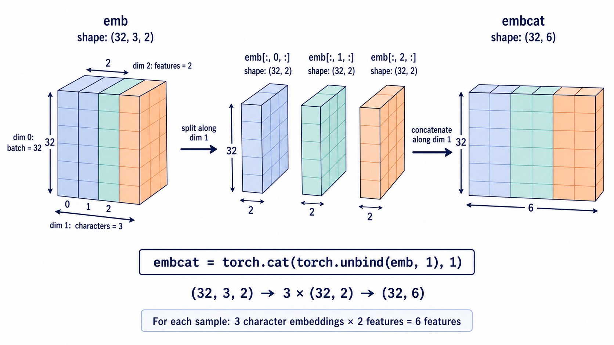
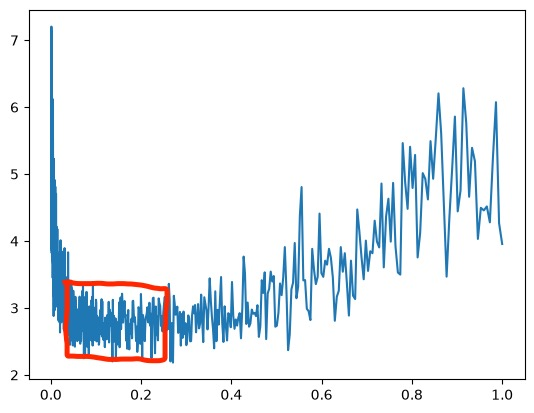
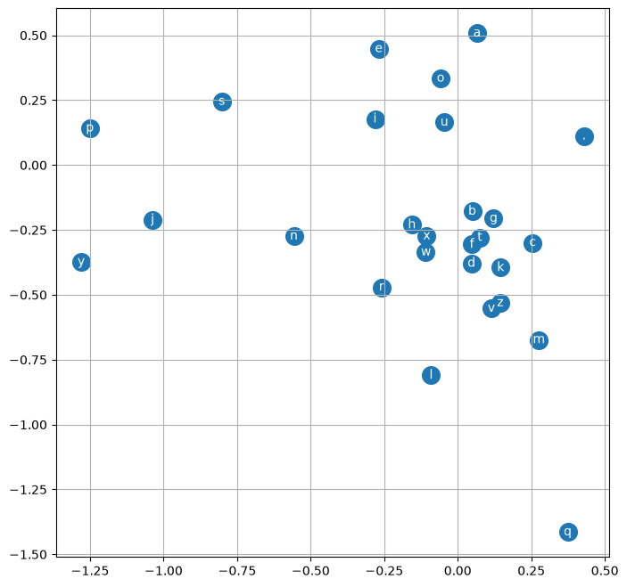

# Introduction

这是一份学习日志，该project为跟着Karpathy的“Zero to Hero"课程手搓一个microGPT。

笔者之前学习的计算机语言是c\+\+，对python不熟悉，学习日志中有一些对于python语言本身的记录将用引用的格式呈现。

本讲要在上一讲的基础上，提高模型的准确性，我们要用更多的字母（例如3个字母）来预测下一个字母。

一些基础的设置没有变化：

```Python
import torch
import torch.nn.functional as F
import matplotlib.pyplot as plt
words = open('names.txt', 'r').read().splitlines()
```

```Python
# 建立字母和数字的映射关系
chars = sorted(list(set(''.join(words))))
stoi = {ch:i+1 for i,ch in enumerate(chars)}  
stoi['.'] = 0  
itos = {i:ch for ch,i in stoi.items()}
print(itos)
```

# Feeding the Model

接下来，我们需要建立一个可供模型输入的数据集：

```Python
# build the dataset
block_size = 3
X, Y = [], []   # X are the input, Y are the labels
for w in words[:5]:
    print(w)
    context = [0] * block_size     
    # 列表乘以整数表示：将列表中的元素重复若干次，并拼接成新列表。
    for ch in w + '.':
        ix = stoi[ch]
        X.append(context)
        Y.append(ix)
        # append() 用于在列表末尾添加一个元素
        print(''.join(itos[i] for i in context),'--->',itos[ix])
        # .join()用于把多个字符串用指定的分隔符连接成一个字符串,此处分隔符为''（空字符串）
        context = context[1:] + [ix]
X = torch.tensor(X)
Y = torch.tensor(Y)
```

注意此时`X`是一个矩阵，而`Y`是一个向量。

```Python
X.shape,X.dtype,Y.shape,Y.dtype
```

Output:

\(torch\.Size\(\[32, 3\]\), torch\.int64, torch\.Size\(\[32\]\), torch\.int64\)

# The First Layer

接下来我们需要设计一个神经网络，使其接受`X`并输出对应`Y`。

首先，我们要设计一个嵌入矩阵C，把各个字符编号转化为可学习的特征向量，此处我们取二维的特征向量，不妨先随机生成一个：

```Python
C = torch.randn((27,2))
```

我们有两种方法可以调取某个字符编号的特征向量：直接调取和与独热向量做矩阵乘法：

```Python
C[5]
```

```Python
F.one_hot(torch.tensor(5),num_classes=27).float() @ C
```

结果都相同：Output：tensor\(\[1\.1293, 0\.9103\]\)

同时，我们也可以把这一步看作整个神经网络的第一层：只是线性神经元，权重矩阵为 C，没有激活函数。

此外，我们除了可以用一维整数（张量）来索引，我们还可以用多维整数（张量）。

```Python
C[[5,6,7]]
```

```Python
C[torch.tensor([5,6,7])]
```

Output：

tensor\(\[\[ 1\.1293,  0\.9103\],

\[\-0\.8120,  1\.1986\],

\[\-0\.4150, \-0\.7304\]\]\)

我们可以把刚刚的输入`X`作用于`C`，而`C[X].shape`会得到一个32\*3\*2的三维张量。

```Python
emb = C[X]
emb.shape
```

# The Hinder Layers

接下来我们来构建神经网络的隐藏层：

```Python
W1 = torch.randn((6,100))
b1 = torch.randn(100)
```

Remark: 对于`W1`,`b1`的尺寸，“6”是为了使得在`emb`压缩后二者可以作矩阵乘法，而“100”是一个人为设定的超参数。Remark: 对于`W1`,`b1`的尺寸，“6”是为了使得在`emb`压缩后二者可以作矩阵乘法，而“100”是一个人为设定的超参数。

此处`emb`（是以个三维张量）和`W1`显然无法直接进行矩阵乘法，我们需要对`emb`进行一些修改，`torch.cat()` 用于沿指定维度，把多个张量拼接起来。

默认情况下沿着第0维拼接，如：

```Plain Text
a = torch.tensor([[1, 2],
                  [3, 4]])

b = torch.tensor([[5, 6],
                  [7, 8]])
```

沿第 0 维拼接（`dim=0`）：增加行，竖着拼

```Plain Text
torch.cat([a, b], dim=0)
```

对于`emb`我们需要先对其进行拆分，再进行拼接：

```Python
torch.cat([emb[:,0,:]],[emb[:,1,:]],[emb[:,2,:]],1)
```

最后一个参数“1”表示沿着第一个维度拼接。



但是当`block_size`取别的值时，上述拆分的代码便不再使用，为此，我们引入一个可以压缩张量维度的函数`torch.unbind(input,dim)`\.

```Python
torch.cat(torch.unbind(emb,1),1)
```

有个问题，张量先沿着dim1拆分，再沿着dim1拼接，这两个过程字面上看时互逆的，为什么得到的张量与原来不同呢？事实上，这是个很容易犯错的问题：因为 `unbind` 会删除被拆分的维度，所以两次操作中的 `dim=1` 指向的维度含义已经不同。

但是上面这种拼接的方式效率是比较低的，因为拼接会创建一个全新的张量并分配全新的存储空间，这会额外占用大量内存。事实上，所有张量在计算机内存中都是排成一条线进行存储的，只是分组方式不同，而`.view()`可以改变其分组方式，所以上述才做也可以用以下方式实现：

```Python
emb.view(32,6)
```

由此，我们就可以得到隐藏层的激活值：

```Python
h = torch.tanh(emb.view(32,6) @ W1 + b1)
```

上述操作中的加法运算要非常小心，我们要用广播规则来验证加法运算的结果是否是我们想要的。`emb.view(32,6) @ W1`的形状为32\*100，而`b1`是一个行向量，根据广播规则，二者运算时`b1`会转化为一个1\*100的矩阵。

# The Output Layer

下面我们来设计输出层：

```Python
W2 = torch.randn((100,27))    # “27”代表了27个字符
b2 = torch.randn(27)
```

```Python
logits = h @ W2 + b2
logits
```

按照上一讲的方式，我们选用softmax函数作为激活函数：

```Python
counts = logits.exp()
prob = counts / counts.sum(1,keepdims=True)
```

`prob.shape == torch.Size([32, 27])`,其含义是32组3个3个字符组成的“block”中对下一个字符的预测（即27个字符分别的概率值）。`torch.arange(32)`可以生成一个有0\-31间的整数构成的一维张量，而向量`Y`中存储着“下一个字符”的正确答案，则

```Python
prob[torch.arange(32),Y]
```

表示了32个block预测为正确答案的概率。与上一讲一样，我们使用负对数似然损失。

```Python
loss = -prob[torch.arange(32),Y].log().mean()
```

同时，我们也可以直接调用Pytorch中的交叉熵函数，输入logits值就可以得到负对数似然损失：

```Python
F.cross_entropy(logits,Y)
```

这种方式能提高运行效率，因为它可以省去创建中间张量的步骤，这些中间张量都会占用内存。除此之外，`F.cross_entropy`函数在数值稳定性上的表现也更加出色。原因在于在`.exp()`操作中，过大的正值会导致数值溢出（过小的负值会使结果接近0，是安全的），最后使得`counts`的结果被记为"inf"，而在logits中加减任意值并不会影响概率分布，所以`F.cross_entropy()`函数在操作时会将logits的每一项都减去最大项，这种操作被称为"safe\_softmax"。

# Backforward Pass

接下来，我们开始进行反向传播。

```Python
parameters = [C, W1, b1, W2, b2]
for p in parameters:
    p.requires_grad = True
for _ in range(10)
# forward pass
h = torch.tanh(emb.view(-1,6) @ W1 + b1)
logits = h @ W2 + b2
loss = F.cross_entropy(logits,Y)
print(loss.item())
# backforward pass
for p in parameters:
    p.grad = None
loss.backward()
# uodate
for p in parameters:
    p.data += 0.1 * p.grad
```

Output：


我们可以发现，梯度下降得非常快，原因是我们只有32个样本却有3400个参数，所以我们正在对这些样本进行过拟合。

# More Datas

接下来，我们要读取完整的数据集，并对神经网络进行优化。我们先把前五个单词的限制去掉，这样`X.shape == torch.Size([228146, 3])`但如果我们每次前向和反向传播都要读取22W个样本效率会很低，因此，我们需要从数据集中随机抽选一部分样本：

```Python
ix = torch.randint(0,X.shape[0],(32,))    
# torch.randint(low, high, size)，注意最后一个参数描述张量的形状，要写成元组的形式
```

此时我们只要把上面代码中的`X`换成`X[ix]`，`Y`换成`Y[ix]`，即可完成在完整数据集内的随机抽样学习。

# Tuning the Learning Rate

上述过程中，0\.1这个学习率是我们随意设置的，接下来我们需要确定一个合理的学习率。

当学习率过小时，Loss减小的速度过慢；当学习率过大时，Loss会出现“上下波动”的情况。

我们发现，上述模型在学习率取1时发生了上下波动，学习率取0\.01时收敛较慢。所以我们断言合理学习率应该在0\.01\-1之间。

`torch.linspace`可以在给定范围和步长时线性地生成一个一维数据张量，由于学习率线性分布显然不太合理，所以我们使其指数分布。

```Python
lre = torch.linspace(-3,0,1000) # 在-3到0的区间内均匀地采样1000个数据
lrs = 10**lre
```

此时完整代码更改为：

```YAML
lri = []    # initialize two state list
lossi = []
parameters = [C, W1, b1, W2, b2]
for p in parameters:
    p.requires_grad = True
for i in range(100):
    # minibatch construct
    ix = torch.randint(0,X.shape[0],(32,))  

    # forward pass
    emb = C[X[ix]]
    h = torch.tanh(emb.view(-1,6) @ W1 + b1)
    logits = h @ W2 + b2
    loss = F.cross_entropy(logits,Y[ix])
    # backforward pass
    for p in parameters:
        p.grad = None
    loss.backward()
    # update
    lr = lrs[i]
    for p in parameters:
        p.data += -lr * p.grad
    # track states
    lri.append(lr)
    lossi.append(loss.item())
```

接下来我们进行可视化：

```Python
plt.plot(lri, lossi)
```

得到的图像如下：



红色方框内的区域应该是学习率比较好的区间。

接下来，我们把横轴`lri`改为学习率的指数，即

```Python
lri.append(lre[i])
```

此时得到的图像如下：


由图像可知，学习率设置在10^\-1左右是比较合理的。

# Splitting the Dataset

由于模型参数过多易导致过拟合，此时损失函数并不能客观地评价模型的拟合效果，所以我们将数据集划为训练集、验证集和测试集（验证集用于调整超参数），同时我们不能在测试集上训练太多次，否则会导致测试集过拟合。

```Python
def bulid_dataset(words):
    block_size = 3
    X, Y = [], []   # X are the input, Y are the labels
    for w in words:
        print(w)
        context = [0] * block_size     
        for ch in w + '.':
            ix = stoi[ch]
            X.append(context)
            Y.append(ix)
            print(''.join(itos[i] for i in context),'--->',itos[ix])
            # .join()用于把多个字符串用指定的分隔符连接成一个字符串,此处分隔符为''（空字符串）
            context = context[1:] + [ix]
    X = torch.tensor(X)
    Y = torch.tensor(Y) 
    print(X.shape,Y.shape)
    return X,Y
import random   # Python 的内置标准库，不需要额外安装。
random.seed(42)
random.shuffle(words)   #随机打乱列表中元素的顺序
n1 = int(0.8*len(words))
n2 = int(0.9*len(words))
Xtr, Ytr = bulid_dataset(words[:n1])
Xdev, Ydev = bulid_dataset(words[n1:n2])
Xte, Yte = bulid_dataset(words[n2:])
```

现在，我们只使用`Xtr`和`Ytr`进行训练，训练20000次。得到Loss = 2\.5175

用`Xdev`和`Ydev`训练，训练20000次，得到Loss = 2\.3568。

二者相差较小，说明目前整个模型没有出现过拟合，仍处于欠拟合的状态，通常意味着网络规模很小，结构很简单。我们预计通过扩大神经网络的规模，能有效提升其性能表现。

最简单的方法是：增加隐藏层中神经元的数量。

接下来，我们把隐藏层中的神经元数量由100变为300（ **与此同时，这项操作会初始化神经网络** ），训练30000次。同时，我们引入随循环次数增加的列表`stepi`,以追踪损失函数随训练次数的变化情况。

```Python
stepi.append(i)
```

```Python
plt.plot(stepi,lossi)
```


此时Loss = 2\.5667，比刚刚还要大点，说明模型可能还没训练到位，这个神经网络可能需要更长的时间才能收敛。另一种可能是“minibatch”设置得太小了，导致训练过程中噪声过大。

再训练30000次，Loss变为2\.3264。

> 在视频中，Karpathy就如同仙术一般通过减小学习率的方法将Loss进一步降到了2\.2左右，但我试图模仿却发现Loss反而增大了
> 
> 

> 后面又重新试了一次，结果如下：
> 
> 学习率0\.1，训练集10000次，Loss = 2\.2535
> 
> 学习率0\.05，训练集10000次，Loss = 2\.2081
> 
> 学习率0\.01，训练集10000次，Loss = 2\.1564
> 
> 学习率0\.01，验证集10000次，Loss = 2\.5065
> 
> 学习率0\.01，验证集10000次，Loss = 2\.7590
> 
> 测试集1次，Loss = 2\.2624
> 
> 

另一个可能的瓶颈是，在字符的嵌入表示时，我们将过多的字符压缩到了仅二维的空间中，导致神经网络无法有效利用该空间。我们现在尝试将字符的嵌入向量可视化。

```Python
plt.figure(figsize=(8,8))
plt.scatter(C[:,0].data, C[:,1].data, s=200)
for i in range(C.shape[0]):
    plt.text(C[i,0].item(), C[i,1].item(), itos[i], ha="center", va="center", color="white")
plt.grid('minor')
```



我们可以发现，网络已经基本上学会区分这些字符，并让它们形成了一定的聚集分布（如元音字母都聚集在一个区域内）。

我们现在要扩大嵌入向量的维度，现在我们把嵌入向量的维度更改为10维，同时我们将隐藏层的神经元数目改为200，学习率0\.1即：

```Python
C = torch.randn((27,10))
W1 = torch.randn((30,200))    # 注意原来的6要改为30
b1 = torch.randn(200)
W2 = torch.randn((200,27))
b2 = torch.randn(27)
```

同时在循环中还有个地方要改：

```Python
h = torch.tanh(emb.view(-1,30) @ W1 + b1)
```

我们这个循环50000次，改为记录损失函数的对数：

```Python
lossi.append(loss.log10().item())
```

```Python
plt.plot(stepi,lossi)
```


Loss = 2\.062

接下来，我们在验证集上循环10000次，得到

Loss = 1\.9833

接下来，我们在测试集上测试1次，得到

Loss=2\.3565

说明模型已经存在一定过拟合现象。

# Summary

本节利用神经网络这种比传统的统计计数更加灵活的方法，将上一节的 Bigram 模型进行拓展，我们使用不同的方法分别设计了输入层，隐藏层和输出层。接着我们将数据集分为三个部分，通过调整学习率，隐藏层神经元数目，嵌入向量维数来降低损失函数。


