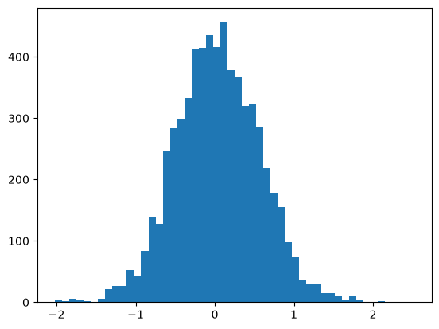

# Lecture4:Makemore3（Activations,Gradients,BatchNorm）

# Introduction

这是一份学习日志，该project为跟着Karpathy的“Zero to Hero"课程手搓一个microGPT。

本讲将在上一讲初步构建完成的MLP的基础上对模型进行优化，首先，我们先以更简洁清楚的方式复现一下上一讲构建的MLP，同时给经常需要变动的位置设置成参数，减小“Magic Numbers”。

```Python
# Imports are just like before
import torch
import torch.nn.functional as F
import matplotlib.pyplot as plt
%matplotlib inline
```

```Python
words = open('names.txt', 'r').read().splitlines() # read in all the words
print(words[:8])           # Show the first eight words
print(len(words), 'words') # Total amount of words in our dataset
```

```Python
# Build a vocabulary of characters and map them to integers
chars = sorted(list(set(''.join(words))))  # set(): Throwing out letter duplicates

stoi = {s:i+1 for i,s in enumerate(chars)} # Make tuples of type (char, counter)
stoi['.'] = 0                              # Add this special symbol's entry explicitly
itos = {i:s for s,i in stoi.items()}       # Switch order of (char, counter) to (counter, char)

vocab_size = len(itos)

# Showing the two mappings, they really just are mirrors of one another
print(itos)
print(stoi)
print(vocab_size)
```

```Python
# Build the dataset
block_size = 3 # Context length: How many characters do we take to predict the next one?

def build_dataset(words, split):  
  X, Y = [], []
  
  for w in words:
    context = [0] * block_size
    for ch in w + '.':
      ix = stoi[ch]
      X.append(context)
      Y.append(ix)
      context = context[1:] + [ix] # Crop and append

  X, Y = torch.tensor(X), torch.tensor(Y)
  print(f"{split} {X.shape}, {Y.shape}")
  return X, Y

# Randomize the dataset (with reproducibility)
import random
random.seed(42)
random.shuffle(words)

# These are the "markers" we will use to divide the dataset
n1, n2 = int(0.8 * len(words)), int(0.9 * len(words))

# Dividing the dataset into train, dev and test splits
Xtr, Ytr = build_dataset(words[:n1], 'train:\t   ') # 80%
Xdev, Ydev = build_dataset(words[n1:n2], 'validation:') # 10%
Xte, Yte = build_dataset(words[n2:], 'test:\t   ')  # 10%
```

```Python
n_embd = 10    # dimensionality of the character embedding vectors
n_hidden = 200 # number of neurons in the hidden layer of the MLP

g  = torch.Generator().manual_seed(2147483647)                 # For reproducibility
C  = torch.randn((vocab_size, n_embd), generator=g)            # 27 letters x 10 values inp layer
W1 = torch.randn((n_embd * block_size, n_hidden), generator=g) # 10 values x 3 priors x 200 neur.
b1 = torch.randn(n_hidden, generator=g)                        # 200 biases for the 200 neurons
W2 = torch.randn((n_hidden, vocab_size), generator=g)          # 200 inputs x 27 output neurons
b2 = torch.randn(vocab_size, generator=g)                      # 27 output biases

parameters = [C, W1, b1, W2, b2] # Cluster all parameters into one structure
print(sum(p.nelement() for p in parameters), 'parameters') # total parameters (3481 before)

for p in parameters:
    p.requires_grad = True
```

```Python
max_steps = 200000 # how many batches to train on
batch_size = 32    # how many samples to process at once
lossi = []         # history of loss values per batch for plotting later

for i in range(max_steps):
    ## Mini-batch construct
    ix = torch.randint(0, Xtr.shape[0], (batch_size,), generator=g)
    Xb, Yb = Xtr[ix], Ytr[ix] # X,Y of this batch
    
    ## Forward-Pass
    emb = C[Xb]                         # Embedding characters into vectors
    embcat = emb.view(emb.shape[0], -1) # Concatenate the vectors
    hpreact = embcat @ W1 + b1          # Hidden layer pre-activation
    h = torch.tanh(hpreact)             # Hidden layer
    logits = h @ W2 + b2                # Output layer
    loss = F.cross_entropy(logits, Yb)  # Loss function
    
    ## Backward-Pass, calculating gradients
    for p in parameters:
        p.grad = None # Making sure that prior iteration's gradients are gone
    loss.backward()   # This calculates the current (new) gradients
    
    ## Param Update, applying scaled gradients to the params
    lr = 0.1 if i < (max_steps / 2) else 0.01 # Learning rate decay
    for p in parameters:
        p.data += -lr * p.grad

    # Printing track stats every once in a while
    if i % 10000 == 0:
        print(f'{i:7d}/{max_steps:7d}: {loss.item():.4f}')
    
    # Adding current loss value to historic losses set (for later display)
    lossi.append(loss.log10().item())
```

# **Problem 1: Unrealistically High Initial Loss**

我们每隔10000次就记录一下Loss的变化，结果如下：


我们发现，第一个损失值非常大，原因在于参数初始化尺度太大，导致模型一开始就对错误答案极度自信。一般情况下，在我们没有其他信息时，我们倾向认为各种情况是平均分布的。

我们让模型只学习一次，并输出`logits[0]`,的代结果如图：


这些极端的logits值会使模型产生虚假的置信度，从而使损失函数变得巨大，原因如下：

softmax函数的图像如下：（选取某个x值，固定其他x值）


不同字符的 logits 可能相差几十。经过 softmax 后，概率会极端集中在某个随机字符上：

交叉熵相当于：

```Plain Text
loss = -log(P[正确字符])
```

正确字符的概率很小时，交叉熵就会很大。

如果初始预测是均匀分布，27 个字符每个概率约为 `1/27`，合理的初始 Loss 应该是：

```Plain Text
-np.log(1 / 27)
# 3.2958
```

所以初始 Loss 约 `3.3` 才比较理想。

为了使初始的概率值均匀分布，我们需要让logistic的值尽可能接近0，于是我们对输出层`logits = h @ W2 + b2`进行处理，

```Python
W2 = torch.randn((n_hidden, vocab_size), generator=g) * 0.01  
b2 = torch.randn(vocab_size, generator=g) * 0       
```

此时结果如下图所示：


可以看到，第一个损失函数值明显减小，

而损失函数关于循环次数的图像也不再是“鞋拔子形”：


---

# **Problem 2: Frequent Tanh Extrema**

接下来我们需要关注一下隐藏层的问题，我们输出`h`,结果如下：


接下来我们可以调用 python 中的`.tolist()`函数吧`h`转化为浮点数表，并绘制直方图：


```Python
plt.hist(h.view(-1).tolist()，50)
```

绝大多数值集中在\-1 和 1 两个端点上，接下来我们输出`hpteact`（即未被`.tanh()`处理前的值）


我们可以看到未激活前数值的分布非常广，但激活后大部分值都分布到了靠近端点处。

这会造成一个严重的后果：双曲正切函数的导数为

$1-\tanh ^2 x$

若代入tanhx=1或\-1，则梯度等于 0，就会出现梯度消失的情况。

事实上由于激活前的值大部分位于双曲正切函数的“平坦”区域，所以神经网络学习时权重与偏置项改动很小，并不会对隐藏层的输出分布造成太大的影响。如果所有输出 h 都落在“平坦区”，那流经该层的梯度就会被严重削弱，不过这个问题存在一些补救措施，我们先用以下代码观察一下“梯度消失”出现的频率。

```Python
plt.figure(figsize=(20, 10))
plt.imshow(h.abs() > 0.99, cmap='gray', interpolation='nearest'); # true: white, false: black (h is 32 x 200)
```


在这 200 个神经元中，如果出现了任何一列所有的点都是白色的，那就说明这个神经元是“死亡神经元 ”，所有样本都落在 tanh 的“平坦区”，这个神经元就永远学不到东西。幸运的是，在图中 200 个神经元中，没有“死亡神经元”。除了 tanh，像 sigmond 函数，ReLU 函数，ELU 函数也会碰到类似问题。

即便如此，位于两端的样本的训练程度会减少，更新频率会降低。 我们的处理方式和刚刚类似，我们需要让`hpreact`较多地落在 0 附近，所以我们可以压缩`W1`和`b1`。

```Python
W1 = torch.randn((n_embd * block_size, n_hidden), generator=g) * 0.1 
b1 = torch.randn(n_hidden, generator=g) * 0.01                
```

更改后的`h`分布（注意，这里只执行了前向传播，并未进行学习）


`hpreact`分布：



此时，`h.abs()`分布：


解决了上面两个问题，我们的 Loss 降到了 1\.8666。

# **Problem 1\+2: Weight\- and Bias\-Scaling**

上面两个案例中，我们都是通过缩放权重和偏置的方法试图让输出值接近中心分布（趋近于 0）事实上，存在一些相对系统的方法来缩放这些参数。

```Python
x = torch.randn(1000,10)    # 此时抽取的 x 满足标准正态分布 (N(0,1))
w = torch.randn(10,200)
y = x @ w
print(x.mean(),x.std())
print(y.mean(),y.std())
plt.figure(figsize=(20,5))
plt.subplot(121)
plt.hist(x.view(-1).tolist(),50,density=True)
plt.subplot(122)
plt.hist(y.view(-1).tolist(),50,density=True)
```

`x`和`w`都满足 Gauss 分布，绘图如下：


`x`和`y`的均值和标准差如下：


可见，在作用了`w`后标准差增大了，从直方图中也可以看到，这个 Gauss 分布正在“扩张”，这是我们不希望看到的。理想情况下，我们希望维持接近标准正态分布的状态，因为分布一旦被不断拉宽，就会出现越来越多的极端值，从而使梯度也越来越容易达到极端状态。

**问题于是变成：怎样缩放 ****`w`****，使得执行 ****`x @ w`**** 之后的标准差仍然约等于 1？**

如果我们给`w`前乘一个 0\.2，那么输出结果如下：


我们应该如何让标准差保持 1 呢，正确的做法是除以“fan\-in”的平方根，“fan\-in”（扇入数）指的是神经元接受输入值的数量，理由如下：

一个神经元的激活前值是：

$z=x_1w_1+x_2w_2+\cdots+x_nw_n+b$

当 fan\-in 为 $n$ 时，需要累加 $n$ 项。如果每个权重都直接来自标准正态分布：

```Plain Text
W1 = torch.randn((10, 200))
```

那么输入项越多，累加结果的波动通常越大。粗略来说，标准差会随$sqrt\{n\}$增长。假设输入和权重的标准差都约为 1，那么 30 项相加后：

$\operatorname{std}(z)\approx\sqrt{10}\approx3.162$ 

这样的值进入 `tanh`：

```Plain Text
torch.tanh(torch.tensor(3.162))  # 接近 1
```

就很容易进入饱和区域。

为了抵消 10 项累加带来的放大，通常将权重除以：

$\sqrt{\text{fan-in}} $

这里是 fan \-in = 10\.即：

```Python
w = torch.randn(10,200)/10**0.5
```

输出结果为：


但是`y = x @ w`仍要通过激活函数 tanh，tanh 会把任何数压缩到 \[\-1,1\]，此时我们需要引入增益系数“gain”以补偿 tanh 的压缩作用。

此时有

$\operatorname{tanh}y \sim \mathcal N\left(0,\frac{\mathrm{gain}^2}{\mathrm{fan\_in}}\right)$

$\operatorname{std}=\frac{\mathrm{gain}}{\sqrt{\mathrm{fan\_in}}}$

不同激活函数的 gain 值不同：

接下来，我们用以上方法来修正我们的模型:

```Python
W1 = torch.randn((n_embd * block_size, n_hidden), generator=g) * (5/3) / ((n_embd *block_size)**0.5)
```

最后输出结果与刚刚大致相同，但是该过程不含有“magic number”。

# 批量归一化

批量归一化由 Ioffe 和 Szegedy 在[这篇论文](https://arxiv.org/abs/1502.03167)中提出。它使我们在前面进行的那种极其精确的权重初始化，几乎变得不再必要或不再那么重要。

我们的目标是让预激活值`hpreact`大致符合 Gauss 分布，

理想情况下，`hpreact` 应大致以 0 为中心，而且方差适中：

- 如果数值过大：`tanh` 输出接近 `±1`，进入饱和区，梯度接近 0。

- 如果数值过小：`tanh` 几乎是线性的，神经元表达能力不足。

- 如果分布严重偏向一侧：大量神经元可能只输出正值或负值。

假设一个 mini\-batch 中有 m 个数据：**\(input\)**

$\mathcal B=\{x_1,x_2,\dots,x_m\} $

BN 对这批数据进行以下处理。

我们先计算这批数据的均值和方差：

$ \mu_{\mathcal B}=\frac{1}{m}\sum_{i=1}^{m}x_i , \sigma_{\mathcal B}^2 =\frac{1}{m}\sum_{i=1}^{m}(x_i-\mu_{\mathcal B})^2 $

用以下方法进行标准化：

$ \hat{x}_i= \frac{x_i-\mu_{\mathcal B}} {\sqrt{\sigma_{\mathcal B}^2+\varepsilon}} $

标准化后，这批数据大致满足：

$ \operatorname{mean}(\hat{x})\approx0, \qquad \operatorname{std}(\hat{x})\approx1 $

其中 \\varepsilon 是一个很小的数，例如 10^\{\-5\}，用于防止方差为 0 时出现除零错误。

接下来对标准化后的数据进行缩放和平移：

$ y_i=\gamma\hat{x}_i+\beta ,y_i:=\operatorname{BN}_{\gamma,\beta}(x_i)$

其中：\\gamma,\\beta 都是模型需要学习的参数。为什么需要有这一步呢？假如在前向传播中直接使用上面第三步得到的 `hpreact`，那么 MLP 的表现实际上会**变差**。原因是，我们真正需要这种受到严格限制的正态分布，只是在 **MLP 初始化时**需要一次。

**批量归一化的目的，是在初始化阶段对激活值进行归一化，为训练过程创造一个公平、稳定的起点，而不是在整个训练过程中始终把它们强制固定为标准正态分布。训练开始后，激活值应当能够通过反向传播，根据输入数据自由调整。**

我们先初始化两个全 0 和全 1 的张量作为标准化预激活值过程的伸缩和平移项，我们把两个新参数也一起写入`parameters`，这样他们能在反向传播的过程中得到训练。

```Python
bngain = torch.ones((1,n_hidden))
bnbias = torch.zeros((1,n_hidden))
parameters = [C, W1, b1, W2, b2,bngain,bnbias]
```

沿 `hpreact` 的第 0 维，也就是批次维度，计算均值和标准差，并进行标准化。

```Python
hpreact = bngain * (hpreact - hpreact.mean(0,keepdim=True)) / hpreact.std(0,keepdim=True) +bnbias
```

训练集结果如下：


```Python
@torch.no_grad()
def split_loss(split):
    x, y = {
        'train': (Xtr, Ytr),
        'val': (Xdev, Ydev),
        'test': (Xte, Yte),
    }[split]

    emb = C[x]
    embcat = emb.view(emb.shape[0], -1)
    hpreact = embcat @ W1 + b1
    hpreact = bngain * (hpreact - hpreact.mean(0, keepdim=True)) / hpreact.std(0, keepdim=True) + bnbias
    
    h = torch.tanh(hpreact)     # 形状为 (N, n_hidden)
    logits = h @ W2 + b2        # 形状为 (N, vocab_size)
    loss = F.cross_entropy(logits, y)
    
    print(split, loss.item())

split_loss('train')
split_loss('val')
```

输出结果：

train 2\.0750362873077393

val 2\.1144859790802

事实上，我们并不期望批归一化能让当前模型的性能或生成质量得到巨大提升。**原因很简单：我们的 MLP 太浅了，批归一化很难在这样的网络中产生明显影响。**MLP 越深、各层之间的关系越复杂，直接调节权重就越困难，例如前面那样手动选择缩放因子。但网络越复杂，批归一化的收益也越大。你不必在每一层之后都进行批归一化，不过通常应当把它用于线性层$Wx\+b$或卷积层附近。

**但批量归一化是有代价的。**到目前为止，我们在每个时刻都可以单独观察一个输入样本，并根据这个输入计算激活值。这个过程是确定性的，也就是说，结果由这一个输入唯一确定。

 在 Makemore 2 中，我们已经把训练数据拆成多个批次。这么做主要是为了提高效率，也就是使用随机梯度下降，同时还能使训练过程更加稳定。

批量归一化改变了这种理解。由于反向传播会使 `hpreact` 的分布逐渐偏离正态分布，一个样本处在哪个批次里，现在开始具有实际意义。同一批次中的输入之间产生了联系。现在，logits 不再“仅仅”是某个单独输入的确定性结果。它们同时取决于该输入以及同一训练批次中的其他输入，因为批归一化会利用整个批次来改变当前状态。**起作用的是整个批次，而不仅仅是某个独立的训练样本。**

这意味着，如果改变批次的组成，然后把同一个输入再次交给 MLP，logits 的数值会随着批次组成的变化而发生“晃动”。 这种*抖动*不仅出现在 `logits` 中，也会出现在 `h` 中。

但事实上这是一件好事，由于这种与训练批次有关的“晃动”，MLP 自然获得了一定的**熵或噪声**。这反过来会降低过拟合的可能性。噪声能够抑制过拟合。


**事实上，这还不是批归一化带来的唯一影响。**

部署 MLP 时，我们希望为*一个*输入得到*一个*输出或预测。
 我们期望模型具有确定性的行为。
 问题在于如果批归一化仍然处于活动状态，它需要利用前面一批输入的统计信息，而生产环境中通常没有这样的一批历史输入（例如此时只有单个输入），那么模型应该怎样工作？它似乎要求输入必须组成批次，并且输出还会受到批次组成的影响。

**解决方案：**
 在训练完成之后、模型正式上线之前，我们会把批归一化层使用的均值和标准差固定下来。这些统计量通过整个训练集一次性计算得到。固定之后，批次之间的依赖关系就被有效消除了。

前面我们已经训练好了一个使用批归一化的 MLP，现在继续完成统计量的确定和模型性能评估：（这段放在训练结束后，测试前）

```Python
with torch.no_grad(): # 关闭计算图记录后，下面的计算会更快
 # 让整个训练集通过网络
 emb = C[Xtr]
 embcat = emb.view(emb.shape[0], -1)
 hpreact = embcat @ W1 + b1
 # 在整个训练集上一次性计算均值和标准差并固定下来
 bnmean = hpreact.mean(0, keepdim=True)
 bnstd = hpreact.std(0, keepdim=True)
```

不过，在真实应用中，通常不会严格按照“定义模型、训练模型、冻结 `bnmean` 和 `bnstd`、再进行评估”这一整套独立步骤来实现。事实上，`bnmean` 和 `bnstd` 可以在 MLP **训练过程中**同步估计。

为此，需要调整模型定义和训练流程。

 已知 `hpreact` 在初始化时近似服从正态分布，因此均值约为 0，标准差约为 1。

 我们新增两个变量：以全零初始化的 `bnmean_running`，以及以全一初始化的 `bnstd_running`。

```Python
bnmean_running = torch.zeros((1,n_hidden))
bnstd_running = torch.ones((1,n_hidden))
```

它们用来在不同批次之间持续记录 `hpreact` 均值和标准差的移动平均。对于每一个训练步骤或批次，我们先计算当前批次的 `bnmeani` 和 `bnstdi`，再在梯度计算之外使用下面的公式更新运行统计量：

```Python
with torch.no_grad(): # 这一操作不参与梯度更新
    # 沿当前均值和标准差的方向累积小幅更新
    # 这些小幅更新会在训练结束时形成整体的均值和标准差估计
    bnmean_running = 0.999 * bnmean_running + 0.001 * bnmeani
    bnstd_running = 0.999 * bnstd_running + 0.001 * bnstdi
```

`bnmean` 与 `bnmean_running`、`bnstd` 与 `bnstd_running` 并不完全相同，但彼此非常接近。这相当于在历史稳定性和当前信息之间做加权平均。`0.001` 很小，所以大约综合了最近上千个 batch 的信息。这两个数不是固定要求： 若权重较大：更新快，但波动大；若权重较小：更平稳，但适应变化更慢。

目前，我们通过 `embcat @ W1 + b1` 计算 `hpreact`。接着，我们计算 `hpreact` 中每个神经元在整个批次上的均值，并从 `hpreact` 中减去这个均值。也就是说，我们先加入 `b1`，试图让每个神经元的均值发生有意的偏移；但随后又从 `hpreact` 中减去均值，使每个神经元重新被强制为均值 0。 因此，`b1` 原本想实现的偏移实际上无法保留下来。批归一化允许我们在完成归一化之后，再通过 `bnbias` 按照通常的方式产生偏移。换句话说，我们不再需要 `b1`，因为 `bnbias` 可以承担同样的作用。

# 使用 Pytorch 重新构建示例

## Pytorch 中的线性层

[线性层](https://pytorch.org/docs/stable/generated/torch.nn.Linear.html)执行 $Wx\+b$。
 要在 PyTorch 中创建这样的层，需要了解以下参数：

- `in_features`：**fan\-in**，单个输入的维度或大小；在前面的例子中是 10\\times 3；

- `out_features`：**fan\-out**，单个输出的维度或大小；在前面的例子中是 200；

- `bias`：取 `True` 或 `False`，用于决定是否使用偏置。

创建后会生成 `Linear.weight` 和 `Linear.bias` 两个变量。

## PyTorch 中的批量归一化

PyTorch 也为这种神经网络层提供了一个[现成的类](https://pytorch.org/docs/stable/generated/torch.nn.BatchNorm1d.html?highlight=batchnorm1d)。

创建一个 `BatchNorm1d` 层时，需要了解以下参数：

- `num_features`：输入的特征数或维度数；

- `epsilon`：用于提高数值稳定性的一个很小的数。PyTorch 已经给出了合理的默认值，这里保持默认即可；

- `momentum`：当前批次的 `mean` 和 `std` 对 `running_mean` 与 `running_std` 的贡献比例。在我们的实现中，这个比例是 0\.001，而 PyTorch 的默认值是 0\.1。

> 数据集越小，`momentum` 通常也应设置得越小。
> 
> 

- `affine`：默认值为 `True`，决定是否创建可学习的 `bngain` 和 `bnbias`；

- `track_running_stats`：默认值为 `True`，决定是否创建并在内部累计 `bnmean_running` 和 `bnstd_running`。

## 批量归一化有更好的替代方案吗

实际上，由于批归一化会让数据和训练效果带上强烈的“批次属性”，它有时会很快变成新的问题来源。

接下来，我们用以上现成的 Pytorch 模型来构建神经网络，不过，这一次我们会更加仔细地观察批归一化层产生的影响。为此，我们首先把网络中的各层构造成模块化的类。 然后搭建一个**不使用**批归一化的神经网络，观察它的性质和可能出现的问题。最后再搭建第二个 PyTorch 模型，并在其中加入批归一化层。

```Python
# 线性层定义，模仿 torch.nn.Linear 的结构
class Linear:
    def __init__(self, fan_in, fan_out, bias=True):
        # 这里暂时没有乘 5/3，因为此处还没有加入非线性激活函数
    # 稍后再加入这一项
        self.weight. = torch.randn((fan_in, fan_out), generator=g) / fan_in ** 0.5
        self.bias = torch.zeros(fan_out) if bias else None 
    def __call__(self, x)
        self.out = x @ self.weight 
        if self.bias is not None:
            self.out += self.bias
        return self.out
    def parameters(self):
        return [self.weight] + ([]if self.bias is None else is None else [self.bias])
        #此处用到了 python 中的三元表达式
```

```Python
class BatchNormld:
    def __init__(self, dim, eps=1e-5, momentum=0.1):
        self.eps = eps
        self. monentum = monemtum
        self.training = True
        self.gamma = torch.ones(dim)
        self.beta = torch.zeros(dim)
        self.running_mean = torch.zeris(dim)
        self.running_var = torch.ones(dim)
    def __call__(self, x):
        if self.training:
            xmean = x.mean(0, keepdim=True)
            xvar = x.var = torch.ones(dim)
        else:
            xmean = self.running_mean
            xmean = self.running_var
        xhat = (x - xmean) / torch.sqrt(xvar + self.eps)
        self.out = self.gamma * xhat + self.beta  # 应用批归一化的增益和偏置
    
        # 更新运行统计缓冲区
        if self.training:
        with torch.no_grad():
            self.running_mean = (1 - self.momentum) * self.running_mean + self.momentum * xmean
            self.running_var = (1 - self.momentum) * self.running_var + self.momentum * xvar
        
        return self.out
    
    def parameters(self):
        return [self.gamma, self.beta] # 返回这一层的张量
```

```Python
class Tanh:
  def __call__(self, x):
    self.out = torch.tanh(x)
    return self.out
  def parameters(self):
    return []
```

## 采用 Tanh 和正确增益时 MLP 的激活值分布

```Python
n_emb = 10
n_hidden = 100
g = torch.Generator().manual_seed(2147483647)
C = torch.randn((vocab_size,n_embd),generator=g)

layers = [
    Linear(n_embd * block_size, n_hidden),Tanh(),
    Linear(n_hidden,n_hidden),Tanh(),
    Linear(n_hidden,n_hidden),Tanh(),
    Linear(n_hidden,n_hidden),Tanh(),
    Linear(n_hidden,n_hidden),Tanh(),
    Linear(n_hidden,vocab_size),
]
with torch.no_grad():
     # 最后一层：降低初始置信程度（模型刚初始化时还没有学到任何规律，因此不应该非常确信某个字符是正确答案）
    layers[-1].weight *= 0.1
     # 其他各层应用 gain 值
    for layer in layers[:-1]:
        if isinstance(layer,Linear):
            layer.weight *= 5/3
# 嵌入矩阵与各层参数构成的全部参数
parameters = [C] + [p for layer in layers for p in layer.parameters()]
print(sum(p.nelement() for p in parameters))  # 参数总数
# 这些参数会通过反向传播得到更新
for p in parameters:
    p.requires_grad = True
```

前几层和最后一层的初始化目标不同，前几层要防止梯度消失，隐藏层后面接的是 `Tanh()`，因此使用`layer.weight *= 5 / 3`

最后一层后面没有 `Tanh`，激活函数使用 softmax，因此 `5/3` 的 `tanh` 增益不适用于它。最后一层输出的是 `logits`。模型刚初始化时还没有学到任何知识，理想情况是所有字符概率接近相同，这要求所有 logits 都接近 0，所以在最后一层的权重中乘了一个 0\.1。

```Python
# 优化过程与之前相同
max_steps = 200000
batch_size = 32
lossi = []
for i in range(max_steps):
    ix = torch.randint(0, Xte.shape[0], (batch_size,), generator=g) 
    # 从 0 到 Xtr.shape[0] - 1 中随机生成 batch_size 个整数，以构造 mini-batch，这些整数是训练样本的索引
    Xb, Yb = Xtr[ix], Ytr[ix] 
    # 当前批次的 X 和 Y

    # forward pass
    emb = C[Xb]  # 把字符嵌入为向量
    x = emb.view(emb.shape[0],-1)   # 拼接向量
    # 按照原始顺序执行各层
    for layer in layers:
        x = layer(x)
    loss = F.cross_entropy(x, Yb)

    # backward pass
    for layer in layers:
        layer.out.retain_grad() # 保存非 leaf node 的梯度，调试结束后，应移除retain_graph
    for p in parameters:
        p.grad = None
    loss.backward()

    # 更新参数
    lr = 0.1 if i<100000 else 0.01 # 分段调整学习率
    for p in parameters:
        p.data += -lr * p.grad

    # 记录统计信息
    if i % 10000 == 0: 
        print(f'{i:7d}/{max_steps:7d}:{loss.item():.4f}')
        lossi.append(loss.log10().item())
    break
```

> 此处`layer(x)`将依次执行`layer[1](x)`,`layer[2](x)`,\.\.\.，其中`layer[1]`是线性层，`layer[2]`是 Tanh 层，\.\.\.以此类推。
> 
> 

Output：      0/ 200000:3\.1811

```Python
# 绘制 Tanh 层前向传播激活值的直方图
plt.figure(figsize=(20,4)) 
legends = []
for i, layer in enumerate(layers[:-1]):
    if isinstance(layer, Tanh):
        t = layer.out
        print('layer %d (%10s): mean %+.2f, std %.2f, saturated: %.2f%%' % (i, layer.__class__.__name__, t.mean(), t.std(), (t.abs() > 0.97).float().mean()*100))
        hy, hx = torch.histogram(t, density=True)
        plt.plot(hx[:-1].detach(), hy.detach())
        legends.append(f'Layer {i} ({layer.__class__.__name__})')
plt.title('Activation Distribution')
plt.legend(legends)*;*
```


这幅图展示了各层数值的取值范围，不包括输出层。换句话说，我们可以看到每一层中有多少张量元素落在横轴的各个取值区间内。特别是在第 1 层中，我们再次看到了那个熟悉的问题：大量神经元的输出被压缩到了 \\tanh 取值范围的边界附近。

这很糟糕，因为它会阻断梯度带来的学习效果，使训练过程变得迟钝。有意思的是，这个现象主要局限在第一层，后续各层看起来都不错。为什么会这样？

由于我们使用了 tanh 激活函数，所以把 gain 设置成了 = 5/3。这是 [Kaiming He 等人在 2015 年论文](https://arxiv.org/abs/1502.01852)中对 \\tanh 推荐的数值，同时也正是造成第一层现象的原因之一。

稍后我们会研究 gain 值变化会造成什么后果。

## 采用 Tanh 和正确增益时 MLP 的梯度分布

接下来我们来观察 gain=5/3 时模型各层的梯度。

```Python
绘制梯度直方图，下面是理想情况
plt.figure(figsize=(20, 4)) # 图像的宽度和高度
 legends = []
 for i, layer in enumerate(layers[:-1]): # 注意：排除输出层
 if isinstance(layer, Tanh):
 t = layer.out.grad
 print('layer %d (%10s): mean %+f, std %e' % (i, layer.**class**.**name**, t.mean(), t.std()))
 hy, hx = torch.histogram(t, density=True)
 plt.plot(hx[:-1].detach(), hy.detach())
 legends.append(f'Layer {i} ({layer.**class**.**name**})')
 plt.title('Gradient Distribution')
 plt.legend(legends);
```


该图的横轴表示**Tanh 层输出张量**的梯度值，纵轴代表概率密度。

需要注意的是，不能根据这里 0 附近的概率密度很高就认为存在梯度消失的情况，**0 附近概率密度很高，不等于大量梯度恰好为 0**。这是连续型分布图，纵轴表示概率密度。由于梯度通常正负对称、均值接近 0，曲线自然会在 0 附近达到峰值。真正需要关注的是分布的**宽度和标准差**。

比较不同层时：

- 越靠近输入层，分布越来越窄、标准差趋近于 0：可能梯度消失； 

- 越靠近输入层，分布越来越宽：可能梯度爆炸； 

- 各层分布宽度大致相近：梯度传播比较稳定。

> 严重梯度消失通常表现为
> 
> 靠近输出层：分布较宽
> 越靠近输入层：分布越来越窄，几乎压成 0 附近的一条线
> 
> 如果不同层的标准差处于相近量级，例如都在 $10^{-3}$ 左右，通常是正常的；如果从后向前由 $10^{-3}$、$10^{-5}$ 一直降到 $10^{-10}$，才说明存在明显的梯度消失。
> 
> 

这个结果看起来*相当不错*，因为各层之间没有出现明显异常。 不同层的梯度应当大致形成相似的钟形曲线，而这里基本就是这种情况。

什么时候会看到与上图不同的结果？当 gain 选择得过小或过大时，各层的钟形曲线就会发生明显变化。（稍后讨论）

除此之外，我们还可以绘制各权重`w`的梯度分布

```Python
plt.figure(figsize=(20, 4))
legends = []
for i,p in enumerate(parameters):
  t = p.grad
  if p.ndim == 2:
    print('weight %10s | mean %+f | std %e | grad:data ratio %e' % (tuple(p.shape), t.mean(), t.std(), t.std() / p.std()))
    hy, hx = torch.histogram(t, density=True)
    plt.plot(hx[:-1].detach(), hy.detach())
    legends.append(f'{i} {tuple(p.shape)}')
plt.legend(legends)
plt.title('Weights Gradient Distribution')*;*
```


权重的梯度分布反映了各层参数实际会以多大幅度更新，

若：

- 某层梯度特别大：更新可能不稳定； 

- 不同层梯度尺度差距极大：各层学习速度不平衡； 

- 存在很长的尾部或极端值：少量参数可能发生异常更新。

不过此处并没有出现这些问题。

## 采用 Tanh 和过小增益时 MLP 的激活值与梯度分布

接下来我们把前面几个隐藏层的 `gain`值改为 1\.0，看看会发生什么：

```Python
with torch.no_grad():
最后一层：降低初始置信程度
  layers[-1].weight *= 0.1
其他各层应用增益
  for layer in layers[:-1]:
 if isinstance(layer, Linear):
 layer.weight *= 1 # 把 5/3 的增益改为 1
```


在没有额外增益的情况下，激活值的标准差会随着层数增加而**逐层减小**。它不再维持在 1 附近。现在第一层看起来最接近正常状态，而后续各层的激活值越来越集中到 \\tanh 取值范围的中心，也就是 0 附近。事实上，这种趋势会一直延续，直到标准差接近 0。

夹在线性层之间的 tanh 会不断压缩数值，因此造成并加剧了这种现象。对于由线性层和 tanh 层交替组成的“夹心”模型，5/3 是一个较合适的 gain。这个数字究竟是怎么推导出来的？这里并不展开。但从前面的图中可以看到，gain=5/3 的作用正是我们所需要的：让标准差大致维持在 1。

gain=0\.5时，激活值的梯度分布曲线如下：


使用 gain=5/3 可以避免各层神经元之间这种不均匀的梯度分布。

为了完整起见，再看一种能够帮助分析此类模型性能和结构的图：更新量与参数值之比，也就是 Update\-to\-Data Ratio。它衡量的并不只是像梯度那样的局部变化强度，而是参数实际更新量相对于参数本身大小的比例。

为此，我们在前面的代码中增加了用于记录更新量与参数值之比的变量 `ud`（每个参数的相对更新幅度）。即对每个参数计算：

$ud=\log_{10} \left( \frac{\operatorname{std}(lr\cdot p.grad)} {\operatorname{std}(p.data)} \right)$

```Python
# 记录统计信息
  if i % 10000 == 0: # 每隔一段时间打印一次
 print(f'{i:7d}/{max_steps:7d}: {loss.item():.4f}')
 lossi.append(loss.log10().item())
 with torch.no_grad():
 ud.append([((lr*p.grad).std() / p.data.std()).log10().item() for p in parameters])
  if i >= 1000:
 break # 调试结束后：完整训练时应删除这一行
```

```Python
更新量与参数值之比的直方图，下面是理想情况
plt.figure(figsize=(20, 4))
 legends = []
 for i,p in enumerate(parameters):
 if p.ndim == 2:
 plt.plot([ud[j][i] for j in range(len(ud))])
 legends.append('param %d' % i)
 plt.plot([0, len(ud)], [-3, -3], 'k') # 这些比例应约为 1e-3，在图中标出参考线
 plt.legend(legends);
```

运行结果如图：


图中绘制了各个参数的变化情况。黑线表示理想的参考水平：我们通常希望这些曲线在对数值约为 \-3 的位置附近趋于平坦。（这个是一个经验值）输出层再次成为一个例外，因为初始化时我们把它额外缩小了 0\.1 倍

> 如果某一层的对数曲线在 \-3 左右趋于平坦，说明这一层的学习状态较好。
> 
>  如果参数长期稳定在远低于 \-3 的位置，则说明**学习率可能太低**。
> 
> 

## 不使用 Tanh 且增益过小时 MLP 的激活值与梯度分布

我们令 gain=0\.5，不设置 tanh 层，只使用线性层。

在绘图时，我们改为对线性层记录激活值和梯度。

激活值分布如下


梯度分布如下


这里可以观察到一种接近最坏情况的状态。不使用 tanh 时，网络越深，激活值以及有效学习程度就越弱。这种方法无法扩展到更深的网络，而且整体学习效果显著下降。
**在这个例子中，不使用 tanh 会明显降低模型性能。（**顺便一提，纯线性神经网络所对应的正确 gain 是 1。）

## 采用 Tanh、批量归一化并关闭增益时 MLP 的激活值与梯度分布

现在来处理最明显的问题：
前向传播的激活值分布表明，很多激活值会趋近 tanh 的边界，从而减慢学习。因此，我们需要批量归一化，且令 gain=1，我们按照如下方式修改层结构。

```Python
layers = [
 Linear(n_embd * block_size, n_hidden), BatchNorm1d(n_hidden), Tanh(),
 Linear(n_hidden, n_hidden), BatchNorm1d(n_hidden), Tanh(),
 Linear(n_hidden, n_hidden), BatchNorm1d(n_hidden), Tanh(),
 Linear(n_hidden, n_hidden), BatchNorm1d(n_hidden), Tanh(),
 Linear(n_hidden, n_hidden), BatchNorm1d(n_hidden), Tanh(),
 Linear(n_hidden, vocab_size), BatchNorm1d(vocab_size),
 ]
with torch.no_grad():
# 最后一层：降低初始置信程度
  layers[-1].gamma *= 0.1 # 因为最后一层是批量归一化层
# 其他各层应用增益
  for layer in layers[:-1]:
 if isinstance(layer, Linear):
 layer.weight *= 1.0
```

激活值分布图如下：


激活值梯度分布图如下：


权重梯度分布图如下：


ud 值分布图如下：


接下来我们来对比下采用Tanh 时。批量归一化且关闭增益（gain=1）和使用正确的 gain 值时的区别：

两种设置都能维持较稳定的梯度，但 BatchNorm \+ gain=1 对激活值的控制明显更好。

# Summary

这一讲主要讨论了 **MLP 的初始化、激活值与梯度稳定性**。

核心内容包括：

- 权重初始化会直接影响各层激活值的分布。初始化过大容易使 `tanh` 饱和，初始化过小则会让信号逐层衰减。 

- 对 `tanh` 使用合适的增益（如 $5/3$）可以在初始化时维持较稳定的激活值和梯度。 

- BatchNorm 会在训练过程中持续对每层输入做归一化，使各层激活分布更一致，并显著减少 `tanh` 饱和。 

- 通过观察激活值分布、激活梯度分布和权重梯度分布，可以判断是否存在梯度消失、梯度爆炸或各层学习不均衡。 

- `ud` 指标衡量参数更新量相对于参数本身的大小： 

它可以用来检查学习率是否合适，经验上接近 $-3$ 表示每步更新约为参数尺度的千分之一。

总的来说，这一讲的重点是：**通过合理初始化、BatchNorm 和梯度诊断，使深层神经网络中的信号与梯度稳定传播，从而让训练更加可靠。**

