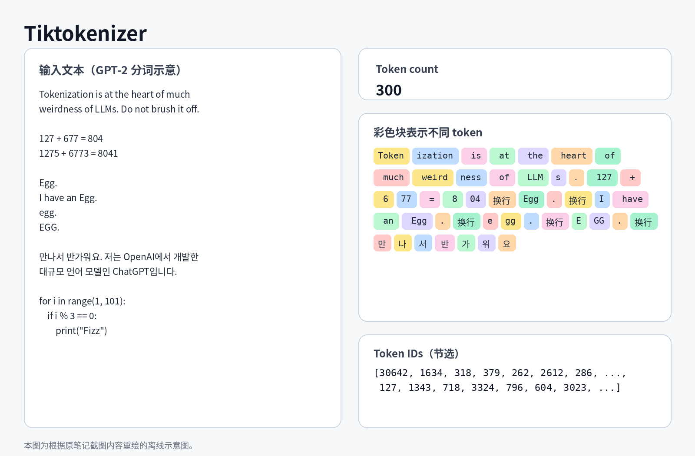

# Lecture8: GPT2\(Tokenization\)

# Introduction

分词是把字符序列转换为一串具有数值表示的 token 的过程。token 是语言模型所处理的基本意义单位。LLM 是*纯粹的数学模型*。它们无法直接处理原始文本，而是*始终只处理数字*。

在上一讲中，我们已经为 GPT 模型实现了一种简化的分词方式。 下面快速回顾一下这一过程：

```Python
import torch
 import torch.nn as nn
 from torch.nn import functional as F
 import regex as re
 import tiktoken
 import os
 import json
```

首先，我们把示例数据集文本文件读入内存：

```Python
Read the txt file to inspect it
with open('../tiny-shakespeare.txt', 'r') as f:
 text = f.read()
Print a sample of the text (First 100 characters)
print("Length of Dataset:", len(text), "\n")
 print(text[:100])
```

然后找出数据集中出现的所有不同字符：

```Python
chars = sorted(list(set(text))) # Get all unique characters in the text
 vocab_size = len(chars)         # Length of vocabulary (this includes the space character and newline)
 print('Unique Characters:', ''.join(chars))
 print(f'\nVocabulary size: {vocab_size}')
```

得到文本文件中的所有不同字符后，我们把每个字符分别映射到一个整数，从而获得字符乃至整个数据集的纯数值表示：

```Python
stoi = { ch:i for i,ch in enumerate(chars) }     # Character to index mapping
 itos = { i:ch for i,ch in enumerate(chars) }     # Index to character mapping
This is the encoder; Encode a string to a list of integers
encode = lambda s: [stoi[c] for c in s]
This is the decoder; Decode a list of integers to a string
decode = lambda l: ''.join([itos[i] for i in l])
msg = "hii there"
 token_list = encode(msg)
 print(token_list)
 print(decode(token_list))
```

接下来嵌入层的处理与之前相同，这样处理的好处是有相似特征的 token 在向量空间中容易聚集到一起。

```Python
class BigramLM(nn.Module):
def __init__(self, vocab_size):
    super().__init__()
    # Embedding the vocabulary
    # Every one of the vocab_size tokens is represented by a vector of size vocab_size
    self.embed = nn.Embedding(vocab_size, vocab_size) # 65 unique 65-dim vectors

def forward(self, idx, targets):
    # idx is of shape (batch_size, block_size)
    # targets is of shape (batch_size, block_size)
    logits = self.embed(idx)
    return logits # Embed the input indices, shape is now (batch_size, block_size, vocab_size) (B, T, C)
```

接下来我们的目标是把分词方法升级到文本块级而不是只停留在字符级。

---

先继续沿用一个基本认识：token 是信息的基本单位。我们的目标，是把文本字符串转换为对 LLM 来说信息量更大、也更容易解释的表示。

如果分词处理不当，它可能导致 LLM 出现*大量*下游问题。
 一些常见的分词相关问题包括：

- 为什么 LLM 不擅长拼写？

- 为什么 LLM 很难完成反转字符串等简单文本操作？

- 为什么 LLM 在非英语语言上的表现可能更差？

- 为什么 LLM 连简单的算术运算也可能算错？

- 为什么输入 `<|endoftext|>` 等特殊字符可能让生成突然停止？

- 为什么“末尾空格”可能让 LLM 出现异常？

- 为什么单词内部突然出现大写字母时，LLM 可能失灵？

- 为什么通过 YAML 与 LLM 交互，可能比使用 JSON 更合适？

- 为什么“LLM”实际上并不意味着“端到端语言建模”？

下图展示了一些分词器运作时容易出现的问题：



处理普通文本时，这一点的影响可能还不算太大；但对于算术表达式的分词结果，除 127 外，其他每个数值都被切成了多个 token。这种不符合数值逻辑的 token 切分可能带来问题，因为它会使模型难以保留数值或算术表达式的语义。

有趣的是，单词 “Egg” 会根据大小写形式以及前面是否有空格，被分成四种不同的 token 组合。我们还可以看到，韩语文本的分词粒度比英语文本更细。这在很大程度上可以归因于训练数据中的表示不平衡：分词器可能主要针对英语文本得到了优化。

# Unicode

Python 原生就能够处理不同的书写系统，Python 的 `str` 类型是一个 [**Unicode**](https://en.wikipedia.org/wiki/Unicode)** 码点序列**。 Unicode 是一种字符编码标准，它把每个字符映射到唯一的整数值。
可以使用 `ord()` 函数读取这个整数值：

```Python
print([ord(x) for x in some_text])
```

Unicode 虽然覆盖面很广，但它仍在不断变化和扩展，而且规模已经非常庞大。**Unicode 本身并不稳定。**不过，Unicode 定义了三种稳定的编码形式，可用于表示 Unicode 字符的子集：[UTF\-8](https://en.wikipedia.org/wiki/UTF-8)、[UTF\-16](https://en.wikipedia.org/wiki/UTF-16) 和 [UTF\-32](https://en.wikipedia.org/wiki/UTF-32)。这些编码通过字节序列表示字符。

> **为什么从上面的代码可以看出 Unicode 用整数表示字符，而 UTF\-8、UTF\-16 和 UTF\-32 却使用字节？**
>  UTF\-8、UTF\-16 和 UTF\-32 是编码方案，它们规定了如何把 Unicode 以二进制形式，也就是字节序列的形式存储和传输。例如，UTF\-8 被专门设计为：即使 Unicode 标准不断扩展，UTF\-8 自身仍然保持稳定。
>  Unicode 为字符分配整数值，而 UTF\-8、UTF\-16 和 UTF\-32 则是底层编码方案，用于描述这些码点怎样转换为可存储、可传输的字节序列。
> 
> 

不过，我们仍然不希望直接把原始字节当作 token。从上面可以看到，由于使用的是 8 位表示，也就是字节，因此一共只能区分 256 种不同的数值。当然，我们可以逐字节地表示整个字节数组，但这种方式表示编码后的文本会非常低效。
它相当于把文本放大到极细的尺度，连一个字符编码内部的字节片段都分别处理，从而不必要地拉长 token 序列。而这又会堵塞 LLM 的注意力缓冲区，限制下游能力。

# Byte\-Pair Encoding

对于给定文本，BPE 会反复找到最常见的一对相邻 token，把它们合并成一个新的 token，并把新 token 加入词表。这个过程会一直重复，直到词表达到预先设定的大小。这种方法会逐步建立 token 层级结构：先合并出现频率最高 token 对，再合并下一组最高频 token 对，如此继续。

```Python
text = "Ｕｎｉｃｏｄｅ! 🅤🅝🅘🅒🅞🅓🅔‽ 🇺‌🇳‌🇮‌🇨‌🇴‌🇩‌🇪! 😄 The very name strikes fear and awe into the hearts of programmers worldwide. We all know we ought to “support Unicode” in our software (whatever that means—like using wchar_t for all the strings, right?). But Unicode can be abstruse, and diving into the thousand-page Unicode Standard plus its dozens of supplementary annexes, reports, and notes can be more than a little intimidating. I don’t blame programmers for still finding the whole thing mysterious, even 30 years after Unicode’s inception."
tokens = text.encode('utf-8')   # Byte array
tokens = list(map(int, tokens)) # Convert to list of integers for visualization
print(text, "\n")
print("Original Text Length:", len(text), "\n\n")
print(tokens, "\n")
print("Length of Token List:", len(tokens)) 
```

> `map()` 的作用：**把一个函数依次作用到一个可迭代对象的每个元素上，并返回处理后的结果。**
> 
> 


> \[\!output\]
> 
> Ｕｎｉｃｏｄｅ\! 🅤🅝🅘🅒🅞🅓🅔‽ 🇺‌🇳‌🇮‌🇨‌🇴‌🇩‌🇪\! 😄 The very name strikes fear and awe into the hearts of programmers worldwide\. We all know we ought to “support Unicode” in our software \(whatever that means—like using wchar\_t for all the strings, right?\)\. But Unicode can be abstruse, and diving into the thousand\-page Unicode Standard plus its dozens of supplementary annexes, reports, and notes can be more than a little intimidating\. I don’t blame programmers for still finding the whole thing mysterious, even 30 years after Unicode’s inception\. 
> 
> 
> 
> Original Text Length: 533 
> 
> 
> 
> 
> 
> \[239, 188, 181, 239, 189, 142, 239, 189, 137, 239, 189, 131, 239, 189, 143, 239, 189, 132, 239, 189, 133, 33, 32, 240, 159, 133, 164, 240, 159, 133, 157, 240, 159, 133, 152, 240, 159, 133, 146, 240, 159, 133, 158, 240, 159, 133, 147, 240, 159, 133, 148, 226, 128, 189, 32, 240, 159, 135, 186, 226, 128, 140, 240, 159, 135, 179, 226, 128, 140, 240, 159, 135, 174, 226, 128, 140, 240, 159, 135, 168, 226, 128, 140, 240, 159, 135, 180, 226, 128, 140, 240, 159, 135, 169, 226, 128, 140, 240, 159, 135, 170, 33, 32, 240, 159, 152, 132, 32, 84, 104, 101, 32, 118, 101, 114, 121, 32, 110, 97, 109, 101, 32, 115, 116, 114, 105, 107, 101, 115, 32, 102, 101, 97, 114, 32, 97, 110, 100, 32, 97, 119, 101, 32, 105, 110, 116, 111, 32, 116, 104, 101, 32, 104, 101, 97, 114, 116, 115, 32, 111, 102, 32, 112, 114, 111, 103, 114, 97, 109, 109, 101, 114, 115, 32, 119, 111, 114, 108, 100, 119, 105, 100, 101, 46, 32, 87, 101, 32, 97, 108, 108, 32, 107, 110, 111, 119, 32, 119, 101, 32, 111, 117, 103, 104, 116, 32, 116, 111, 32, 226, 128, 156, 115, 117, 112, 112, 111, 114, 116, 32, 85, 110, 105, 99, 111, 100, 101, 226, 128, 157, 32, 105, 110, 32, 111, 117, 114, 32, 115, 111, 102, 116, 119, 97, 114, 101, 32, 40, 119, 104, 97, 116, 101, 118, 101, 114, 32, 116, 104, 97, 116, 32, 109, 101, 97, 110, 115, 226, 128, 148, 108, 105, 107, 101, 32, 117, 115, 105, 110, 103, 32, 119, 99, 104, 97, 114, 95, 116, 32, 102, 111, 114, 32, 97, 108, 108, 32, 116, 104, 101, 32, 115, 116, 114, 105, 110, 103, 115, 44, 32, 114, 105, 103, 104, 116, 63, 41, 46, 32, 66, 117, 116, 32, 85, 110, 105, 99, 111, 100, 101, 32, 99, 97, 110, 32, 98, 101, 32, 97, 98, 115, 116, 114, 117, 115, 101, 44, 32, 97, 110, 100, 32, 100, 105, 118, 105, 110, 103, 32, 105, 110, 116, 111, 32, 116, 104, 101, 32, 116, 104, 111, 117, 115, 97, 110, 100, 45, 112, 97, 103, 101, 32, 85, 110, 105, 99, 111, 100, 101, 32, 83, 116, 97, 110, 100, 97, 114, 100, 32, 112, 108, 117, 115, 32, 105, 116, 115, 32, 100, 111, 122, 101, 110, 115, 32, 111, 102, 32, 115, 117, 112, 112, 108, 101, 109, 101, 110, 116, 97, 114, 121, 32, 97, 110, 110, 101, 120, 101, 115, 44, 32, 114, 101, 112, 111, 114, 116, 115, 44, 32, 97, 110, 100, 32, 110, 111, 116, 101, 115, 32, 99, 97, 110, 32, 98, 101, 32, 109, 111, 114, 101, 32, 116, 104, 97, 110, 32, 97, 32, 108, 105, 116, 116, 108, 101, 32, 105, 110, 116, 105, 109, 105, 100, 97, 116, 105, 110, 103, 46, 32, 73, 32, 100, 111, 110, 226, 128, 153, 116, 32, 98, 108, 97, 109, 101, 32, 112, 114, 111, 103, 114, 97, 109, 109, 101, 114, 115, 32, 102, 111, 114, 32, 115, 116, 105, 108, 108, 32, 102, 105, 110, 100, 105, 110, 103, 32, 116, 104, 101, 32, 119, 104, 111, 108, 101, 32, 116, 104, 105, 110, 103, 32, 109, 121, 115, 116, 101, 114, 105, 111, 117, 115, 44, 32, 101, 118, 101, 110, 32, 51, 48, 32, 121, 101, 97, 114, 115, 32, 97, 102, 116, 101, 114, 32, 85, 110, 105, 99, 111, 100, 101, 226, 128, 153, 115, 32, 105, 110, 99, 101, 112, 116, 105, 111, 110, 46\] 
> 
> 
> 
> Length of Token List: 616
> 
> 

```Python
def get_stats(ids):
    counts = {}
    for pair in zip(ids, ids[1:]):
        counts[pair] = counts.get(pair, 0)
    return counts

stats = get_stats(tokens)
print(sorted(((v, k) for k, v in stats.items()), reverse=True))
print(sorted(((v,(chr(k[0]), chr(k[1]))) for k, v in stats.items()), reverse=True))
top_pair = max(stats, key=stats.get)
print(top_pair)
```

> \[\!output\]
> 
> \[\(0, \(240, 159\)\), \(0, \(239, 189\)\), \(0, \(239, 188\)\), \(0, \(226, 128\)\), \(0, \(189, 143\)\), \(0, \(189, 142\)\), \(0, \(189, 137\)\), \(0, \(189, 133\)\), \(0, \(189, 132\)\), \(0, \(189, 131\)\), \(0, \(189, 32\)\), \(0, \(188, 181\)\), \(0, \(186, 226\)\), \(0, \(181, 239\)\), \(0, \(180, 226\)\), \(0, \(179, 226\)\), \(0, \(174, 226\)\), \(0, \(170, 33\)\), \(0, \(169, 226\)\), \(0, \(168, 226\)\), \(0, \(164, 240\)\), \(0, \(159, 152\)\), \(0, \(159, 135\)\), \(0, \(159, 133\)\), \(0, \(158, 240\)\), \(0, \(157, 240\)\), \(0, \(157, 32\)\), \(0, \(156, 115\)\), \(0, \(153, 116\)\), \(0, \(153, 115\)\), \(0, \(152, 240\)\), \(0, \(152, 132\)\), \(0, \(148, 226\)\), \(0, \(148, 108\)\), \(0, \(147, 240\)\), \(0, \(146, 240\)\), \(0, \(143, 239\)\), \(0, \(142, 239\)\), \(0, \(140, 240\)\), \(0, \(137, 239\)\), \(0, \(135, 186\)\), \(0, \(135, 180\)\), \(0, \(135, 179\)\), \(0, \(135, 174\)\), \(0, \(135, 170\)\), \(0, \(135, 169\)\), \(0, \(135, 168\)\), \(0, \(133, 164\)\), \(0, \(133, 158\)\), \(0, \(133, 157\)\), \(0, \(133, 152\)\), \(0, \(133, 148\)\), \(0, \(133, 147\)\), \(0, \(133, 146\)\), \(0, \(133, 33\)\), \(0, \(132, 239\)\), \(0, \(132, 32\)\), \(0, \(131, 239\)\), \(0, \(128, 189\)\), \(0, \(128, 157\)\), \(0, \(128, 156\)\), \(0, \(128, 153\)\), \(0, \(128, 148\)\), \(0, \(128, 140\)\), \(0, \(122, 101\)\), \(0, \(121, 115\)\), \(0, \(121, 101\)\), \(0, \(121, 32\)\), \(0, \(120, 101\)\), \(0, \(119, 111\)\), \(0, \(119, 105\)\), \(0, \(119, 104\)\), \(0, \(119, 101\)\), \(0, \(119, 99\)\), \(0, \(119, 97\)\), \(0, \(119, 32\)\), \(0, \(118, 105\)\), \(0, \(118, 101\)\), \(0, \(117, 116\)\), \(0, \(117, 115\)\), \(0, \(117, 114\)\), \(0, \(117, 112\)\), \(0, \(117, 103\)\), \(0, \(116, 119\)\), \(0, \(116, 116\)\), \(0, \(116, 115\)\), \(0, \(116, 114\)\), \(0, \(116, 111\)\), \(0, \(116, 108\)\), \(0, \(116, 105\)\), \(0, \(116, 104\)\), \(0, \(116, 101\)\), \(0, \(116, 97\)\), \(0, \(116, 63\)\), \(0, \(116, 32\)\), \(0, \(115, 226\)\), \(0, \(115, 117\)\), \(0, \(115, 116\)\), \(0, \(115, 111\)\), \(0, \(115, 105\)\), \(0, \(115, 101\)\), \(0, \(115, 97\)\), \(0, \(115, 44\)\), \(0, \(115, 32\)\), \(0, \(114, 121\)\), \(0, \(114, 117\)\), \(0, \(114, 116\)\), \(0, \(114, 115\)\), \(0, \(114, 111\)\), \(0, \(114, 108\)\), \(0, \(114, 105\)\), \(0, \(114, 101\)\), \(0, \(114, 100\)\), \(0, \(114, 97\)\), \(0, \(114, 95\)\), \(0, \(114, 32\)\), \(0, \(112, 116\)\), \(0, \(112, 114\)\), \(0, \(112, 112\)\), \(0, \(112, 111\)\), \(0, \(112, 108\)\), \(0, \(112, 97\)\), \(0, \(111, 122\)\), \(0, \(111, 119\)\), \(0, \(111, 117\)\), \(0, \(111, 116\)\), \(0, \(111, 114\)\), \(0, \(111, 110\)\), \(0, \(111, 108\)\), \(0, \(111, 103\)\), \(0, \(111, 102\)\), \(0, \(111, 100\)\), \(0, \(111, 32\)\), \(0, \(110, 226\)\), \(0, \(110, 116\)\), \(0, \(110, 115\)\), \(0, \(110, 111\)\), \(0, \(110, 110\)\), \(0, \(110, 105\)\), \(0, \(110, 103\)\), \(0, \(110, 101\)\), \(0, \(110, 100\)\), \(0, \(110, 99\)\), \(0, \(110, 97\)\), \(0, \(110, 46\)\), \(0, \(110, 32\)\), \(0, \(109, 121\)\), \(0, \(109, 111\)\), \(0, \(109, 109\)\), \(0, \(109, 105\)\), \(0, \(109, 101\)\), \(0, \(108, 117\)\), \(0, \(108, 108\)\), \(0, \(108, 105\)\), \(0, \(108, 101\)\), \(0, \(108, 100\)\), \(0, \(108, 97\)\), \(0, \(108, 32\)\), \(0, \(107, 110\)\), \(0, \(107, 101\)\), \(0, \(105, 118\)\), \(0, \(105, 116\)\), \(0, \(105, 111\)\), \(0, \(105, 110\)\), \(0, \(105, 109\)\), \(0, \(105, 108\)\), \(0, \(105, 107\)\), \(0, \(105, 103\)\), \(0, \(105, 100\)\), \(0, \(105, 99\)\), \(0, \(104, 116\)\), \(0, \(104, 111\)\), \(0, \(104, 105\)\), \(0, \(104, 101\)\), \(0, \(104, 97\)\), \(0, \(103, 115\)\), \(0, \(103, 114\)\), \(0, \(103, 104\)\), \(0, \(103, 101\)\), \(0, \(103, 46\)\), \(0, \(103, 32\)\), \(0, \(102, 116\)\), \(0, \(102, 111\)\), \(0, \(102, 105\)\), \(0, \(102, 101\)\), \(0, \(102, 32\)\), \(0, \(101, 226\)\), \(0, \(101, 120\)\), \(0, \(101, 118\)\), \(0, \(101, 115\)\), \(0, \(101, 114\)\), \(0, \(101, 112\)\), \(0, \(101, 110\)\), \(0, \(101, 109\)\), \(0, \(101, 97\)\), \(0, \(101, 46\)\), \(0, \(101, 44\)\), \(0, \(101, 32\)\), \(0, \(100, 119\)\), \(0, \(100, 111\)\), \(0, \(100, 105\)\), \(0, \(100, 101\)\), \(0, \(100, 97\)\), \(0, \(100, 45\)\), \(0, \(100, 32\)\), \(0, \(99, 111\)\), \(0, \(99, 104\)\), \(0, \(99, 101\)\), \(0, \(99, 97\)\), \(0, \(98, 115\)\), \(0, \(98, 108\)\), \(0, \(98, 101\)\), \(0, \(97, 119\)\), \(0, \(97, 116\)\), \(0, \(97, 114\)\), \(0, \(97, 110\)\), \(0, \(97, 109\)\), \(0, \(97, 108\)\), \(0, \(97, 103\)\), \(0, \(97, 102\)\), \(0, \(97, 98\)\), \(0, \(97, 32\)\), \(0, \(95, 116\)\), \(0, \(87, 101\)\), \(0, \(85, 110\)\), \(0, \(84, 104\)\), \(0, \(83, 116\)\), \(0, \(73, 32\)\), \(0, \(66, 117\)\), \(0, \(63, 41\)\), \(0, \(51, 48\)\), \(0, \(48, 32\)\), \(0, \(46, 32\)\), \(0, \(45, 112\)\), \(0, \(44, 32\)\), \(0, \(41, 46\)\), \(0, \(40, 119\)\), \(0, \(33, 32\)\), \(0, \(32, 240\)\), \(0, \(32, 226\)\), \(0, \(32, 121\)\), \(0, \(32, 119\)\), \(0, \(32, 118\)\), \(0, \(32, 117\)\), \(0, \(32, 116\)\), \(0, \(32, 115\)\), \(0, \(32, 114\)\), \(0, \(32, 112\)\), \(0, \(32, 111\)\), \(0, \(32, 110\)\), \(0, \(32, 109\)\), \(0, \(32, 108\)\), \(0, \(32, 107\)\), \(0, \(32, 105\)\), \(0, \(32, 104\)\), \(0, \(32, 102\)\), \(0, \(32, 101\)\), \(0, \(32, 100\)\), \(0, \(32, 99\)\), \(0, \(32, 98\)\), \(0, \(32, 97\)\), \(0, \(32, 87\)\), \(0, \(32, 85\)\), \(0, \(32, 84\)\), \(0, \(32, 83\)\), \(0, \(32, 73\)\), \(0, \(32, 66\)\), \(0, \(32, 51\)\), \(0, \(32, 40\)\)\]
> 
> \[\(0, \('ð', '\\x9f'\)\), \(0, \('ï', '½'\)\), \(0, \('ï', '¼'\)\), \(0, \('â', '\\x80'\)\), \(0, \('½', '\\x8f'\)\), \(0, \('½', '\\x8e'\)\), \(0, \('½', '\\x89'\)\), \(0, \('½', '\\x85'\)\), \(0, \('½', '\\x84'\)\), \(0, \('½', '\\x83'\)\), \(0, \('½', ' '\)\), \(0, \('¼', 'µ'\)\), \(0, \('º', 'â'\)\), \(0, \('µ', 'ï'\)\), \(0, \('´', 'â'\)\), \(0, \('³', 'â'\)\), \(0, \('®', 'â'\)\), \(0, \('ª', '\!'\)\), \(0, \('©', 'â'\)\), \(0, \('¨', 'â'\)\), \(0, \('¤', 'ð'\)\), \(0, \('\\x9f', '\\x98'\)\), \(0, \('\\x9f', '\\x87'\)\), \(0, \('\\x9f', '\\x85'\)\), \(0, \('\\x9e', 'ð'\)\), \(0, \('\\x9d', 'ð'\)\), \(0, \('\\x9d', ' '\)\), \(0, \('\\x9c', 's'\)\), \(0, \('\\x99', 't'\)\), \(0, \('\\x99', 's'\)\), \(0, \('\\x98', 'ð'\)\), \(0, \('\\x98', '\\x84'\)\), \(0, \('\\x94', 'â'\)\), \(0, \('\\x94', 'l'\)\), \(0, \('\\x93', 'ð'\)\), \(0, \('\\x92', 'ð'\)\), \(0, \('\\x8f', 'ï'\)\), \(0, \('\\x8e', 'ï'\)\), \(0, \('\\x8c', 'ð'\)\), \(0, \('\\x89', 'ï'\)\), \(0, \('\\x87', 'º'\)\), \(0, \('\\x87', '´'\)\), \(0, \('\\x87', '³'\)\), \(0, \('\\x87', '®'\)\), \(0, \('\\x87', 'ª'\)\), \(0, \('\\x87', '©'\)\), \(0, \('\\x87', '¨'\)\), \(0, \('\\x85', '¤'\)\), \(0, \('\\x85', '\\x9e'\)\), \(0, \('\\x85', '\\x9d'\)\), \(0, \('\\x85', '\\x98'\)\), \(0, \('\\x85', '\\x94'\)\), \(0, \('\\x85', '\\x93'\)\), \(0, \('\\x85', '\\x92'\)\), \(0, \('\\x85', '\!'\)\), \(0, \('\\x84', 'ï'\)\), \(0, \('\\x84', ' '\)\), \(0, \('\\x83', 'ï'\)\), \(0, \('\\x80', '½'\)\), \(0, \('\\x80', '\\x9d'\)\), \(0, \('\\x80', '\\x9c'\)\), \(0, \('\\x80', '\\x99'\)\), \(0, \('\\x80', '\\x94'\)\), \(0, \('\\x80', '\\x8c'\)\), \(0, \('z', 'e'\)\), \(0, \('y', 's'\)\), \(0, \('y', 'e'\)\), \(0, \('y', ' '\)\), \(0, \('x', 'e'\)\), \(0, \('w', 'o'\)\), \(0, \('w', 'i'\)\), \(0, \('w', 'h'\)\), \(0, \('w', 'e'\)\), \(0, \('w', 'c'\)\), \(0, \('w', 'a'\)\), \(0, \('w', ' '\)\), \(0, \('v', 'i'\)\), \(0, \('v', 'e'\)\), \(0, \('u', 't'\)\), \(0, \('u', 's'\)\), \(0, \('u', 'r'\)\), \(0, \('u', 'p'\)\), \(0, \('u', 'g'\)\), \(0, \('t', 'w'\)\), \(0, \('t', 't'\)\), \(0, \('t', 's'\)\), \(0, \('t', 'r'\)\), \(0, \('t', 'o'\)\), \(0, \('t', 'l'\)\), \(0, \('t', 'i'\)\), \(0, \('t', 'h'\)\), \(0, \('t', 'e'\)\), \(0, \('t', 'a'\)\), \(0, \('t', '?'\)\), \(0, \('t', ' '\)\), \(0, \('s', 'â'\)\), \(0, \('s', 'u'\)\), \(0, \('s', 't'\)\), \(0, \('s', 'o'\)\), \(0, \('s', 'i'\)\), \(0, \('s', 'e'\)\), \(0, \('s', 'a'\)\), \(0, \('s', ','\)\), \(0, \('s', ' '\)\), \(0, \('r', 'y'\)\), \(0, \('r', 'u'\)\), \(0, \('r', 't'\)\), \(0, \('r', 's'\)\), \(0, \('r', 'o'\)\), \(0, \('r', 'l'\)\), \(0, \('r', 'i'\)\), \(0, \('r', 'e'\)\), \(0, \('r', 'd'\)\), \(0, \('r', 'a'\)\), \(0, \('r', '\_'\)\), \(0, \('r', ' '\)\), \(0, \('p', 't'\)\), \(0, \('p', 'r'\)\), \(0, \('p', 'p'\)\), \(0, \('p', 'o'\)\), \(0, \('p', 'l'\)\), \(0, \('p', 'a'\)\), \(0, \('o', 'z'\)\), \(0, \('o', 'w'\)\), \(0, \('o', 'u'\)\), \(0, \('o', 't'\)\), \(0, \('o', 'r'\)\), \(0, \('o', 'n'\)\), \(0, \('o', 'l'\)\), \(0, \('o', 'g'\)\), \(0, \('o', 'f'\)\), \(0, \('o', 'd'\)\), \(0, \('o', ' '\)\), \(0, \('n', 'â'\)\), \(0, \('n', 't'\)\), \(0, \('n', 's'\)\), \(0, \('n', 'o'\)\), \(0, \('n', 'n'\)\), \(0, \('n', 'i'\)\), \(0, \('n', 'g'\)\), \(0, \('n', 'e'\)\), \(0, \('n', 'd'\)\), \(0, \('n', 'c'\)\), \(0, \('n', 'a'\)\), \(0, \('n', '\.'\)\), \(0, \('n', ' '\)\), \(0, \('m', 'y'\)\), \(0, \('m', 'o'\)\), \(0, \('m', 'm'\)\), \(0, \('m', 'i'\)\), \(0, \('m', 'e'\)\), \(0, \('l', 'u'\)\), \(0, \('l', 'l'\)\), \(0, \('l', 'i'\)\), \(0, \('l', 'e'\)\), \(0, \('l', 'd'\)\), \(0, \('l', 'a'\)\), \(0, \('l', ' '\)\), \(0, \('k', 'n'\)\), \(0, \('k', 'e'\)\), \(0, \('i', 'v'\)\), \(0, \('i', 't'\)\), \(0, \('i', 'o'\)\), \(0, \('i', 'n'\)\), \(0, \('i', 'm'\)\), \(0, \('i', 'l'\)\), \(0, \('i', 'k'\)\), \(0, \('i', 'g'\)\), \(0, \('i', 'd'\)\), \(0, \('i', 'c'\)\), \(0, \('h', 't'\)\), \(0, \('h', 'o'\)\), \(0, \('h', 'i'\)\), \(0, \('h', 'e'\)\), \(0, \('h', 'a'\)\), \(0, \('g', 's'\)\), \(0, \('g', 'r'\)\), \(0, \('g', 'h'\)\), \(0, \('g', 'e'\)\), \(0, \('g', '\.'\)\), \(0, \('g', ' '\)\), \(0, \('f', 't'\)\), \(0, \('f', 'o'\)\), \(0, \('f', 'i'\)\), \(0, \('f', 'e'\)\), \(0, \('f', ' '\)\), \(0, \('e', 'â'\)\), \(0, \('e', 'x'\)\), \(0, \('e', 'v'\)\), \(0, \('e', 's'\)\), \(0, \('e', 'r'\)\), \(0, \('e', 'p'\)\), \(0, \('e', 'n'\)\), \(0, \('e', 'm'\)\), \(0, \('e', 'a'\)\), \(0, \('e', '\.'\)\), \(0, \('e', ','\)\), \(0, \('e', ' '\)\), \(0, \('d', 'w'\)\), \(0, \('d', 'o'\)\), \(0, \('d', 'i'\)\), \(0, \('d', 'e'\)\), \(0, \('d', 'a'\)\), \(0, \('d', '\-'\)\), \(0, \('d', ' '\)\), \(0, \('c', 'o'\)\), \(0, \('c', 'h'\)\), \(0, \('c', 'e'\)\), \(0, \('c', 'a'\)\), \(0, \('b', 's'\)\), \(0, \('b', 'l'\)\), \(0, \('b', 'e'\)\), \(0, \('a', 'w'\)\), \(0, \('a', 't'\)\), \(0, \('a', 'r'\)\), \(0, \('a', 'n'\)\), \(0, \('a', 'm'\)\), \(0, \('a', 'l'\)\), \(0, \('a', 'g'\)\), \(0, \('a', 'f'\)\), \(0, \('a', 'b'\)\), \(0, \('a', ' '\)\), \(0, \('\_', 't'\)\), \(0, \('W', 'e'\)\), \(0, \('U', 'n'\)\), \(0, \('T', 'h'\)\), \(0, \('S', 't'\)\), \(0, \('I', ' '\)\), \(0, \('B', 'u'\)\), \(0, \('?', '\)'\)\), \(0, \('3', '0'\)\), \(0, \('0', ' '\)\), \(0, \('\.', ' '\)\), \(0, \('\-', 'p'\)\), \(0, \(',', ' '\)\), \(0, \('\)', '\.'\)\), \(0, \('\(', 'w'\)\), \(0, \('\!', ' '\)\), \(0, \(' ', 'ð'\)\), \(0, \(' ', 'â'\)\), \(0, \(' ', 'y'\)\), \(0, \(' ', 'w'\)\), \(0, \(' ', 'v'\)\), \(0, \(' ', 'u'\)\), \(0, \(' ', 't'\)\), \(0, \(' ', 's'\)\), \(0, \(' ', 'r'\)\), \(0, \(' ', 'p'\)\), \(0, \(' ', 'o'\)\), \(0, \(' ', 'n'\)\), \(0, \(' ', 'm'\)\), \(0, \(' ', 'l'\)\), \(0, \(' ', 'k'\)\), \(0, \(' ', 'i'\)\), \(0, \(' ', 'h'\)\), \(0, \(' ', 'f'\)\), \(0, \(' ', 'e'\)\), \(0, \(' ', 'd'\)\), \(0, \(' ', 'c'\)\), \(0, \(' ', 'b'\)\), \(0, \(' ', 'a'\)\), \(0, \(' ', 'W'\)\), \(0, \(' ', 'U'\)\), \(0, \(' ', 'T'\)\), \(0, \(' ', 'S'\)\), \(0, \(' ', 'I'\)\), \(0, \(' ', 'B'\)\), \(0, \(' ', '3'\)\), \(0, \(' ', '\('\)\)\]
> 
> \(239, 188\)
> 
> 


此时 token 词表的范围是 0 到 255，因为我们正在处理的是 8 位表示，也就是字节。现在可以创建第 256 号新 token，用它表示出现次数最多的 token 对 `('e', ' ')`：

```Python
def merge(ids, pair, idx):
    newids = []
    i = 0
    while i < len(ids):
        if i < len(ids)-1 and (ids[i], ids[i+1]) == pair:
            newids.append(idx)
            i += 2
        else:
            newids.append(ids[i])
            i += 1
    return newids
print(merge([5, 6, 6, 7, 9,1], (6, 7), 99)
```

> \[\!output\]
> 
> \[5, 6, 99, 9, 1\]
> 
> 

```Python
tokens2 = merge(tokens, top_pair, 256)

print(tokens2, "\n")
print("length of token list:")
print("All Occurrences Removed" if (True if top_pair not in zip(tokens2, tokens2[1:]) else False) else "Still Some Occurrences Left")
```

> \[\!output\]
> 
> \[256, 181, 239, 189, 142, 239, 189, 137, 239, 189, 131, 239, 189, 143, 239, 189, 132, 239, 189, 133, 33, 32, 240, 159, 133, 164, 240, 159, 133, 157, 240, 159, 133, 152, 240, 159, 133, 146, 240, 159, 133, 158, 240, 159, 133, 147, 240, 159, 133, 148, 226, 128, 189, 32, 240, 159, 135, 186, 226, 128, 140, 240, 159, 135, 179, 226, 128, 140, 240, 159, 135, 174, 226, 128, 140, 240, 159, 135, 168, 226, 128, 140, 240, 159, 135, 180, 226, 128, 140, 240, 159, 135, 169, 226, 128, 140, 240, 159, 135, 170, 33, 32, 240, 159, 152, 132, 32, 84, 104, 101, 32, 118, 101, 114, 121, 32, 110, 97, 109, 101, 32, 115, 116, 114, 105, 107, 101, 115, 32, 102, 101, 97, 114, 32, 97, 110, 100, 32, 97, 119, 101, 32, 105, 110, 116, 111, 32, 116, 104, 101, 32, 104, 101, 97, 114, 116, 115, 32, 111, 102, 32, 112, 114, 111, 103, 114, 97, 109, 109, 101, 114, 115, 32, 119, 111, 114, 108, 100, 119, 105, 100, 101, 46, 32, 87, 101, 32, 97, 108, 108, 32, 107, 110, 111, 119, 32, 119, 101, 32, 111, 117, 103, 104, 116, 32, 116, 111, 32, 226, 128, 156, 115, 117, 112, 112, 111, 114, 116, 32, 85, 110, 105, 99, 111, 100, 101, 226, 128, 157, 32, 105, 110, 32, 111, 117, 114, 32, 115, 111, 102, 116, 119, 97, 114, 101, 32, 40, 119, 104, 97, 116, 101, 118, 101, 114, 32, 116, 104, 97, 116, 32, 109, 101, 97, 110, 115, 226, 128, 148, 108, 105, 107, 101, 32, 117, 115, 105, 110, 103, 32, 119, 99, 104, 97, 114, 95, 116, 32, 102, 111, 114, 32, 97, 108, 108, 32, 116, 104, 101, 32, 115, 116, 114, 105, 110, 103, 115, 44, 32, 114, 105, 103, 104, 116, 63, 41, 46, 32, 66, 117, 116, 32, 85, 110, 105, 99, 111, 100, 101, 32, 99, 97, 110, 32, 98, 101, 32, 97, 98, 115, 116, 114, 117, 115, 101, 44, 32, 97, 110, 100, 32, 100, 105, 118, 105, 110, 103, 32, 105, 110, 116, 111, 32, 116, 104, 101, 32, 116, 104, 111, 117, 115, 97, 110, 100, 45, 112, 97, 103, 101, 32, 85, 110, 105, 99, 111, 100, 101, 32, 83, 116, 97, 110, 100, 97, 114, 100, 32, 112, 108, 117, 115, 32, 105, 116, 115, 32, 100, 111, 122, 101, 110, 115, 32, 111, 102, 32, 115, 117, 112, 112, 108, 101, 109, 101, 110, 116, 97, 114, 121, 32, 97, 110, 110, 101, 120, 101, 115, 44, 32, 114, 101, 112, 111, 114, 116, 115, 44, 32, 97, 110, 100, 32, 110, 111, 116, 101, 115, 32, 99, 97, 110, 32, 98, 101, 32, 109, 111, 114, 101, 32, 116, 104, 97, 110, 32, 97, 32, 108, 105, 116, 116, 108, 101, 32, 105, 110, 116, 105, 109, 105, 100, 97, 116, 105, 110, 103, 46, 32, 73, 32, 100, 111, 110, 226, 128, 153, 116, 32, 98, 108, 97, 109, 101, 32, 112, 114, 111, 103, 114, 97, 109, 109, 101, 114, 115, 32, 102, 111, 114, 32, 115, 116, 105, 108, 108, 32, 102, 105, 110, 100, 105, 110, 103, 32, 116, 104, 101, 32, 119, 104, 111, 108, 101, 32, 116, 104, 105, 110, 103, 32, 109, 121, 115, 116, 101, 114, 105, 111, 117, 115, 44, 32, 101, 118, 101, 110, 32, 51, 48, 32, 121, 101, 97, 114, 115, 32, 97, 102, 116, 101, 114, 32, 85, 110, 105, 99, 111, 100, 101, 226, 128, 153, 115, 32, 105, 110, 99, 101, 112, 116, 105, 111, 110, 46\] 
> 
> 
> 
> length of token list:
> 
> All Occurrences Removed
> 
> 

我们实际上完成了以下操作：把文本映射为 UTF\-8，找出最常见的一对相邻字节值——字节值位于 0 到 255 之间——然后把这对字节的所有出现位置替换成一个代表该组合的新 token（256）。
 不过，我们还没有记录自己进行过哪些合并。在确认基础实现能够工作后，就可以按需要多次遍历 token，真正逐步构造词表。可以把这种扩充词表的过程理解为：从叶节点向根节点逐步构建一棵二叉树。

接下来我们使用整篇文章作为训练样本

```Python
def get_stats(ids):
    counts = {}
    for pair in zip(ids, ids[1:]):
        counts[pair] = counts.get(pair, 0) + 1
    return counts

def merge(ids, pair, idx):
    newids = []
    i = 0
    while i < len(ids):
        if i < len(ids)-1 and (ids[i], ids[i+1]) == pair:
            newids.append(idx)
            i += 2
        else:
            newids.append(ids[i])
            i += 1
    return newids

vocab_size = 276
num_merges = vocab_size - 256
ids = list(tokens)
merges = {}

for i in range(num_merges):
    stats = get_stats(ids)
    pair = max(stats, key=stats.get)
    idx = 256 + i
    print(f"Merging {pair}\tinto new token {idx}")
    ids = merge(ids, pair, idx)
    merges[pair] = idx
```

> \[\!output\]
> 
> Merging \(101, 32\)        into new token 256
> 
> Merging \(105, 110\)        into new token 257
> 
> Merging \(115, 32\)        into new token 258
> 
> Merging \(116, 104\)        into new token 259
> 
> Merging \(101, 114\)        into new token 260
> 
> Merging \(99, 111\)        into new token 261
> 
> Merging \(116, 32\)        into new token 262
> 
> Merging \(226, 128\)        into new token 263
> 
> Merging \(44, 32\)        into new token 264
> 
> Merging \(97, 110\)        into new token 265
> 
> Merging \(111, 114\)        into new token 266
> 
> Merging \(100, 32\)        into new token 267
> 
> Merging \(97, 114\)        into new token 268
> 
> Merging \(101, 110\)        into new token 269
> 
> Merging \(257, 103\)        into new token 270
> 
> Merging \(261, 100\)        into new token 271
> 
> Merging \(121, 32\)        into new token 272
> 
> Merging \(46, 32\)        into new token 273
> 
> Merging \(97, 108\)        into new token 274
> 
> Merging \(259, 256\)        into new token 275
> 
> 

把扩充后的词表与原始词表进行比较，可以看到：由于现在能够用一个 token 表示更复杂的文本块，因此表示相同数据所需的 token 数量变少了：

```Python
print("Old Length of Token List:", len(tokens))
print("New Length of Token List:", len(ids))
print(f"Compression Ratio: {len(tokens) / len(ids):.2f}x")
```

> \[\!output\]
> 
> Old Length of Token List: 24597
> 
> New Length of Token List: 19438
> 
> Compression Ratio: 1\.27x
> 
> 

只进行了 20 次合并并创建 20 个新 token，就把词表表示压缩了 1\.27 倍。有了 `merges`，我们就既能编码，也能解码。分词器已经成为 LLM 与可读文本之间的翻译层。

# Decoding

```Python
vocab = {idx:bytes([idx]) for idx in range(256)}
for (p0, p1), idx in merges.items():
    vocab[idx] = vocab[p0] + vocab[p1]
def decode(ids):
    tokens = b"".join(vocab[idx] for idx in ids)
    text = tokens.decode("utf-8", errors="replace") # 让解码器在遇到无法解码的字符时不要报错
    return text
```

```Python
print(decode([97]))  
print(decode([128]))
```

> \[\!output\]
> 
> a
> 
> �
> 
> 

如果解码器遇到无法解码为合法 Unicode 的字节序列，它会用特殊的 Unicode 替换字符（U\+FFFD）替代这段序列。我们相当于跨过无效字节，然后继续处理后面的内容。

# Encoding

```C++
def encode(text):
    tokens = list(text.encode("utf-8"))
    while len(tokens) > 1:
        stats = get_stats(tokens)
        pair = min(stats, key=lambda p:merges.get(p, float('inf')))
        if pair not in merges:
            break
        idx = merges[pair]
        tokens = merge(tokens, pair, idx)
    return tokens
```

```Python
print(encode("hello world!"))
print(encode("h"))
```

> \[\!output\]
> 
> \[104, 101, 108, 108, 111, 32, 119, 266, 108, 100, 33\]
> 
> \[104\]
> 
> 


